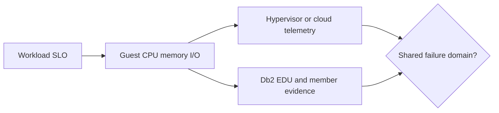

# A-01 — Host, server, virtualization, capacity, and failure domains

**Procedure status: NOT YET EXECUTED.** This is a teaching procedure for Db2 LUW 12.1.0 on Linux x86-64, single-member topology. The exact fix pack is not pinned. Engine commands run on the Db2 server as the named instance/database authority; client checks run on the client; OS commands run on the named host and normally require read-only access. Windows, AIX, DPF, and pureScale differences are called out where material. The supplied environment has no Db2 CLI or disposable Db2 server, so no lab command is claimed as executed. Before production use, confirm each command against the installed fix pack and local change controls.

## 1. Quick answer

Use host evidence to decide whether a Db2 symptom is local, shared, or caused by an undersized virtual resource. A VM dashboard is not a substitute for guest and Db2 measurements.

**Safest first step:** Capture the current target, timestamp, release, and read-only state before acting.

## 2. Learn the concept

The useful mental model is to follow physical or virtual host sizing; CPU topology, SMT, NUMA and steal time; memory reservation and ballooning; virtual storage/network and noisy neighbors; capacity and failure-domain placement from the service boundary inward. Record who owns each boundary and which evidence is authoritative there.

### Working model

Scope: physical or virtual host sizing → CPU topology, SMT, NUMA and steal time → memory reservation and ballooning → virtual storage/network and noisy neighbors → capacity and failure-domain placement. The arrows represent dependency, not proof of a fault. Confirm each hop independently.



## 3. Choose an approach

| Variant | Choose it when | Do not choose it when / boundary |
|---|---|---|
| Bare metal | Use when the guest owns the hardware counters and device paths. | NUMA locality and firmware still matter. |
| VM/cloud VM | Compare guest metrics with hypervisor reservation, ready/steal and storage latency. | Do not infer host headroom from vCPU count alone. |
| Failure-domain review | Map instance, storage, network, power and site dependencies. | A second VM in one rack or zone is not an independent DR site. |

## 4. Understand the lifecycle

- Define workload target and observation window.
- Inventory host topology and guest limits.
- Collect aligned OS, hypervisor and Db2 samples.
- Compare measured peak and failover demand with usable headroom.
- Document a placement or capacity decision and remeasure after change.

**Pause/retry/stop/rollback rule:** Stop if the target identity, current state, authority, or rollback dependency is uncertain; preserve evidence and escalate.

## 5. Do the work

### Precheck

- Record host, VM, clock, workload window, and Db2 member.
- Obtain read-only hypervisor and cloud telemetry; note unit and interval.
- Do not change vCPU or memory live without the platform change plan.

### Scoped procedures

### Procedure 1: Guest CPU and NUMA inventory

**Status:** NOT YET EXECUTED. **Run as:** Linux DBA/host administrator. **Target:** Db2 server host. **Authority/prerequisite:** Tools installed; read-only host access.

```bash
lscpu; numactl --hardware
```

**Expected result:** CPU model, logical/physical topology, and node memory are printed.

**Independent check:** Compare socket/node counts with Db2 process placement and hypervisor allocation.

**Stop/rollback boundary:** No state changes; install missing tools only through host change management.

### Procedure 2: Linux CPU sample

**Status:** NOT YET EXECUTED. **Run as:** Linux host operator. **Target:** Target host over five one-second intervals. **Authority/prerequisite:** sysstat package available; record the exact incident window.

```bash
mpstat -P ALL 1 5
```

**Expected result:** Per-CPU user/system/iowait/steal values appear.

**Independent check:** Correlate steal time and saturation with hypervisor ready time and Db2 EDU CPU.

**Stop/rollback boundary:** Sampling is read-only; widen the window before a capacity change.

## 6. Worked example and verification

At 09:10 a report query slows while guest CPU shows 35% idle and 18% steal. The guest has spare scheduled CPU, but the hypervisor is delaying vCPU execution. Treat this as a placement/contention problem until host telemetry disproves it; adding Db2 agents would increase runnable demand.

**Expected state/result:** Decision record distinguishes Db2 CPU demand from VM scheduling and records the actual peak/failover capacity.

**Independent verification:**

- Align guest and hypervisor samples to the same clock and interval.
- Re-run the same workload after a placement change; compare throughput and latency percentiles.

## 7. Diagnose problems

| Symptom or verified error | Evidence to collect | Likely cause | Safe correction and recheck | Avoid |
|---|---|---|---|---|
| Db2 latency rises while guest CPU appears idle. | mpstat steal, hypervisor CPU ready, and Db2 per-EDU deltas. | vCPU descheduling or contention on an oversubscribed host. | Move or resize through the virtualization change process, then repeat the measured workload. | Increasing Db2 parallelism before confirming guest scheduling delay. |
| Failover host is nominally large but runs out of headroom. | Peak CPU/memory demand plus all-active and failover topology. | Capacity counted from installed size instead of usable post-failure capacity. | Recalculate with one failure domain removed and realistic concurrency. | Counting standby capacity as spare for unrelated workloads. |

## 8. Practice

Build a host inventory for a fictional four-vCPU Db2 VM. Add CPU model, NUMA nodes, guest memory limit, storage latency, and host failure domain. Create two timelines, one CPU-bound and one steal-bound. Explain which owner receives each incident. Cleanup: keep the report as lab evidence; make no VM changes.

## 9. Check understanding

**Question:** Guest CPU has 40% idle, but steal is 20% and Db2 service time grows. What is your first escalation?

**Answer and reasoning:** Ask the virtualization/cloud owner to inspect ready/steal and noisy-neighbor placement using the same interval; the guest cannot explain scheduler delay alone. Keep a Db2 baseline so a simultaneous engine bottleneck is not missed.

## 10. Look it up later

### Short checklist

- Name the target and scope.
- Collect a baseline and confirm prerequisites.
- Choose the least disruptive supported branch.
- Verify state and service behavior.
- Record evidence and recovery limits.

### Related lessons

[A-03](../A/A-03.md) · [A-04](../A/A-04.md) · [I-06](../I/I-06.md)

### Authoritative references

- [IBM system requirements](https://www.ibm.com/docs/en/db2/12.1.x?topic=servers-db2-installation-methods)
- [Linux mpstat manual](https://man7.org/linux/man-pages/man1/mpstat.1.html)

---

[Domain index](README.md) · [Course index](../README.md) · [Glossary](../GLOSSARY.md)
