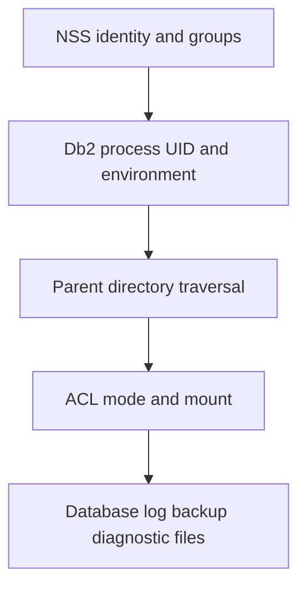

# A-02 — Linux identity, filesystems, permissions, limits, and services

**Procedure status: NOT YET EXECUTED.** This is a teaching procedure for Db2 LUW 12.1.0 on Linux x86-64, single-member topology. The exact fix pack is not pinned. Engine commands run on the Db2 server as the named instance/database authority; client checks run on the client; OS commands run on the named host and normally require read-only access. Windows, AIX, DPF, and pureScale differences are called out where material. The supplied environment has no Db2 CLI or disposable Db2 server, so no lab command is claimed as executed. Before production use, confirm each command against the installed fix pack and local change controls.

## 1. Quick answer

Use this lesson to make a bounded DBA decision about user, group and supplementary-group resolution, instance owner and profile environment, directory traversal, ACL, umask and mount ownership. The key is to identify the failing layer and scope before changing state.

**Safest first step:** Capture the current target, timestamp, release, and read-only state before acting.

## 2. Learn the concept

The useful mental model is to follow user, group and supplementary-group resolution; instance owner and profile environment; directory traversal, ACL, umask and mount ownership; open files and process limits; systemd startup and service identity; Linux versus AIX/Windows service differences from the service boundary inward. Record who owns each boundary and which evidence is authoritative there.

### Working model

Scope: user, group and supplementary-group resolution → instance owner and profile environment → directory traversal, ACL, umask and mount ownership → open files and process limits → systemd startup and service identity → Linux versus AIX/Windows service differences. The arrows represent dependency, not proof of a fault. Confirm each hop independently.



## 3. Choose an approach

| Variant | Choose it when | Do not choose it when / boundary |
|---|---|---|
| Instance owner | Use the dedicated OS account for Db2 CLP and instance operations. | Do not run routine Db2 work as root. |
| Root/service administrator | Use only for install, OS service, ownership, or approved host work. | Root cannot replace correct instance identity. |
| Windows/AIX host | Use native service manager, groups, registry/environment and limit tools. | Do not transpose Linux paths or systemd behavior. |

## 4. Understand the lifecycle

- Resolve account and groups from the host name service.
- Confirm the instance profile and effective environment.
- Walk every parent directory and inspect mount, ACL and limits.
- Check service definition, run-as account and boot ordering.
- Test a controlled read-only access as the service identity.

**Pause/retry/stop/rollback rule:** Stop if the target identity, current state, authority, or rollback dependency is uncertain; preserve evidence and escalate.

## 5. Do the work

### Precheck

- Confirm the target instance name, owner UID/GID, home and profile.
- Check name-service consistency on each cluster node.
- Record current permissions and service startup configuration before edits.

### Scoped procedures

### Procedure 1: Identity resolution

**Status:** NOT YET EXECUTED. **Run as:** Linux host operator. **Target:** Server account and groups. **Authority/prerequisite:** Read access to NSS; names are lab examples.

```bash
id db2inst1; getent passwd db2inst1; getent group db2iadm1
```

**Expected result:** UID, primary/supplementary groups and account mapping are returned.

**Independent check:** Compare across every host; verify actual process UID with ps -eo user,pid,args.

**Stop/rollback boundary:** Do not chown broad trees to fix a mismatch; correct the single named owner/group with host approval.

### Procedure 2: Path traversal and modes

**Status:** NOT YET EXECUTED. **Run as:** Instance owner and host administrator. **Target:** Database path chain. **Authority/prerequisite:** ACL tool available; inspect parent directories as well as leaf.

```bash
namei -l /db2data/SAMPLE; getfacl -p /db2data/SAMPLE
```

**Expected result:** Each component permission and any ACL mask is visible.

**Independent check:** Run a minimal read/write test as the instance owner in a disposable directory.

**Stop/rollback boundary:** Restore captured ACL/mode only through a scoped change; do not use chmod -R 777.

## 6. Worked example and verification

A backup target exists and has free space, but a backup utility reports a path permission failure. `namei -l` shows the Db2 owner can write the final folder but cannot traverse its parent. Repair the narrow parent execute permission for the intended group, then validate access as the instance owner.

**Expected state/result:** Instance services start as the configured owner, and only intended service identities can traverse/write data and diagnostic paths.

**Independent verification:**

- Compare the post-state with the captured pre-state.
- Confirm the intended service or data outcome independently of the command return code.

## 7. Diagnose problems

| Symptom or verified error | Evidence to collect | Likely cause | Safe correction and recheck | Avoid |
|---|---|---|---|---|
| A Db2 path returns permission denied despite write permission on the leaf. | id, namei -l, getfacl, mount flags, and process UID. | A parent directory lacks execute/traverse permission or an ACL mask removes rights. | Correct the specific directory/group ACL and repeat the access test under the Db2 UID. | Changing every file to world-writable. |
| Service starts manually but not after reboot. | systemd unit, journal, environment/profile, dependency ordering, and account lookup. | Service manager does not load the interactive instance profile or starts before a required mount. | Use the supported Db2 service integration and declare the correct mount/service dependency. | Embedding a password or ad hoc `source` command into an unrelated global unit. |

## 8. Practice

Compare account resolution and path permissions on two lab hosts. Write a service-start checklist that identifies which steps belong to root, the instance owner, and systemd. Do not change production ownership. Cleanup: remove only the disposable test directory.

## 9. Check understanding

**Question:** Why can `db2inst1` write a directory but fail to open a file in it?

**Answer and reasoning:** A missing execute bit on a parent, ACL mask, read-only mount, security policy, or process identity mismatch can block access. Inspect the whole path and actual service UID before changing the leaf mode.

## 10. Look it up later

### Short checklist

- Name the target and scope.
- Collect a baseline and confirm prerequisites.
- Choose the least disruptive supported branch.
- Verify state and service behavior.
- Record evidence and recovery limits.

### Related lessons

[A-04](../A/A-04.md) · [B-02](../B/B-02.md) · [J-01](../J/J-01.md)

### Authoritative references

- [IBM installation methods](https://www.ibm.com/docs/en/db2/12.1.x?topic=servers-db2-installation-methods)
- [Linux namei manual](https://man7.org/linux/man-pages/man1/namei.1.html)

---

[Domain index](README.md) · [Course index](../README.md) · [Glossary](../GLOSSARY.md)
