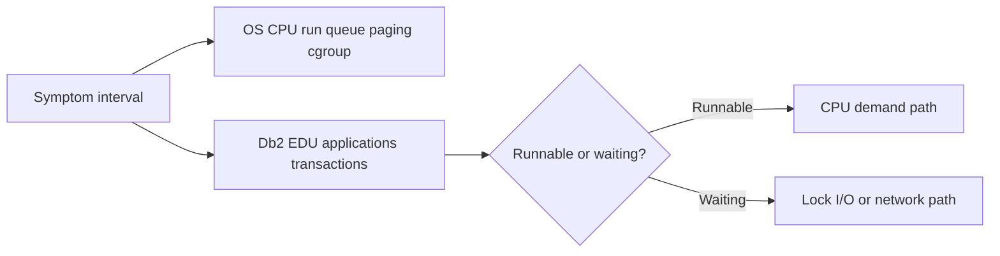

# A-03 — CPU, memory, process, paging, and Db2 EDU diagnosis

**Procedure status: NOT YET EXECUTED.** This is a teaching procedure for Db2 LUW 12.1.0 on Linux x86-64, single-member topology. The exact fix pack is not pinned. Engine commands run on the Db2 server as the named instance/database authority; client checks run on the client; OS commands run on the named host and normally require read-only access. Windows, AIX, DPF, and pureScale differences are called out where material. The supplied environment has no Db2 CLI or disposable Db2 server, so no lab command is claimed as executed. Before production use, confirm each command against the installed fix pack and local change controls.

## 1. Quick answer

Use this lesson to make a bounded DBA decision about runnable versus blocked processes, load average versus CPU saturation, user/system/steal/iowait. The key is to identify the failing layer and scope before changing state.

**Safest first step:** Capture the current target, timestamp, release, and read-only state before acting.

## 2. Learn the concept

The useful mental model is to follow runnable versus blocked processes; load average versus CPU saturation; user/system/steal/iowait; process and thread samples; cgroup limits; memory pressure, paging, swap and OOM; Db2 EDU attribution from the service boundary inward. Record who owns each boundary and which evidence is authoritative there.

### Working model

Scope: runnable versus blocked processes → load average versus CPU saturation → user/system/steal/iowait → process and thread samples → cgroup limits → memory pressure, paging, swap and OOM → Db2 EDU attribution. The arrows represent dependency, not proof of a fault. Confirm each hop independently.



## 3. Choose an approach

| Variant | Choose it when | Do not choose it when / boundary |
|---|---|---|
| CPU saturation | High non-idle CPU and runnable queue persists through the workload window. | One snapshot or load average is insufficient. |
| Blocked work | High load may coexist with idle CPU when work waits on locks or I/O. | Do not tune CPU parameters to treat a wait. |
| Memory pressure | Use reclaim, paging, cgroup and Db2 memory evidence together. | RSS alone does not prove an allocation leak. |

## 4. Understand the lifecycle

- Capture a time-aligned interval baseline.
- Separate runnable, sleeping and blocked Db2 processes/EDUs.
- Check guest/cgroup memory limits, reclaim, paging and OOM evidence.
- Map the symptom to SQL, lock, storage or engine work.
- Repeat after the narrow corrective action.

**Pause/retry/stop/rollback rule:** Stop if the target identity, current state, authority, or rollback dependency is uncertain; preserve evidence and escalate.

## 5. Do the work

### Precheck

- Record sample interval and host timezone.
- Use non-invasive tools; avoid attaching debuggers to a production engine.
- Resolve PID/member mapping with Db2 before interpreting a thread.

### Scoped procedures

### Procedure 1: OS scheduler and paging sample

**Status:** NOT YET EXECUTED. **Run as:** Linux host operator. **Target:** Server during incident window. **Authority/prerequisite:** Read-only access; first line is since boot on common procps versions.

```bash
vmstat 1 5
```

**Expected result:** Five interval rows show run queue, swap, I/O wait, and CPU fields.

**Independent check:** Interpret interval rows, then compare with pidstat and Db2 EDU CPU deltas.

**Stop/rollback boundary:** Sampling is read-only; no service restart based on one row.

### Procedure 2: Db2 EDU view

**Status:** NOT YET EXECUTED. **Run as:** Instance owner. **Target:** Connected instance and active SAMPLE database. **Authority/prerequisite:** Instance is running; choose the correct member for DPF/pureScale.

```bash
db2pd -db SAMPLE -edus
```

**Expected result:** EDU IDs, names, status and CPU data are displayed.

**Independent check:** Take a second sample after a bounded interval; correlate EDU with application/statement evidence.

**Stop/rollback boundary:** Read-only; use a support collection if engine responsiveness is compromised.

## 6. Worked example and verification

`vmstat` shows a high run queue with sustained user CPU, while steal and iowait remain low; `db2pd -edus` shows several database agents consuming CPU. That supports a CPU-demand hypothesis; identify statements and parallelism before adding cores.

**Expected state/result:** Diagnosis names the dominant resource and interval; it does not infer a cause from a single counter.

**Independent verification:**

- Compare the post-state with the captured pre-state.
- Confirm the intended service or data outcome independently of the command return code.

## 7. Diagnose problems

| Symptom or verified error | Evidence to collect | Likely cause | Safe correction and recheck | Avoid |
|---|---|---|---|---|
| Load average is high but CPU idle and iowait is elevated. | vmstat blocked queue, iostat latency, `db2pd -wlocks`, and `-applications`. | Tasks are blocked on I/O or locks, not runnable CPU demand. | Follow the blocked chain to device or transaction evidence and correct that layer. | Increasing CPU or agent limits as the first response. |
| Db2 process is killed or host swaps during a busy period. | kernel journal OOM records, cgroup memory.events, Db2 memory sets, and process RSS. | Host/cgroup limit or concurrent memory consumers exceed headroom. | Restore host headroom and isolate the consumer; lower concurrency only with workload-owner agreement. | Raising Db2 memory caps above the host/cgroup limit. |

## 8. Practice

Collect a five-interval vmstat sample and two Db2 EDU samples against a disposable database. Label each signal as demand, wait, or capacity. For a safe failure drill, use a CPU-only bounded test process in a container with a low CPU quota; compare guest CPU with throttling counters. Stop the test process and verify normal scheduler values.

## 9. Check understanding

**Question:** Which additional evidence separates CPU saturation from many lock-waiting connections?

**Answer and reasoning:** Pair interval CPU/run-queue data with Db2 application/EDU and lock-wait evidence. CPU saturation shows runnable work consuming processor; lock waits show waiting activities and a blocker chain even if host CPU is idle.

## 10. Look it up later

### Short checklist

- Name the target and scope.
- Collect a baseline and confirm prerequisites.
- Choose the least disruptive supported branch.
- Verify state and service behavior.
- Record evidence and recovery limits.

### Related lessons

[A-01](../A/A-01.md) · [A-04](../A/A-04.md) · [E-03](../E/E-03.md) · [E-04](../E/E-04.md)

### Authoritative references

- [IBM db2pd reference](https://www.ibm.com/docs/en/db2/12.1.x?topic=commands-db2pd-monitor-troubleshoot-db2-engine-activities)
- [Linux vmstat manual](https://man7.org/linux/man-pages/man8/vmstat.8.html)

---

[Domain index](README.md) · [Course index](../README.md) · [Glossary](../GLOSSARY.md)
