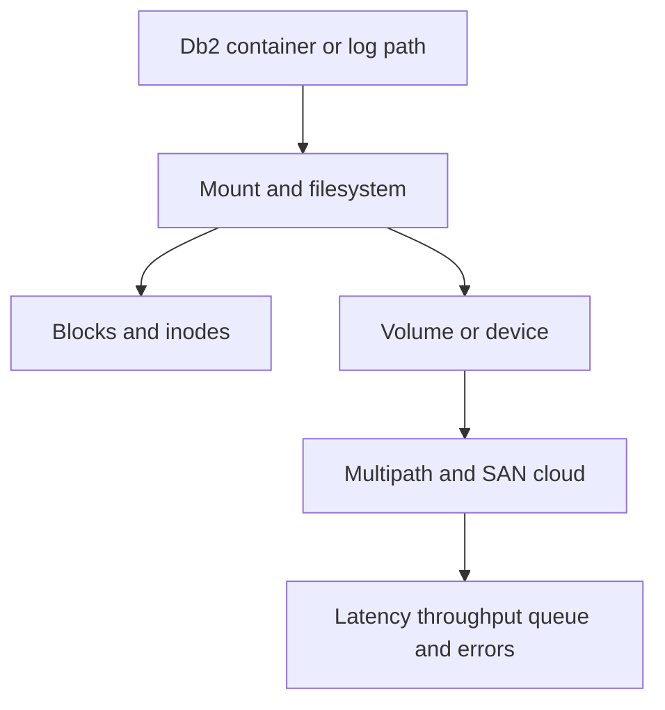

# A-04 — Storage, filesystems, multipath, capacity, and I/O diagnosis

**Procedure status: NOT YET EXECUTED.** This is a teaching procedure for Db2 LUW 12.1.0 on Linux x86-64, single-member topology. The exact fix pack is not pinned. Engine commands run on the Db2 server as the named instance/database authority; client checks run on the client; OS commands run on the named host and normally require read-only access. Windows, AIX, DPF, and pureScale differences are called out where material. The supplied environment has no Db2 CLI or disposable Db2 server, so no lab command is claimed as executed. Before production use, confirm each command against the installed fix pack and local change controls.

## 1. Quick answer

Use this lesson to make a bounded DBA decision about device-to-filesystem-to-Db2 path, block and inode capacity, deleted-open-file space. The key is to identify the failing layer and scope before changing state.

**Safest first step:** Capture the current target, timestamp, release, and read-only state before acting.

## 2. Learn the concept

The useful mental model is to follow device-to-filesystem-to-Db2 path; block and inode capacity; deleted-open-file space; mount flags and ownership; latency throughput queue depth; multipath and storage failure; safe df du lsblk iostat interpretation from the service boundary inward. Record who owns each boundary and which evidence is authoritative there.

### Working model

Scope: device-to-filesystem-to-Db2 path → block and inode capacity → deleted-open-file space → mount flags and ownership → latency throughput queue depth → multipath and storage failure → safe df du lsblk iostat interpretation. The arrows represent dependency, not proof of a fault. Confirm each hop independently.



## 3. Choose an approach

| Variant | Choose it when | Do not choose it when / boundary |
|---|---|---|
| No space blocks | Check blocks and inodes independently at the mount point. | A table-space high-water mark is not the same as full filesystem. |
| High latency | Measure device service time and queue depth over the affected interval. | A high I/O rate alone does not prove saturation. |
| Path failure | Inspect multipath and kernel/storage events before failover. | Do not remove a live path or force filesystem repair. |

## 4. Understand the lifecycle

- Map Db2 path and container to mount and block device.
- Check free blocks, inodes, quotas and open-deleted files.
- Sample latency and queue depth; check multipath and kernel events.
- Determine whether pressure is table space, log, backup or diagnostics.
- Add capacity or remediate the failed path under storage ownership; verify.

**Pause/retry/stop/rollback rule:** Stop if the target identity, current state, authority, or rollback dependency is uncertain; preserve evidence and escalate.

## 5. Do the work

### Precheck

- Capture `df`, `df -i`, mount, device and Db2 container evidence.
- Do not run destructive fsck, multipath flush, or device rescan during active I/O without platform owner.
- Confirm free capacity on all paths and failure-safe redundancy.

### Scoped procedures

### Procedure 1: Capacity and inode check

**Status:** NOT YET EXECUTED. **Run as:** Linux host operator. **Target:** Filesystem hosting Db2 data. **Authority/prerequisite:** Read-only tools; use the actual mount path.

```bash
df -hP /db2data; df -iP /db2data; lsblk -f
```

**Expected result:** Block, inode, filesystem and device mapping are reported.

**Independent check:** Map Db2 containers with `db2pd -db SAMPLE -tablespaces` and confirm exact mount path.

**Stop/rollback boundary:** Read-only; do not extend the wrong volume.

### Procedure 2: Device latency sample

**Status:** NOT YET EXECUTED. **Run as:** Linux host operator. **Target:** Server storage devices. **Authority/prerequisite:** sysstat installed; capture during the service symptom.

```bash
iostat -xz 1 5
```

**Expected result:** Interval IOPS, throughput, queue and latency fields are emitted.

**Independent check:** Compare with the same workload baseline and SAN/cloud metrics; include multipath state.

**Stop/rollback boundary:** Read-only; storage path changes require a planned owner-led action.

## 6. Worked example and verification

`df -h` shows 38% free, but `df -i` shows zero free inodes on the archive-log filesystem. Db2 cannot create the next archive file. Add inode capacity or clean only identified non-Db2 files under retention rules; then force a controlled archive and verify the log path.

**Expected state/result:** The measured problem is classified as filesystem blocks, inodes, latency, path health, or Db2 tablespace capacity.

**Independent verification:**

- Compare the post-state with the captured pre-state.
- Confirm the intended service or data outcome independently of the command return code.

## 7. Diagnose problems

| Symptom or verified error | Evidence to collect | Likely cause | Safe correction and recheck | Avoid |
|---|---|---|---|---|
| Archive creation fails although `df -h` reports free space. | `df -i`, archive destination permissions, mount events, and db2diag archive message. | Inode exhaustion or unusable mount/permission, rather than block capacity. | Restore the mount or free approved non-Db2 files; repeat a controlled archive and verify the chain. | Deleting active/archive logs outside Db2 retention and recovery procedures. |
| Filesystem remains full after a large file is removed. | `lsof +L1`, process FD list, and filesystem usage. | A process still holds a deleted file open. | Identify owner and rotate/reopen through the supported service procedure; recheck freed blocks. | Killing the Db2 process that owns an open log without recovery assessment. |

## 8. Practice

On a disposable filesystem, create a small file and keep it open while unlinking it; observe that `df` and `du` differ, then close the handle and verify free space returns. Do not use Db2 log paths for this drill.

## 9. Check understanding

**Question:** When should `du` and `df` disagree?

**Answer and reasoning:** Deleted-but-open files, reserved filesystem blocks, snapshots, or different mount visibility can explain it. Find open deleted files and mount accounting before removing data.

## 10. Look it up later

### Short checklist

- Name the target and scope.
- Collect a baseline and confirm prerequisites.
- Choose the least disruptive supported branch.
- Verify state and service behavior.
- Record evidence and recovery limits.

### Related lessons

[A-02](../A/A-02.md) · [A-03](../A/A-03.md) · [C-04](../C/C-04.md) · [F-01](../F/F-01.md)

### Authoritative references

- [IBM table-space monitor](https://www.ibm.com/docs/en/db2/12.1.x?topic=functions-monitor-mon-routines)
- [Linux iostat manual](https://man7.org/linux/man-pages/man1/iostat.1.html)

---

[Domain index](README.md) · [Course index](../README.md) · [Glossary](../GLOSSARY.md)
