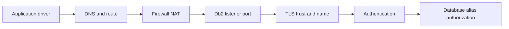

# A-05 — Networking, DNS, ports, firewalls, time, and client/server evidence

**Procedure status: NOT YET EXECUTED.** This is a teaching procedure for Db2 LUW 12.1.0 on Linux x86-64, single-member topology. The exact fix pack is not pinned. Engine commands run on the Db2 server as the named instance/database authority; client checks run on the client; OS commands run on the named host and normally require read-only access. Windows, AIX, DPF, and pureScale differences are called out where material. The supplied environment has no Db2 CLI or disposable Db2 server, so no lab command is claimed as executed. Before production use, confirm each command against the installed fix pack and local change controls.

## 1. Quick answer

Use this lesson to make a bounded DBA decision about forward and reverse DNS, routes, interfaces, firewall and NAT, Db2 listener and service-name/port mapping. The key is to identify the failing layer and scope before changing state.

**Safest first step:** Capture the current target, timestamp, release, and read-only state before acting.

## 2. Learn the concept

The useful mental model is to follow forward and reverse DNS; routes, interfaces, firewall and NAT; Db2 listener and service-name/port mapping; TLS trust and hostname validation; timeout versus refusal; keepalive and client/server evidence; clock synchronization from the service boundary inward. Record who owns each boundary and which evidence is authoritative there.

### Working model

Scope: forward and reverse DNS → routes, interfaces, firewall and NAT → Db2 listener and service-name/port mapping → TLS trust and hostname validation → timeout versus refusal → keepalive and client/server evidence → clock synchronization. The arrows represent dependency, not proof of a fault. Confirm each hop independently.



## 3. Choose an approach

| Variant | Choose it when | Do not choose it when / boundary |
|---|---|---|
| Name resolution | Check resolver output from the same client context as the app. | A successful ping is not a Db2 connection test. |
| Transport port | Compare listener and firewall state on both endpoints. | Refusal suggests reachable host/no listener; timeout may be path filtering. |
| TLS/session | Validate trust, certificate name, expiry and protocol after TCP succeeds. | Do not disable certificate validation to make a connection work. |

## 4. Understand the lifecycle

- Resolve the hostname and expected endpoint from the application host.
- Confirm route/interface and listener/port on server.
- Test TCP without credentials, then TLS trust, then authentication and Db2 alias.
- Capture paired client and server timestamps and diagnostics.
- Fix the earliest failing layer and repeat the complete connection test.

**Pause/retry/stop/rollback rule:** Stop if the target identity, current state, authority, or rollback dependency is uncertain; preserve evidence and escalate.

## 5. Do the work

### Precheck

- Identify exact client driver and Db2 server levels.
- Record server name, resolved IP, service/port and expected TLS mode.
- Use a safe test account; never place a password in shell history or traces.

### Scoped procedures

### Procedure 1: DNS resolution

**Status:** NOT YET EXECUTED. **Run as:** Client OS operator. **Target:** Application client resolver. **Authority/prerequisite:** Use the exact hostname configured by the application.

```bash
getent ahosts db2host.example.net
```

**Expected result:** Resolver addresses and address families are returned.

**Independent check:** Compare with server-side DNS records and certificate subject/SAN.

**Stop/rollback boundary:** Read-only; correct the authoritative DNS record through network owners.

### Procedure 2: Listener and TCP probe

**Status:** NOT YET EXECUTED. **Run as:** Server operator, then client operator. **Target:** Server listening sockets and client route. **Authority/prerequisite:** `ss` runs on server; `nc` runs on client; listener port is lab example.

```bash
ss -ltnp; nc -vz db2host.example.net 50000
```

**Expected result:** Server shows bound listener; client probe succeeds or reports refusal/timeout.

**Independent check:** Verify service mapping and test Db2 auth only after transport passes.

**Stop/rollback boundary:** Read-only; firewall changes require scoped network change.

### Procedure 3: Clock and certificate window

**Status:** NOT YET EXECUTED. **Run as:** Host operator. **Target:** Client and Db2 server clocks. **Authority/prerequisite:** Read-only; repeat on each endpoint.

```bash
timedatectl status
```

**Expected result:** NTP synchronization and offset are displayed.

**Independent check:** Compare certificate validity dates and incident timestamps in UTC.

**Stop/rollback boundary:** No state change; fix NTP through platform management, not manual clock jumps.

## 6. Worked example and verification

Client resolves the alias to the expected server, but TCP to the configured port times out. Server `ss` has no listener on that port. Check DBM SVCENAME/service resolution and `DB2COMM` before changing firewall rules.

**Expected state/result:** A tested path identifies DNS, route/firewall, listener, TLS, authentication, catalog alias, or application driver as the earliest failing layer.

**Independent verification:**

- Compare the post-state with the captured pre-state.
- Confirm the intended service or data outcome independently of the command return code.

## 7. Diagnose problems

| Symptom or verified error | Evidence to collect | Likely cause | Safe correction and recheck | Avoid |
|---|---|---|---|---|
| TCP connection is refused immediately. | server `ss -ltnp`, service mapping, Db2 instance status and db2diag startup record. | No listener on the port or service not started/bound. | Correct the configured service/listener and restart only if the parameter requires it; retest port then Db2. | Opening every firewall port. |
| TLS client rejects a valid server certificate. | client trust chain, certificate SAN/expiry, system time, client driver and TLS trace. | Trust store/name mismatch or clock skew. | Install the approved CA chain and connect using the certificate name; recheck TLS handshake. | Disabling hostname or certificate validation. |

## 8. Practice

Use a disposable client/server pair. Break one layer at a time: wrong DNS name, closed test port, then untrusted test CA. Record the client result, server evidence, and the smallest fix. Restore original config and prove the successful authenticated connection.

## 9. Check understanding

**Question:** What does a successful TCP probe prove?

**Answer and reasoning:** Only that a TCP path to that endpoint/port accepted the probe at that moment. It says nothing about TLS, Db2 cataloging, authentication, authorization, driver compatibility, or application SQL.

## 10. Look it up later

### Short checklist

- Name the target and scope.
- Collect a baseline and confirm prerequisites.
- Choose the least disruptive supported branch.
- Verify state and service behavior.
- Record evidence and recovery limits.

### Related lessons

[D-03](../D/D-03.md) · [D-04](../D/D-04.md) · [D-06](../D/D-06.md) · [E-01](../E/E-01.md)

### Authoritative references

- [IBM Db2 TCP/IP setup](https://www.ibm.com/docs/en/db2/12.1.x?topic=tcpip-setting-communication-protocols-db2-instance)
- [IBM TLS server configuration](https://www.ibm.com/docs/en/db2/12.1?topic=ctcsc-configure-tls-db2-server)

---

[Domain index](README.md) · [Course index](../README.md) · [Glossary](../GLOSSARY.md)
