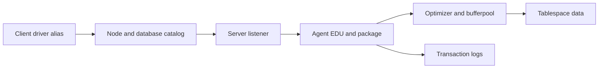

# B-01 — Instances, databases, members, agents, and Db2 request path

**Procedure status: NOT YET EXECUTED.** This is a teaching procedure for Db2 LUW 12.1.0 on Linux x86-64, single-member topology. The exact fix pack is not pinned. Engine commands run on the Db2 server as the named instance/database authority; client checks run on the client; OS commands run on the named host and normally require read-only access. Windows, AIX, DPF, and pureScale differences are called out where material. The supplied environment has no Db2 CLI or disposable Db2 server, so no lab command is claimed as executed. Before production use, confirm each command against the installed fix pack and local change controls.

## 1. Quick answer

Use this lesson to make a bounded DBA decision about install copy versus instance versus database, instance owner/profile and database directory, member versus DPF partition. The key is to identify the failing layer and scope before changing state.

**Safest first step:** Capture the current target, timestamp, release, and read-only state before acting.

## 2. Learn the concept

The useful mental model is to follow install copy versus instance versus database; instance owner/profile and database directory; member versus DPF partition; client-to-listener-to-agent path; package compiler optimizer and data/log path; configuration/catalog/diagnostic boundaries from the service boundary inward. Record who owns each boundary and which evidence is authoritative there.

### Working model

Scope: install copy versus instance versus database → instance owner/profile and database directory → member versus DPF partition → client-to-listener-to-agent path → package compiler optimizer and data/log path → configuration/catalog/diagnostic boundaries. The arrows represent dependency, not proof of a fault. Confirm each hop independently.



## 3. Choose an approach

| Variant | Choose it when | Do not choose it when / boundary |
|---|---|---|
| Install copy | Contains binaries and tools at one Db2 code level. | Not a running database or isolated data directory by itself. |
| Instance | Owns engine processes and DBM CFG; can manage multiple databases. | DB2INSTANCE must match the target. |
| Database/member | Database owns DB CFG/catalog/data; member or DPF partition changes command scope. | Do not assume every operation runs on one host. |

## 4. Understand the lifecycle

- Select the Db2 copy and load its profile.
- Identify the attached instance and its owner.
- Resolve local/remote database alias and active member topology.
- Trace client request through listener, EDU, package, bufferpool, log and storage.
- Verify the response and state at each boundary.

**Pause/retry/stop/rollback rule:** Stop if the target identity, current state, authority, or rollback dependency is uncertain; preserve evidence and escalate.

## 5. Do the work

### Precheck

- Run `db2level` and `db2 get instance` in the same shell.
- Capture directory and member topology before interpreting a handle.
- Confirm whether the target is local catalog, remote alias, DPF or pureScale.

### Scoped procedures

### Procedure 1: Release and instance identity

**Status:** NOT YET EXECUTED. **Run as:** Instance owner. **Target:** Current shell, instance and catalog directory. **Authority/prerequisite:** Source the intended copy profile; instance owner identity is confirmed.

```bash
db2level; db2 get instance; db2 list database directory
```

**Expected result:** Db2 code level, instance name and cataloged databases are printed.

**Independent check:** Compare database directory entry with the application alias and server host.

**Stop/rollback boundary:** Read-only; stop if release or alias differs from the change ticket.

### Procedure 2: Request-path activity

**Status:** NOT YET EXECUTED. **Run as:** Instance owner. **Target:** Active SAMPLE database/member. **Authority/prerequisite:** Database is active; select member explicitly for scale-out topology.

```bash
db2pd -db SAMPLE -applications
```

**Expected result:** Active application handles and states are displayed.

**Independent check:** Correlate one handle with client, statement and transaction evidence before action.

**Stop/rollback boundary:** Read-only; do not force an application solely from a handle listing.

## 6. Worked example and verification

A user says “the database is down.” `db2 get instance` shows a different DB2INSTANCE from the expected one, and the alias points to a remote server. Correct the shell/context first; do not start a second engine on the wrong host.

**Expected state/result:** An operator can name binary copy, instance, database, member, alias, application handle, and data/log owner separately.

**Independent verification:**

- Compare the post-state with the captured pre-state.
- Confirm the intended service or data outcome independently of the command return code.

## 7. Diagnose problems

| Symptom or verified error | Evidence to collect | Likely cause | Safe correction and recheck | Avoid |
|---|---|---|---|---|
| `db2 connect` reaches an unexpected database. | db2level, `db2 get instance`, node/database directory and server identity. | Wrong client copy/profile or alias resolves to a different endpoint. | Switch to the intended profile and verify alias/host before reconnecting. | Changing database content to match an incorrect alias. |
| Application is active but returns slowly. | application handle, EDU state, package/statement, wait category and data/log path. | Request path is blocked downstream of listener/agent. | Follow the same handle through wait and resource evidence. | Restarting the instance before identifying the blocked path. |

## 8. Practice

Trace a synthetic SELECT from driver to listener to application handle to table-space read. Mark where database configuration, package cache, bufferpool and log appear. Cleanup: detach/reset only your lab connection.

## 9. Check understanding

**Question:** What is the difference between an instance and a database?

**Answer and reasoning:** The instance is the engine environment and instance-wide configuration/process scope; a database is a managed set of catalogs, data, logs, and DB CFG owned by that engine. They have different paths, authorities and lifecycle.

## 10. Look it up later

### Short checklist

- Name the target and scope.
- Collect a baseline and confirm prerequisites.
- Choose the least disruptive supported branch.
- Verify state and service behavior.
- Record evidence and recovery limits.

### Related lessons

[B-02](../B/B-02.md) · [B-03](../B/B-03.md) · [B-05](../B/B-05.md) · [B-06](../B/B-06.md)

### Authoritative references

- [IBM Db2 installation methods](https://www.ibm.com/docs/en/db2/12.1.x?topic=servers-db2-installation-methods)
- [IBM monitoring interfaces](https://www.ibm.com/docs/en/db2/12.1.x?topic=monitoring-interfaces-database)

---

[Domain index](README.md) · [Course index](../README.md) · [Glossary](../GLOSSARY.md)
