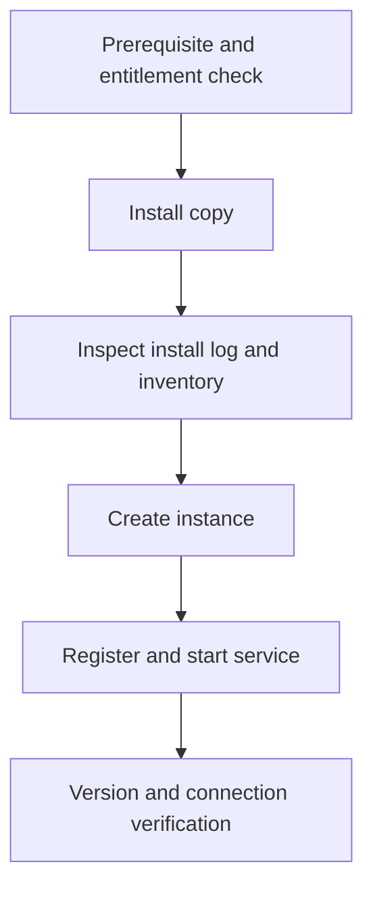

# B-02 — Installation copies, licensing, instance creation, profiles, and service lifecycle

**Procedure status: NOT YET EXECUTED.** This is a teaching procedure for Db2 LUW 12.1.0 on Linux x86-64, single-member topology. The exact fix pack is not pinned. Engine commands run on the Db2 server as the named instance/database authority; client checks run on the client; OS commands run on the named host and normally require read-only access. Windows, AIX, DPF, and pureScale differences are called out where material. The supplied environment has no Db2 CLI or disposable Db2 server, so no lab command is claimed as executed. Before production use, confirm each command against the installed fix pack and local change controls.

## 1. Quick answer

Use this lesson to make a bounded DBA decision about supported host prerequisites, interactive response file and RPM install paths, multiple copies, license and inventory. The key is to identify the failing layer and scope before changing state.

**Safest first step:** Capture the current target, timestamp, release, and read-only state before acting.

## 2. Learn the concept

The useful mental model is to follow supported host prerequisites; interactive response file and RPM install paths; multiple copies, license and inventory; install logs and instance create/update/drop; profiles and DB2INSTANCE; service registration/autostart; start stop force and reboot validation; fix-pack and uninstall boundaries from the service boundary inward. Record who owns each boundary and which evidence is authoritative there.

### Working model

Scope: supported host prerequisites → interactive response file and RPM install paths → multiple copies, license and inventory → install logs and instance create/update/drop → profiles and DB2INSTANCE → service registration/autostart → start stop force and reboot validation → fix-pack and uninstall boundaries. The arrows represent dependency, not proof of a fault. Confirm each hop independently.



## 3. Choose an approach

| Variant | Choose it when | Do not choose it when / boundary |
|---|---|---|
| New install copy | Use response-file or supported package method for repeatability. | Do not use `db2_install` expecting it to create users or an instance. |
| Instance create | Use db2icrt with deliberate auth/fenced IDs. | Requires root on Linux/UNIX for root installation; local administrator on Windows. |
| Service lifecycle | Drain applications before planned stop; force only with recovery plan. | `db2stop force` disconnects active applications. |

## 4. Understand the lifecycle

- Check supported OS, libraries, users/groups, limits, storage and licensing.
- Install a new copy or update an existing copy using the supported method.
- Review install logs and inventory; register license where required.
- Create instance and load correct profile; confirm owner/services.
- Start instance and test local/remote connections; document rollback version.

**Pause/retry/stop/rollback rule:** Stop if the target identity, current state, authority, or rollback dependency is uncertain; preserve evidence and escalate.

## 5. Do the work

### Precheck

- Read the exact Db2 12.1 fix-pack installation notes and OS support matrix.
- Inventory existing copies/instances and preserve response files and logs.
- Confirm Linux root or Windows Local Administrator, fenced user, ports and data paths.

### Scoped procedures

### Procedure 1: Copy inventory

**Status:** NOT YET EXECUTED. **Run as:** Host installer / instance owner. **Target:** Local Db2 host copies and instances. **Authority/prerequisite:** Commands are read-only; run under a shell with Db2 tools in PATH.

```bash
db2ls; db2ilist
```

**Expected result:** Installed copy paths and instance list are returned.

**Independent check:** Compare with `db2level` for each instance and license entitlement.

**Stop/rollback boundary:** Read-only; do not remove an unfamiliar copy.

### Procedure 2: Create a lab instance

**Status:** NOT YET EXECUTED. **Run as:** root on Linux/UNIX root install; Local Administrator on Windows. **Target:** New instance owner `db2inst1` on lab host. **Authority/prerequisite:** Install copy exists, users/groups exist, and names are unused.

```bash
/opt/ibm/db2/V12.1/instance/db2icrt -a server -u db2fenc1 db2inst1
```

**Expected result:** Instance creation completes and instance profile is installed.

**Independent check:** Log in as instance owner; `db2 get instance`, `db2level`, and service status agree.

**Stop/rollback boundary:** If creation fails, inspect the generated log and use supported db2idrop only after confirming no database data is attached.

## 6. Worked example and verification

The binaries are installed but `db2 get instance` returns no instance. That is expected before db2icrt; installation and instance creation are separate lifecycle steps. Keep both installer and instance logs with the build record.

**Expected state/result:** The intended copy, license entitlement, instance owner, fenced identity, service registration, and startup behavior are all verified.

**Independent verification:**

- Compare the post-state with the captured pre-state.
- Confirm the intended service or data outcome independently of the command return code.

## 7. Diagnose problems

| Symptom or verified error | Evidence to collect | Likely cause | Safe correction and recheck | Avoid |
|---|---|---|---|---|
| Installer returns success but `db2ilist` is empty. | install logs, chosen installation method, instance inventory and owner/group setup. | Binary installation completed but instance creation was not part of that method. | Create the instance separately using documented db2icrt prerequisites. | Rerunning installation blindly over the same copy. |
| Instance starts manually but not at boot. | service registration, owner profile, mount dependencies, journal/system log. | Service unit lacks environment or starts before data/log mounts. | Configure the supported service integration and boot dependency; test reboot in lab. | Root-owned cron that launches Db2 without owner context. |

## 8. Practice

Install only in an isolated disposable VM. Compare response-file and package-install paths, create an instance, validate owner and service restart after a planned reboot. Cleanup: archive installation logs; drop only the empty lab instance and remove only its matching copy.

## 9. Check understanding

**Question:** Why might `db2_install` leave no instance behind?

**Answer and reasoning:** It deploys product components but does not create users/groups, instance, or configuration. The installation method and instance lifecycle are separate.

## 10. Look it up later

### Short checklist

- Name the target and scope.
- Collect a baseline and confirm prerequisites.
- Choose the least disruptive supported branch.
- Verify state and service behavior.
- Record evidence and recovery limits.

### Related lessons

[A-02](../A/A-02.md) · [B-01](../B/B-01.md) · [I-02](../I/I-02.md)

### Authoritative references

- [IBM Db2 installation methods](https://www.ibm.com/docs/en/db2/12.1.x?topic=servers-db2-installation-methods)
- [IBM db2icrt reference](https://www.ibm.com/docs/en/db2/12.1.x?topic=commands-db2icrt-create-instance)

---

[Domain index](README.md) · [Course index](../README.md) · [Glossary](../GLOSSARY.md)
