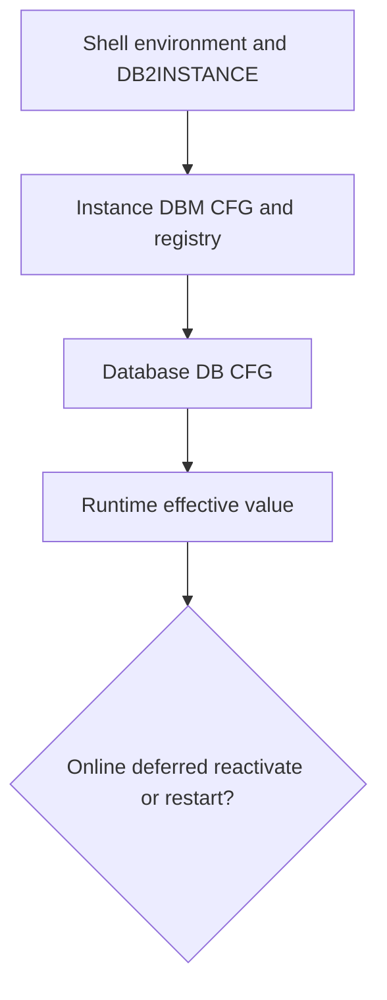

# B-03 — Database creation, activation, connections, and configuration scope

**Procedure status: NOT YET EXECUTED.** This is a teaching procedure for Db2 LUW 12.1.0 on Linux x86-64, single-member topology. The exact fix pack is not pinned. Engine commands run on the Db2 server as the named instance/database authority; client checks run on the client; OS commands run on the named host and normally require read-only access. Windows, AIX, DPF, and pureScale differences are called out where material. The supplied environment has no Db2 CLI or disposable Db2 server, so no lab command is claimed as executed. Before production use, confirm each command against the installed fix pack and local change controls.

## 1. Quick answer

Use this lesson to make a bounded DBA decision about CREATE DATABASE code set territory collation page size and storage, DBM CFG versus DB CFG versus registry/environment, online immediate deferred/reactivate/restart parameter classes. The key is to identify the failing layer and scope before changing state.

**Safest first step:** Capture the current target, timestamp, release, and read-only state before acting.

## 2. Learn the concept

The useful mental model is to follow CREATE DATABASE code set territory collation page size and storage; DBM CFG versus DB CFG versus registry/environment; online immediate deferred/reactivate/restart parameter classes; effective values and member scope; activate deactivate connect disconnect; configuration baseline diff and rollback from the service boundary inward. Record who owns each boundary and which evidence is authoritative there.

### Working model

Scope: CREATE DATABASE code set territory collation page size and storage → DBM CFG versus DB CFG versus registry/environment → online immediate deferred/reactivate/restart parameter classes → effective values and member scope → activate deactivate connect disconnect → configuration baseline diff and rollback. The arrows represent dependency, not proof of a fault. Confirm each hop independently.



## 3. Choose an approach

| Variant | Choose it when | Do not choose it when / boundary |
|---|---|---|
| DBM CFG | Instance-wide defaults, communication and engine resources. | Changing one database setting cannot alter it. |
| DB CFG | Per database resource/recovery behavior; some values activate on reactivation. | A value shown in config may not be effective until the next lifecycle boundary. |
| Registry/environment | Instance or client profile behavior (db2set/shell). | Not SQL configuration; persistence and scope differ. |

## 4. Understand the lifecycle

- Choose database path, territory/code set, page size, logging/storage and owner.
- Create database with explicit choices.
- Capture DBM CFG, DB CFG and registry separately.
- Classify the selected setting as online, deferred, reactivation or restart.
- Apply one scoped change and verify effective value after required boundary.

**Pause/retry/stop/rollback rule:** Stop if the target identity, current state, authority, or rollback dependency is uncertain; preserve evidence and escalate.

## 5. Do the work

### Precheck

- Check database alias/path and ensure it does not already exist.
- Capture `GET DBM CFG SHOW DETAIL`, `GET DB CFG ... SHOW DETAIL`, and `db2set -all`.
- Read the selected parameter reference for supported value, propagation class and topology behavior.

### Scoped procedures

### Procedure 1: Create isolated sample

**Status:** NOT YET EXECUTED. **Run as:** Instance owner. **Target:** New single-member lab database SAMPLE. **Authority/prerequisite:** Alias unused; destination has measured capacity; command is for disposable lab only.

```bash
db2 create database SAMPLE automatic storage yes using codeset UTF-8 territory US
```

**Expected result:** CREATE DATABASE completes and catalogs SAMPLE.

**Independent check:** List database directory, connect, check code set/page size and database path.

**Stop/rollback boundary:** Drop only the newly created empty lab database after independent identity check.

### Procedure 2: Inspect effective scope

**Status:** NOT YET EXECUTED. **Run as:** Instance owner. **Target:** Instance and SAMPLE configuration. **Authority/prerequisite:** No state change; save output with timestamp and release.

```bash
db2 get dbm cfg show detail; db2 get db cfg for SAMPLE show detail; db2set -all
```

**Expected result:** Current/deferred values and registry variables are displayed.

**Independent check:** Compare current and delayed values; confirm member scope for pureScale/DPF.

**Stop/rollback boundary:** Read-only; do not edit Db2 config files directly.

## 6. Worked example and verification

Before adjusting `LOGPRIMARY`, establish that the property belongs to DB CFG and determine whether it is online for this release. Compare the current and delayed values, assess active-log filesystem headroom, then apply and verify through GET DB CFG and a controlled workload.

**Expected state/result:** A configuration change is tied to the correct scope and propagation class, with a recorded prior value and safe rollback.

**Independent verification:**

- Compare the post-state with the captured pre-state.
- Confirm the intended service or data outcome independently of the command return code.

## 7. Diagnose problems

| Symptom or verified error | Evidence to collect | Likely cause | Safe correction and recheck | Avoid |
|---|---|---|---|---|
| GET DB CFG shows new value, but behavior does not change. | current/delayed values, database activation, all connections, and parameter docs. | Parameter is deferred until reactivation or requires instance restart. | Schedule the documented boundary, drain safely, reactivate/restart, and verify effective value. | Repeatedly issuing UPDATE DB CFG or editing SQLDBCONF directly. |
| A setting differs across members or appears not to persist. | member-aware config output, command scope, registry profile and start environment. | Wrong scope or per-member behavior not included in the change plan. | Set supported scope explicitly and inspect effective value on each member. | Assuming one-member results generalize to DPF or pureScale. |

## 8. Practice

Create SAMPLE and save all three configuration views. Change one documented online parameter in the disposable database, record current/delayed value, and restore the baseline. Cleanup: deactivate/drop SAMPLE only after confirming its path and name.

## 9. Check understanding

**Question:** Why are DBM CFG, DB CFG and db2set separate evidence?

**Answer and reasoning:** They affect different scopes and have different storage, persistence and activation behavior. A matching-looking value at one layer does not prove the other layers or effective runtime state.

## 10. Look it up later

### Short checklist

- Name the target and scope.
- Collect a baseline and confirm prerequisites.
- Choose the least disruptive supported branch.
- Verify state and service behavior.
- Record evidence and recovery limits.

### Related lessons

[B-01](../B/B-01.md) · [B-02](../B/B-02.md) · [B-04](../B/B-04.md) · [D-01](../D/D-01.md)

### Authoritative references

- [IBM configuration parameter summary](https://www.ibm.com/docs/en/db2/12.1.x?topic=parameters-configuration-summary)

---

[Domain index](README.md) · [Course index](../README.md) · [Glossary](../GLOSSARY.md)
