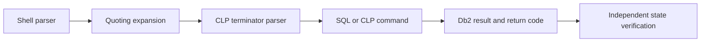

# B-04 — CLP, SQL boundaries, command files, terminators, quoting, and safe workflows

**Procedure status: NOT YET EXECUTED.** This is a teaching procedure for Db2 LUW 12.1.0 on Linux x86-64, single-member topology. The exact fix pack is not pinned. Engine commands run on the Db2 server as the named instance/database authority; client checks run on the client; OS commands run on the named host and normally require read-only access. Windows, AIX, DPF, and pureScale differences are called out where material. The supplied environment has no Db2 CLI or disposable Db2 server, so no lab command is claimed as executed. Before production use, confirm each command against the installed fix pack and local change controls.

## 1. Quick answer

Use this lesson to make a bounded DBA decision about interactive CLP and connection context, semicolon and alternate terminators, CLP commands versus SQL statements. The key is to identify the failing layer and scope before changing state.

**Safest first step:** Capture the current target, timestamp, release, and read-only state before acting.

## 2. Learn the concept

The useful mental model is to follow interactive CLP and connection context; semicolon and alternate terminators; CLP commands versus SQL statements; shell quoting and variable substitution; command-file stop/continue and return codes; secure output and target guard from the service boundary inward. Record who owns each boundary and which evidence is authoritative there.

### Working model

Scope: interactive CLP and connection context → semicolon and alternate terminators → CLP commands versus SQL statements → shell quoting and variable substitution → command-file stop/continue and return codes → secure output and target guard. The arrows represent dependency, not proof of a fault. Confirm each hop independently.



## 3. Choose an approach

| Variant | Choose it when | Do not choose it when / boundary |
|---|---|---|
| Interactive CLP | Use for short inspection with explicit connect/reset. | Session context persists; verify database before state change. |
| Command file | Use alternate terminator when SQL contains semicolons or compound blocks. | Do not assume first error stops every command file. |
| Shell wrapper | Use argument-safe invocation and preserve exit status. | Avoid `eval`, secrets in argv, and silent pipeline failures. |

## 4. Understand the lifecycle

- Set release/profile and a clean CLP session.
- Validate database alias and connect identity.
- Choose terminator and quoting for SQL and host shell layers.
- Run read-only preflight; execute bounded script with captured output/return code.
- Reset connection and verify result independently.

**Pause/retry/stop/rollback rule:** Stop if the target identity, current state, authority, or rollback dependency is uncertain; preserve evidence and escalate.

## 5. Do the work

### Precheck

- Place scripts in a private, version-controlled lab directory.
- Use unique lab schema/database and no password literals.
- Review every statement for COMMIT, DDL, utility or target change.

### Scoped procedures

### Procedure 1: Alternate terminator script

**Status:** NOT YET EXECUTED. **Run as:** Instance owner or authorized database user. **Target:** Database named inside `setup.sql`. **Authority/prerequisite:** File uses `@` terminators; inspect the complete file before execution.

```bash
db2 -td@ -vf setup.sql
```

**Expected result:** CLP echoes statements, emits messages and returns a process status.

**Independent check:** Query the resulting object/data and check shell `$LASTEXITCODE`/`$?` appropriate to host.

**Stop/rollback boundary:** Use ROLLBACK only for uncommitted transactional work; DDL/utility effects need their own compensation.

### Procedure 2: Safe read-only interactive session

**Status:** NOT YET EXECUTED. **Run as:** Client/instance owner. **Target:** Cataloged SAMPLE alias. **Authority/prerequisite:** Alias has been independently verified; values are read-only.

```bash
db2 connect to SAMPLE; db2 "values current server, current user"; db2 connect reset
```

**Expected result:** Current server and authorization identity are returned.

**Independent check:** Confirm server name matches ticket before running any later command.

**Stop/rollback boundary:** Connect reset ends the session; no database changes are made.

## 6. Worked example and verification

A compound SQL procedure has internal semicolons. Running `db2 -tvf` stops at the first semicolon rather than treating the procedure as one statement. Set `@` as terminator and ensure only the file’s outer statements end with `@`.

**Expected state/result:** The script runs against one verified target, logs stdout/stderr and exit status, and leaves no unintended connection or open unit of work.

**Independent verification:**

- Compare the post-state with the captured pre-state.
- Confirm the intended service or data outcome independently of the command return code.

## 7. Diagnose problems

| Symptom or verified error | Evidence to collect | Likely cause | Safe correction and recheck | Avoid |
|---|---|---|---|---|
| SQL file is split inside a procedure or trigger. | CLP echo, file terminators, and parser error line. | Default semicolon terminator conflicts with SQL compound body. | Set a deliberate alternate terminator and test in an empty lab schema. | Blindly replacing every semicolon in the SQL source. |
| Script reports failure but later statements still execute. | CLP options, wrapper status handling and final object state. | Command-file continuation semantics or shell pipeline discarded exit status. | Use explicit per-command checks and stop logic; inspect partial effects before retry. | Re-running non-idempotent DDL/LOAD after a partial failure. |

## 8. Practice

Create a script with a compound SQL body, one deliberate syntax error in a disposable file, and a following marker statement. Observe terminator and continuation behavior; then write a wrapper that stops on failure and prints the command status. Cleanup: drop only the lab routine/table.

## 9. Check understanding

**Question:** Why can a successful shell process still hide a failed Db2 statement?

**Answer and reasoning:** A wrapper can discard or overwrite the CLP return code, or continue after an error. Preserve command status and verify expected database state instead of trusting the final shell line.

## 10. Look it up later

### Short checklist

- Name the target and scope.
- Collect a baseline and confirm prerequisites.
- Choose the least disruptive supported branch.
- Verify state and service behavior.
- Record evidence and recovery limits.

### Related lessons

[B-03](../B/B-03.md) · [J-01](../J/J-01.md) · [J-02](../J/J-02.md)

### Authoritative references

- [IBM Db2 installation methods](https://www.ibm.com/docs/en/db2/12.1.x?topic=servers-db2-installation-methods)
- [IBM configuration parameter summary](https://www.ibm.com/docs/en/db2/12.1.x?topic=parameters-configuration-summary)

---

[Domain index](README.md) · [Course index](../README.md) · [Glossary](../GLOSSARY.md)
