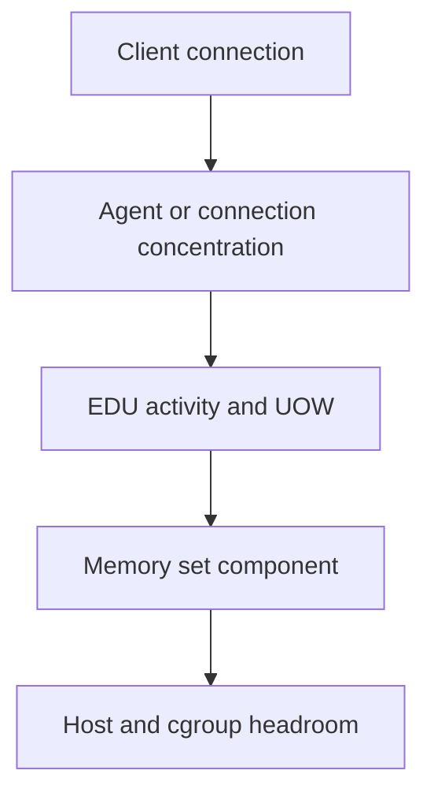

# B-05 — Agents, EDUs, units of work, and Db2 memory areas

**Procedure status: NOT YET EXECUTED.** This is a teaching procedure for Db2 LUW 12.1.0 on Linux x86-64, single-member topology. The exact fix pack is not pinned. Engine commands run on the Db2 server as the named instance/database authority; client checks run on the client; OS commands run on the named host and normally require read-only access. Windows, AIX, DPF, and pureScale differences are called out where material. The supplied environment has no Db2 CLI or disposable Db2 server, so no lab command is claimed as executed. Before production use, confirm each command against the installed fix pack and local change controls.

## 1. Quick answer

Use this lesson to make a bounded DBA decision about connection and agent/concentrator models, EDU type and process/thread mapping, unit-of-work age and commit boundary. The key is to identify the failing layer and scope before changing state.

**Safest first step:** Capture the current target, timestamp, release, and read-only state before acting.

## 2. Learn the concept

The useful mental model is to follow connection and agent/concentrator models; EDU type and process/thread mapping; unit-of-work age and commit boundary; private/shared memory sets; database and instance memory; bufferpool sort lock/package/utility consumers; saturation evidence from the service boundary inward. Record who owns each boundary and which evidence is authoritative there.

### Working model

Scope: connection and agent/concentrator models → EDU type and process/thread mapping → unit-of-work age and commit boundary → private/shared memory sets → database and instance memory → bufferpool sort lock/package/utility consumers → saturation evidence. The arrows represent dependency, not proof of a fault. Confirm each hop independently.



## 3. Choose an approach

| Variant | Choose it when | Do not choose it when / boundary |
|---|---|---|
| Agent pressure | Separate connected clients from active agents and pool demand. | Connection count alone does not establish agent shortage. |
| Memory consumer | Attribute usage to memory set, database, member and component. | Never increase a heap without checking host and cgroup headroom. |
| UOW duration | Use transaction age and commit boundary to find retained locks/logs. | Do not force an application based only on age. |

## 4. Understand the lifecycle

- Enumerate connections and active work.
- Map application handle to EDU and member.
- Inspect transaction age and memory-set consumers.
- Compare interval demand with configured/automatic caps and host limits.
- Remeasure after a workload or memory-control change.

**Pause/retry/stop/rollback rule:** Stop if the target identity, current state, authority, or rollback dependency is uncertain; preserve evidence and escalate.

## 5. Do the work

### Precheck

- Use the instance owner and correct database/member.
- Capture host memory, Db2 memory sets and connection activity at the same interval.
- Name the exact component before changing any parameter.

### Scoped procedures

### Procedure 1: EDU and memory inventory

**Status:** NOT YET EXECUTED. **Run as:** Instance owner. **Target:** SAMPLE and its active member. **Authority/prerequisite:** Instance/database active; options are read-only.

```bash
db2pd -db SAMPLE -edus; db2pd -db SAMPLE -memsets
```

**Expected result:** EDU state and memory-set usage are emitted.

**Independent check:** Repeat with MON_GET_AGENT/MON_GET_MEMORY_POOL and compare host committed memory.

**Stop/rollback boundary:** Read-only; do not terminate EDUs or raise memory limits from one snapshot.

### Procedure 2: Long UOW inspection

**Status:** NOT YET EXECUTED. **Run as:** Database user with monitor privileges. **Target:** Connected SAMPLE member(s). **Authority/prerequisite:** MON_GET_UNIT_OF_WORK is member-aware; name columns explicitly.

```bash
db2 "select application_handle, uow_start_time, uow_log_space_used from table(mon_get_unit_of_work(null,-2)) as u"
```

**Expected result:** Rows show active unit-of-work start and log usage metrics.

**Independent check:** Join handle to application and lock-wait evidence; no rows may mean no current UOWs.

**Stop/rollback boundary:** Read-only; data values depend on workload and monitor privileges.

## 6. Worked example and verification

A high open-connection count with low active-agent count suggests idle pooled sessions, while a few active agents have high sort memory. Tune the active sort workload or concurrency only after measuring spills and host memory; do not reduce connections blindly.

**Expected state/result:** Connection count, active EDUs, transaction age, and memory consumption are distinct measurements with scope and interval.

**Independent verification:**

- Compare the post-state with the captured pre-state.
- Confirm the intended service or data outcome independently of the command return code.

## 7. Diagnose problems

| Symptom or verified error | Evidence to collect | Likely cause | Safe correction and recheck | Avoid |
|---|---|---|---|---|
| A connection limit alert fires but CPU and active work remain low. | agent pool state, connection concentration, app status, and workload classes. | Many idle persistent sessions rather than executing agent saturation. | Review pool idle/lifetime settings with the application team and monitor active demand. | Increasing AGENT_MAX as a reflex. |
| Host begins swapping after a memory parameter increase. | Db2 memory set growth, Linux reclaim/swap, cgroup limit and workload concurrency. | Database allocation exceeded safe physical/container headroom. | Restore the captured parameter value at its supported propagation boundary; reduce competing demand and remeasure. | Changing several memory parameters together. |

## 8. Practice

Use a small synthetic workload with one long transaction and one sort-heavy query. Observe UOW age, EDU states and memory sets in separate snapshots. Commit/rollback only your test work; verify normal memory and connection counts afterward.

## 9. Check understanding

**Question:** Which evidence proves that a connected application is actively consuming an agent?

**Answer and reasoning:** An active application/agent state correlated with an EDU and current activity; connected count alone can include idle pooled sessions.

## 10. Look it up later

### Short checklist

- Name the target and scope.
- Collect a baseline and confirm prerequisites.
- Choose the least disruptive supported branch.
- Verify state and service behavior.
- Record evidence and recovery limits.

### Related lessons

[B-01](../B/B-01.md) · [E-03](../E/E-03.md) · [E-04](../E/E-04.md) · [H-06](../H/H-06.md)

### Authoritative references

- [IBM MON routines](https://www.ibm.com/docs/en/db2/12.1.x?topic=functions-monitor-mon-routines)
- [IBM db2pd reference](https://www.ibm.com/docs/en/db2/12.1.x?topic=commands-db2pd-monitor-troubleshoot-db2-engine-activities)

---

[Domain index](README.md) · [Course index](../README.md) · [Glossary](../GLOSSARY.md)
