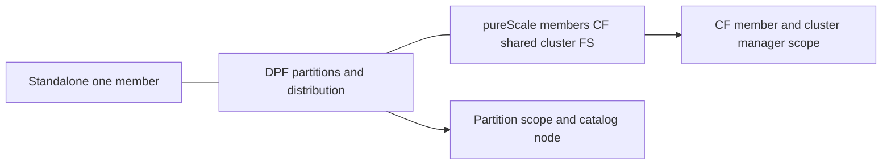

# B-06 — Standalone, DPF, and pureScale architectures and operational boundaries

**Procedure status: NOT YET EXECUTED.** This is a teaching procedure for Db2 LUW 12.1.0 on Linux x86-64, single-member topology. The exact fix pack is not pinned. Engine commands run on the Db2 server as the named instance/database authority; client checks run on the client; OS commands run on the named host and normally require read-only access. Windows, AIX, DPF, and pureScale differences are called out where material. The supplied environment has no Db2 CLI or disposable Db2 server, so no lab command is claimed as executed. Before production use, confirm each command against the installed fix pack and local change controls.

## 1. Quick answer

Use this lesson to make a bounded DBA decision about single-member standalone, DPF members/partitions catalog node distribution map FCM, pureScale members CF cluster filesystem interconnect recovery. The key is to identify the failing layer and scope before changing state.

**Safest first step:** Capture the current target, timestamp, release, and read-only state before acting.

## 2. Learn the concept

The useful mental model is to follow single-member standalone; DPF members/partitions catalog node distribution map FCM; pureScale members CF cluster filesystem interconnect recovery; topology discovery and command scope; member-aware utilities and failure drills from the service boundary inward. Record who owns each boundary and which evidence is authoritative there.

### Working model

Scope: single-member standalone → DPF members/partitions catalog node distribution map FCM → pureScale members CF cluster filesystem interconnect recovery → topology discovery and command scope → member-aware utilities and failure drills. The arrows represent dependency, not proof of a fault. Confirm each hop independently.



## 3. Choose an approach

| Variant | Choose it when | Do not choose it when / boundary |
|---|---|---|
| Standalone | One member owns the database engine boundary. | A second instance is not DPF. |
| DPF | Data is distributed across database partitions and partition groups. | Command effects may fan out; catalog partition matters for some recovery tasks. |
| pureScale | Members coordinate through CFs and shared cluster storage. | It is not DPF; member and CF failures use different recovery paths. |

## 4. Understand the lifecycle

- Discover product feature and topology from supported tools.
- Map member/partition identifiers to host and database path.
- Classify command scope as local, member, partition or cluster-wide.
- Use topology-native monitoring and failure procedures.
- Prove data placement and service recovery across the intended scope.

**Pause/retry/stop/rollback rule:** Stop if the target identity, current state, authority, or rollback dependency is uncertain; preserve evidence and escalate.

## 5. Do the work

### Precheck

- Confirm `db2level`, `db2instance -list` when pureScale, and db2nodes.cfg when DPF.
- Record catalog partition/member and cluster manager health.
- Do not run a single-member lab command across a multi-host cluster without local runbook review.

### Scoped procedures

### Procedure 1: DPF topology inventory

**Status:** NOT YET EXECUTED. **Run as:** Instance owner. **Target:** All configured DPF partitions. **Authority/prerequisite:** Only on DPF; use bounded host command and validated instance profile.

```bash
cat $HOME/sqllib/db2nodes.cfg; db2_all "hostname"
```

**Expected result:** Node list and one response per participating host are produced.

**Independent check:** Compare partition IDs, host list and database partition group distribution.

**Stop/rollback boundary:** Read-only; do not edit db2nodes.cfg while instance is running.

### Procedure 2: pureScale member status

**Status:** NOT YET EXECUTED. **Run as:** Instance owner. **Target:** pureScale cluster and SAMPLE members. **Authority/prerequisite:** Only on pureScale; require cluster health and correct instance.

```bash
db2instance -list; db2pd -db SAMPLE -members
```

**Expected result:** Member/CF role and database member status are shown.

**Independent check:** Compare with cluster manager and CF health, not one Db2 output alone.

**Stop/rollback boundary:** Read-only; cluster repair/failover must follow cluster-manager procedure.

### Procedure 3: Standalone boundary

**Status:** NOT YET EXECUTED. **Run as:** Instance owner. **Target:** One standalone host. **Authority/prerequisite:** Correct instance profile; do not infer topology from catalog entries alone.

```bash
db2pd -inst; db2 list db directory
```

**Expected result:** One local engine inventory and database directory are returned.

**Independent check:** Check host inventory and absence of DPF/pureScale configuration.

**Stop/rollback boundary:** Read-only.

## 6. Worked example and verification

The same backup request needs topology-specific scope: a standalone database has one engine target; DPF requires partition-aware image and restore planning; pureScale uses member/CF awareness and cluster-managed resources. Name that boundary before selecting a utility.

**Expected state/result:** A topology diagram lists hosts, members/partitions, catalog node, CFs, shared filesystems, and command fan-out.

**Independent verification:**

- Compare the post-state with the captured pre-state.
- Confirm the intended service or data outcome independently of the command return code.

## 7. Diagnose problems

| Symptom or verified error | Evidence to collect | Likely cause | Safe correction and recheck | Avoid |
|---|---|---|---|---|
| Command succeeds on one node but database remains inconsistent across a DPF target. | db2nodes.cfg, per-partition utility/status output, and catalog partition role. | Command was run at the wrong scope or one partition did not participate. | Use supported partition-wide operation and verify every partition result. | Repeating a state-changing command independently on nodes without partition semantics. |
| pureScale member failure is mistaken for a partition failure. | `db2instance -list`, CF and cluster manager health, member recovery state. | DPF and pureScale concepts were conflated. | Follow the pureScale member/CF recovery sequence and verify cluster filesystem/interconnect. | Editing db2nodes.cfg or forcing DPF utilities on pureScale. |

## 8. Practice

Draw three separate diagrams: single-member, two-partition DPF, and two-member/two-CF pureScale. For each mark where a backup, `db2pd`, member failure and recovery decision is scoped. Use documentation only; no cluster lab exists here.

## 9. Check understanding

**Question:** What information must be added before turning a standalone command into a DPF runbook?

**Answer and reasoning:** Partition list/catalog partition, per-partition data placement and command fan-out, host mapping, consistency behavior, and verification for every participating partition.

## 10. Look it up later

### Short checklist

- Name the target and scope.
- Collect a baseline and confirm prerequisites.
- Choose the least disruptive supported branch.
- Verify state and service behavior.
- Record evidence and recovery limits.

### Related lessons

[G-06](../G/G-06.md) · [F-03](../F/F-03.md) · [F-05](../F/F-05.md) · [E-03](../E/E-03.md)

### Authoritative references

- [IBM monitoring interfaces](https://www.ibm.com/docs/en/db2/12.1.x?topic=monitoring-interfaces-database)
- [IBM Db2 pureScale HADR overview](https://www.ibm.com/docs/en/db2/12.1.x?topic=idpe-high-availability-disaster-recovery-hadr-in-db2-purescale-environments)

---

[Domain index](README.md) · [Course index](../README.md) · [Glossary](../GLOSSARY.md)
