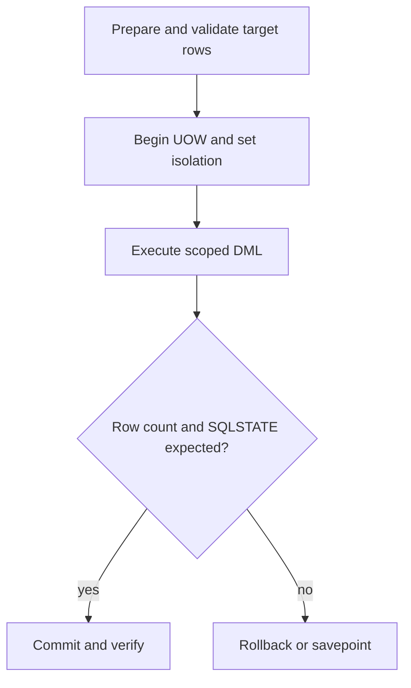

# C-01 — SQL, transactions, isolation, SQLCODE, and SQLSTATE fundamentals

**Procedure status: NOT YET EXECUTED.** This is a teaching procedure for Db2 LUW 12.1.0 on Linux x86-64, single-member topology. The exact fix pack is not pinned. Engine commands run on the Db2 server as the named instance/database authority; client checks run on the client; OS commands run on the named host and normally require read-only access. Windows, AIX, DPF, and pureScale differences are called out where material. The supplied environment has no Db2 CLI or disposable Db2 server, so no lab command is claimed as executed. Before production use, confirm each command against the installed fix pack and local change controls.

## 1. Quick answer

Use this lesson to make a bounded DBA decision about read-only SELECT and parameter markers, INSERT UPDATE DELETE guardrails, COMMIT ROLLBACK SAVEPOINT and autocommit. The key is to identify the failing layer and scope before changing state.

**Safest first step:** Capture the current target, timestamp, release, and read-only state before acting.

## 2. Learn the concept

The useful mental model is to follow read-only SELECT and parameter markers; INSERT UPDATE DELETE guardrails; COMMIT ROLLBACK SAVEPOINT and autocommit; isolation levels and anomalies; cursor locks and transaction boundaries; SQLCODE SQLSTATE and token interpretation from the service boundary inward. Record who owns each boundary and which evidence is authoritative there.

### Working model

Scope: read-only SELECT and parameter markers → INSERT UPDATE DELETE guardrails → COMMIT ROLLBACK SAVEPOINT and autocommit → isolation levels and anomalies → cursor locks and transaction boundaries → SQLCODE SQLSTATE and token interpretation. The arrows represent dependency, not proof of a fault. Confirm each hop independently.



## 3. Choose an approach

| Variant | Choose it when | Do not choose it when / boundary |
|---|---|---|
| Read-only query | Use a bounded predicate and explicit columns. | Avoid unbounded scans on shared systems. |
| Transactional DML | Use a transaction boundary and verify affected rows before commit. | Autocommit can commit each statement before a later check. |
| Isolation | Choose based on consistency requirement and wait risk. | Do not reduce isolation to hide a data race. |

## 4. Understand the lifecycle

- Prepare a statement and identify target rows.
- Begin or verify transaction mode.
- Execute one scoped unit of work.
- Check row count and concurrent effects.
- Commit only on expected result; otherwise rollback/savepoint.

**Pause/retry/stop/rollback rule:** Stop if the target identity, current state, authority, or rollback dependency is uncertain; preserve evidence and escalate.

## 5. Do the work

### Precheck

- Use synthetic schema/table and bind parameter types explicitly.
- Check autocommit and isolation in the actual client/driver.
- Capture before-row count or primary-key values.

### Scoped procedures

### Procedure 1: Bounded change with verification

**Status:** NOT YET EXECUTED. **Run as:** Authorized application/database user. **Target:** One synthetic inventory row. **Authority/prerequisite:** Confirm primary key and expected quantity; use an explicit transaction with autocommit disabled.

```bash
UPDATE APP.INVENTORY SET quantity = quantity - 2 WHERE sku = 70021 AND quantity >= 2; SELECT sku, quantity FROM APP.INVENTORY WHERE sku = 70021;
```

**Expected result:** One row changes only if stock is sufficient; the SELECT returns the resulting quantity.

**Independent check:** Compare row count and data with the request before COMMIT; otherwise ROLLBACK.

**Stop/rollback boundary:** Rollback the open UOW; after commit, use a reviewed compensating transaction, not assumed undo.

### Procedure 2: Transaction checkpoint

**Status:** NOT YET EXECUTED. **Run as:** Database user in active transaction. **Target:** Current lab unit of work. **Authority/prerequisite:** Use only in a session that owns the savepoint; verify client syntax/driver behavior.

```bash
SAVEPOINT before_edit ON ROLLBACK RETAIN CURSORS; ROLLBACK TO SAVEPOINT before_edit
```

**Expected result:** Changes after the savepoint are undone while earlier work remains.

**Independent check:** Requery rows and confirm expected pre-savepoint values.

**Stop/rollback boundary:** Rollback the full transaction if state is uncertain.

## 6. Worked example and verification

A guarded UPDATE affects zero rows. That is a meaningful outcome: the row may be absent or quantity may already be below the requested decrement. Read the key row and stop rather than remove the predicate.

**Expected state/result:** Transaction boundary, row count, isolation, SQLCODE and SQLSTATE are interpreted together.

**Independent verification:**

- Compare the post-state with the captured pre-state.
- Confirm the intended service or data outcome independently of the command return code.

## 7. Diagnose problems

| Symptom or verified error | Evidence to collect | Likely cause | Safe correction and recheck | Avoid |
|---|---|---|---|---|
| SQL0911N after a statement. | SQLSTATE, reason code/token, deadlock/timeout event, transaction age and blocker. | Statement was selected as a deadlock victim or timed out waiting for a lock. | Retry only the complete idempotent business unit after resolving contention; verify commit outcome. | Blindly retrying a non-idempotent update after an ambiguous client timeout. |
| SQL0803N unique-key violation on insert. | SQLCODE/SQLSTATE, constraint/index name, key values and existing row. | Duplicate key or application retry repeated a successful insert. | Read by business key, reconcile request outcome and use idempotency key. | Dropping the unique index to make the insert pass. |

## 8. Practice

Create a lab inventory row and run a guarded decrement with autocommit off. Induce an insufficient-stock zero-row update; test COMMIT and ROLLBACK separately. Cleanup: restore or delete only the synthetic row.

## 9. Check understanding

**Question:** Why is a client timeout an ambiguous transaction outcome?

**Answer and reasoning:** The server may have committed before the client lost its response. Reconnect and query by a stable business/idempotency key before retrying.

## 10. Look it up later

### Short checklist

- Name the target and scope.
- Collect a baseline and confirm prerequisites.
- Choose the least disruptive supported branch.
- Verify state and service behavior.
- Record evidence and recovery limits.

### Related lessons

[H-05](../H/H-05.md) · [D-03](../D/D-03.md) · [J-03](../J/J-03.md)

### Authoritative references

- [IBM MON routines](https://www.ibm.com/docs/en/db2/12.1.x?topic=functions-monitor-mon-routines)

---

[Domain index](README.md) · [Course index](../README.md) · [Glossary](../GLOSSARY.md)
