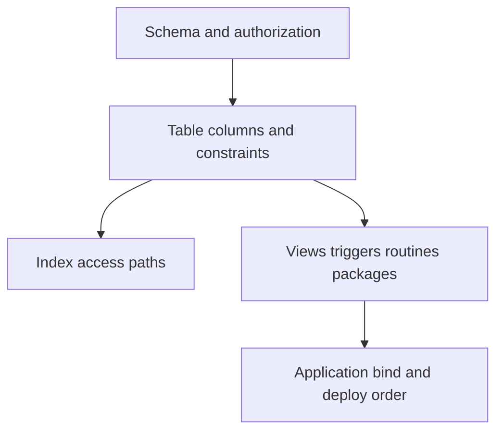

# C-02 — Schemas, tables, data types, indexes, constraints, and dependencies

**Procedure status: NOT YET EXECUTED.** This is a teaching procedure for Db2 LUW 12.1.0 on Linux x86-64, single-member topology. The exact fix pack is not pinned. Engine commands run on the Db2 server as the named instance/database authority; client checks run on the client; OS commands run on the named host and normally require read-only access. Windows, AIX, DPF, and pureScale differences are called out where material. The supplied environment has no Db2 CLI or disposable Db2 server, so no lab command is claimed as executed. Before production use, confirm each command against the installed fix pack and local change controls.

## 1. Quick answer

Use this lesson to make a bounded DBA decision about schema/authorization boundaries, data types null/default identity/generated columns, PK unique FK check constraints. The key is to identify the failing layer and scope before changing state.

**Safest first step:** Capture the current target, timestamp, release, and read-only state before acting.

## 2. Learn the concept

The useful mental model is to follow schema/authorization boundaries; data types null/default identity/generated columns; PK unique FK check constraints; composite/unique/partitioned index tradeoffs; views aliases MQTs triggers routines packages; dependency inspection and DDL rollback; LOB XML temporal and organized-table restrictions from the service boundary inward. Record who owns each boundary and which evidence is authoritative there.

### Working model

Scope: schema/authorization boundaries → data types null/default identity/generated columns → PK unique FK check constraints → composite/unique/partitioned index tradeoffs → views aliases MQTs triggers routines packages → dependency inspection and DDL rollback → LOB XML temporal and organized-table restrictions. The arrows represent dependency, not proof of a fault. Confirm each hop independently.



## 3. Choose an approach

| Variant | Choose it when | Do not choose it when / boundary |
|---|---|---|
| Table definition | Choose types/nullability/key rules from business semantics. | Changing a type may rewrite data and invalidate dependents. |
| Index design | Key order follows predicate, join and ordering patterns. | Every index consumes storage and adds write/maintenance cost. |
| Dependencies | Capture object graph before DDL and deploy in dependency order. | Drop/recreate is not a safe rollback if data or grants are lost. |

## 4. Understand the lifecycle

- Model keys and domain values.
- Create schema/table and integrity rules.
- Add only justified indexes and dependent objects.
- Inspect catalog and explain dependencies.
- Deploy change in a transaction/change window and validate applications.

**Pause/retry/stop/rollback rule:** Stop if the target identity, current state, authority, or rollback dependency is uncertain; preserve evidence and escalate.

## 5. Do the work

### Precheck

- Export DDL and grants before change.
- Check object owner, dependent packages/views/triggers and row count.
- Review special types and table organization limitations for target Db2 level.

### Scoped procedures

### Procedure 1: Create a keyed object

**Status:** NOT YET EXECUTED. **Run as:** Authorized schema owner. **Target:** APP schema in disposable database. **Authority/prerequisite:** Schema exists; choose numeric precision from domain rules.

```bash
CREATE TABLE APP.ORDER_LINE (order_id BIGINT NOT NULL, line_no SMALLINT NOT NULL, sku INTEGER NOT NULL, quantity DECIMAL(9,2) NOT NULL CHECK (quantity > 0), PRIMARY KEY (order_id, line_no));
```

**Expected result:** Table and PK/check constraints are created.

**Independent check:** Inspect SYSCAT.TABLES, SYSCAT.COLUMNS, SYSCAT.TABCONST and insert valid/invalid lab rows.

**Stop/rollback boundary:** Drop only the empty lab table after checking dependents.

### Procedure 2: Index and dependency capture

**Status:** NOT YET EXECUTED. **Run as:** Schema owner and catalog reader. **Target:** APP.ORDER_LINE. **Authority/prerequisite:** Use plan evidence to justify key order; SQL query is read-only.

```bash
CREATE INDEX APP.IX_ORDER_LINE_SKU ON APP.ORDER_LINE (sku, order_id);
SELECT tabschema, tabname, type FROM syscat.tables WHERE tabschema = 'APP' ORDER BY tabname;
```

**Expected result:** Index exists; catalog inventory lists objects in APP.

**Independent check:** Explain representative query and compare index usage after workload sample.

**Stop/rollback boundary:** Drop only the index if plan/workload proof shows it is unnecessary.

## 6. Worked example and verification

For `WHERE sku=? AND order_id=?`, a `(sku, order_id)` index may filter efficiently, while a primary key `(order_id, line_no)` serves a different access path. Measure reads and writes before retaining both.

**Expected state/result:** Object DDL, type/null semantics, constraints, grants, indexes, and dependent objects are captured and verified.

**Independent verification:**

- Compare the post-state with the captured pre-state.
- Confirm the intended service or data outcome independently of the command return code.

## 7. Diagnose problems

| Symptom or verified error | Evidence to collect | Likely cause | Safe correction and recheck | Avoid |
|---|---|---|---|---|
| Application insert fails after adding NOT NULL column. | SQLCODE/STATE, deploy order, default/generated behavior and application binds. | Existing rows or insert statements do not provide a legal value. | Use a staged migration: compatible default/backfill, deploy app, then enforce constraint after validation. | Adding NOT NULL with an arbitrary value that misrepresents existing data. |
| New index does not appear in chosen plan. | statistics timestamp/cardinality, predicates/types and EXPLAIN output. | Stale/missing stats, incompatible expression/type, or cost favors another access path. | Update relevant statistics and inspect estimates; test rewrite/index only in workload replay. | Forcing an index before understanding plan estimates. |

## 8. Practice

Build APP.ORDER_LINE with a primary key, check constraint and secondary index. Attempt one invalid row, read the exact SQLSTATE, then explain a filter on sku. Cleanup in dependency order: remove dependents, index and table.

## 9. Check understanding

**Question:** Why can adding an index reduce overall throughput?

**Answer and reasoning:** It adds storage, logging and maintenance to inserts/updates/deletes, plus backup and REORG work. Compare total workload benefit against write cost.

## 10. Look it up later

### Short checklist

- Name the target and scope.
- Collect a baseline and confirm prerequisites.
- Choose the least disruptive supported branch.
- Verify state and service behavior.
- Record evidence and recovery limits.

### Related lessons

[C-03](../C/C-03.md) · [C-07](../C/C-07.md) · [H-02](../H/H-02.md) · [H-04](../H/H-04.md) · [I-04](../I/I-04.md)

### Authoritative references

- [IBM monitoring interfaces](https://www.ibm.com/docs/en/db2/12.1.x?topic=monitoring-interfaces-database)
- [IBM Db2 catalog views](https://www.ibm.com/docs/en/db2/12.1.x?topic=views-catalog-views)

---

[Domain index](README.md) · [Course index](../README.md) · [Glossary](../GLOSSARY.md)
