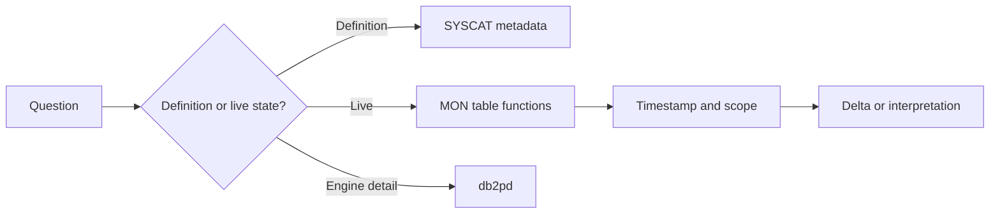

# C-03 — Db2 catalogs, administrative views, monitor functions, and snapshots

**Procedure status: NOT YET EXECUTED.** This is a teaching procedure for Db2 LUW 12.1.0 on Linux x86-64, single-member topology. The exact fix pack is not pinned. Engine commands run on the Db2 server as the named instance/database authority; client checks run on the client; OS commands run on the named host and normally require read-only access. Windows, AIX, DPF, and pureScale differences are called out where material. The supplied environment has no Db2 CLI or disposable Db2 server, so no lab command is claimed as executed. Before production use, confirm each command against the installed fix pack and local change controls.

## 1. Quick answer

Use this lesson to make a bounded DBA decision about SYSCAT metadata versus SYSIBM internals, read-only inventory queries, administrative views. The key is to identify the failing layer and scope before changing state.

**Safest first step:** Capture the current target, timestamp, release, and read-only state before acting.

## 2. Learn the concept

The useful mental model is to follow SYSCAT metadata versus SYSIBM internals; read-only inventory queries; administrative views; MON_GET current measures; legacy SNAP_GET and cumulative counters; db2pd engine evidence; catalog/version/privilege/no-data interpretation from the service boundary inward. Record who owns each boundary and which evidence is authoritative there.

### Working model

Scope: SYSCAT metadata versus SYSIBM internals → read-only inventory queries → administrative views → MON_GET current measures → legacy SNAP_GET and cumulative counters → db2pd engine evidence → catalog/version/privilege/no-data interpretation. The arrows represent dependency, not proof of a fault. Confirm each hop independently.



## 3. Choose an approach

| Variant | Choose it when | Do not choose it when / boundary |
|---|---|---|
| Catalog query | Use for stable object definitions and privileges. | Catalog metadata is not a live workload sample. |
| MON table function | Use for current or cumulative database metrics with member scope. | Counter totals need interval deltas; newer output columns can be added. |
| db2pd/snapshot | Use engine-level or legacy evidence where it adds value. | Snapshot monitor is older and no longer enhanced. |

## 4. Understand the lifecycle

- Ask whether the question is metadata or runtime behavior.
- Select catalog, MON function, db2pd or event evidence.
- Name columns explicitly and specify scope/member.
- Take two samples when rate/delta is required.
- Explain empty result, privileges and data freshness.

**Pause/retry/stop/rollback rule:** Stop if the target identity, current state, authority, or rollback dependency is uncertain; preserve evidence and escalate.

## 5. Do the work

### Precheck

- Capture release and privileges of the querying identity.
- Avoid SELECT * from monitor functions; future versions can add columns.
- Record sample timestamps and member IDs.

### Scoped procedures

### Procedure 1: Object inventory

**Status:** NOT YET EXECUTED. **Run as:** Catalog reader. **Target:** Current connected database catalog. **Authority/prerequisite:** Read-only SELECT; schema is a synthetic filter.

```bash
SELECT tabschema, tabname, type, create_time FROM syscat.tables WHERE tabschema = 'APP' ORDER BY tabname;
```

**Expected result:** APP object names/types/timestamps are listed.

**Independent check:** Compare object count with DDL/deployment inventory.

**Stop/rollback boundary:** Read-only; grant minimum catalog access if rows are hidden.

### Procedure 2: Live connection sample

**Status:** NOT YET EXECUTED. **Run as:** User with monitor authority. **Target:** Connected database member scope. **Authority/prerequisite:** MON_GET is for connected database; specify needed columns.

```bash
SELECT application_handle, client_hostname, client_applname FROM TABLE(mon_get_connection(NULL,-2)) AS c
```

**Expected result:** Current connections, clients and application names appear.

**Independent check:** Repeat after interval for state change; compare with db2pd on member.

**Stop/rollback boundary:** Read-only; event/statement text collection has privacy and overhead implications.

## 6. Worked example and verification

A query against SYSCAT.TABLES returns all tables, while MON_GET_CONNECTION returns no rows. These outputs answer different questions; if the database has no connections besides the observer, empty runtime data can be correct.

**Expected state/result:** Every result has a defined scope, timestamp and metric meaning; catalog inventory is not mistaken for performance telemetry.

**Independent verification:**

- Compare the post-state with the captured pre-state.
- Confirm the intended service or data outcome independently of the command return code.

## 7. Diagnose problems

| Symptom or verified error | Evidence to collect | Likely cause | Safe correction and recheck | Avoid |
|---|---|---|---|---|
| Monitor query returns no rows while users report active sessions. | connection alias, monitor privilege, member scope and server identity. | Connected to wrong database/member or monitor function scope/privilege mismatch. | Verify current server/user and query supported member scope; compare db2pd on correct host. | Assuming empty means no activity. |
| Counter increased but team calls it a rate. | two timestamped samples, database/member resets, metric definition. | Cumulative counter interpreted without a time interval. | Compute delta per elapsed seconds and handle reset/wrap semantics. | Alerting on lifetime totals as if they were per-second metrics. |

## 8. Practice

Run an object catalog query and a MON_GET_TABLESPACE query at two timestamps. Label which fields are definitions, gauges, or cumulative counters; explain why a zero-row monitor result can be valid.

## 9. Check understanding

**Question:** Why should queries name columns rather than use `SELECT *` on MON routines?

**Answer and reasoning:** IBM can add output columns in later releases; explicit projection keeps scripts stable and documents which metrics matter.

## 10. Look it up later

### Short checklist

- Name the target and scope.
- Collect a baseline and confirm prerequisites.
- Choose the least disruptive supported branch.
- Verify state and service behavior.
- Record evidence and recovery limits.

### Related lessons

[E-03](../E/E-03.md) · [E-05](../E/E-05.md) · [E-06](../E/E-06.md) · [C-02](../C/C-02.md)

### Authoritative references

- [IBM monitoring interfaces](https://www.ibm.com/docs/en/db2/12.1.x?topic=monitoring-interfaces-database)
- [IBM MON routines](https://www.ibm.com/docs/en/db2/12.1.x?topic=functions-monitor-mon-routines)

---

[Domain index](README.md) · [Course index](../README.md) · [Glossary](../GLOSSARY.md)
