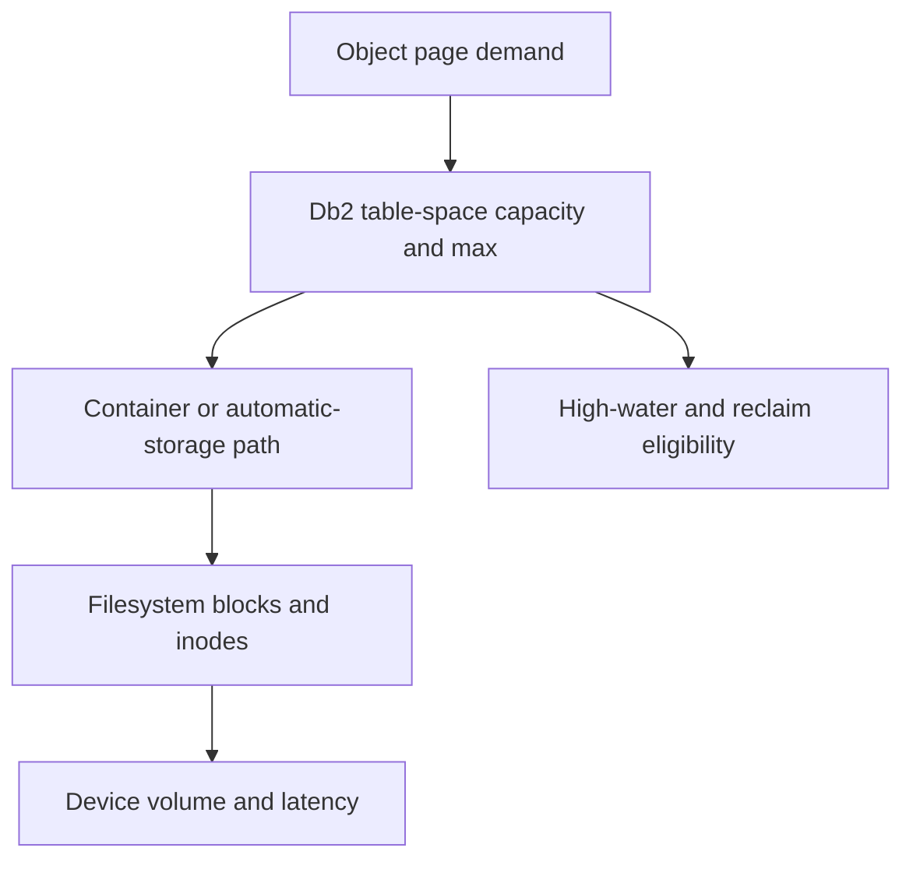

# C-04 — Tablespaces, storage groups, containers, AUTORESIZE, and space reclamation

**Procedure status: NOT YET EXECUTED.** This is a teaching procedure for Db2 LUW 12.1.0 on Linux x86-64, single-member topology. The exact fix pack is not pinned. Engine commands run on the Db2 server as the named instance/database authority; client checks run on the client; OS commands run on the named host and normally require read-only access. Windows, AIX, DPF, and pureScale differences are called out where material. The supplied environment has no Db2 CLI or disposable Db2 server, so no lab command is claimed as executed. Before production use, confirm each command against the installed fix pack and local change controls.

## 1. Quick answer

Use this lesson to make a bounded DBA decision about regular/large/temp/system spaces, automatic storage versus DMS/SMS legacy, page extent and bufferpool mapping. The key is to identify the failing layer and scope before changing state.

**Safest first step:** Capture the current target, timestamp, release, and read-only state before acting.

## 2. Learn the concept

The useful mental model is to follow regular/large/temp/system spaces; automatic storage versus DMS/SMS legacy; page extent and bufferpool mapping; storage groups and containers; AUTORESIZE and MAXSIZE; add drop extend rebalance; tablespace state and high-water reclaim; SQL0289N blocks/inodes versus logical capacity from the service boundary inward. Record who owns each boundary and which evidence is authoritative there.

### Working model

Scope: regular/large/temp/system spaces → automatic storage versus DMS/SMS legacy → page extent and bufferpool mapping → storage groups and containers → AUTORESIZE and MAXSIZE → add drop extend rebalance → tablespace state and high-water reclaim → SQL0289N blocks/inodes versus logical capacity. The arrows represent dependency, not proof of a fault. Confirm each hop independently.



## 3. Choose an approach

| Variant | Choose it when | Do not choose it when / boundary |
|---|---|---|
| Automatic storage | Prefer managed paths and controlled growth where supported. | Growth still needs filesystem capacity and max limits. |
| DMS containers | Use when explicit container layout/legacy compatibility is required. | AUTORESIZE has restrictions, including raw devices. |
| Reclaimable storage | Lower high-water mark or reduce containers after data is eligible. | Free extents inside a table space do not automatically free OS blocks. |

## 4. Understand the lifecycle

- Identify table-space type and storage group/container paths.
- Measure utilization, high-water mark, filesystem blocks and inodes.
- Choose grow, rebalance, reclaim or data movement.
- Run the state-changing operation with enough path headroom.
- Monitor extent movement and recheck table-space plus OS capacity.

**Pause/retry/stop/rollback rule:** Stop if the target identity, current state, authority, or rollback dependency is uncertain; preserve evidence and escalate.

## 5. Do the work

### Precheck

- List tablespaces, containers, buffer pools, `AUTORESIZE`, MAXSIZE and pending state.
- Confirm every storage path has capacity, permission and redundancy.
- Check active backup/restore/rebalance conflicts.

### Scoped procedures

### Procedure 1: Table-space monitor

**Status:** NOT YET EXECUTED. **Run as:** Monitor-authorized database user. **Target:** All visible table spaces in current member scope. **Authority/prerequisite:** Column names are explicit; verify function columns in installed level.

```bash
SELECT tbsp_name, tbsp_type, tbsp_state, tbsp_utilization_percent FROM TABLE(mon_get_tablespace(NULL,-2)) AS t
```

**Expected result:** Table space type, state and utilization are returned.

**Independent check:** Compare Db2 usage/high-water with filesystem `df` and container paths.

**Stop/rollback boundary:** Read-only; do not reclaim before eligibility and free-space estimate.

### Procedure 2: Bounded automatic growth

**Status:** NOT YET EXECUTED. **Run as:** Tablespace administrator/DBA. **Target:** APPDATA automatic-storage/DMS eligible table space. **Authority/prerequisite:** Confirm exact type, supported options, disk headroom and change window.

```bash
ALTER TABLESPACE APPDATA AUTORESIZE YES INCREASESIZE 256 M MAXSIZE 40 G
```

**Expected result:** Growth policy and maximum are updated at catalog level.

**Independent check:** Read current table-space attributes and test controlled growth in lab.

**Stop/rollback boundary:** Restore captured AUTORESIZE/INCREASESIZE/MAXSIZE values if no growth operation has begun; once extended, data movement/reclaim may be required.

## 6. Worked example and verification

The Db2 space alert is 98%, but filesystem has 60% free and AUTORESIZE is disabled. If the table space is eligible, enable bounded growth after confirming its path, max size and planned capacity; do not resize the filesystem as a substitute for logical-space diagnosis.

**Expected state/result:** Logical table-space utilization, containers/storage groups, Db2 high-water and OS capacity are distinguished.

**Independent verification:**

- Compare the post-state with the captured pre-state.
- Confirm the intended service or data outcome independently of the command return code.

## 7. Diagnose problems

| Symptom or verified error | Evidence to collect | Likely cause | Safe correction and recheck | Avoid |
|---|---|---|---|---|
| SQL0289N reports no space available. | table-space state/utilization, max size, container and `df -h`/`df -i`. | Logical maximum, filesystem block/inode exhaustion or container path permission. | Add capacity in the correct layer, then rerun a bounded transaction and verify table-space state. | Dropping an arbitrary container while it may hold extents. |
| Db2 frees extents but OS usage does not drop. | table-space HWM, container size, storage type and MON_GET_EXTENT_MOVEMENT_STATUS. | Space is available inside container but not released from container/filesystem. | Use supported reclaim/reduce after eligible extents consolidate; verify both Db2 and OS. | Claiming REORG always returns blocks to the operating system. |

## 8. Practice

Create an automatic-storage tablespace in a disposable database with a small bounded maximum. Observe initial allocation and monitor view. Use documentation to compare `LOWER HIGH WATER MARK` and `REDUCE`; do not fill disks intentionally. Cleanup: drop lab tablespace only after checking it contains no other objects.

## 9. Check understanding

**Question:** What does `LOWER HIGH WATER MARK` prove?

**Answer and reasoning:** It attempts to lower the table-space high-water mark by moving extents; it does not by itself prove the storage container/file was physically reduced. Check the selected `REDUCE` behavior and OS path.

## 10. Look it up later

### Short checklist

- Name the target and scope.
- Collect a baseline and confirm prerequisites.
- Choose the least disruptive supported branch.
- Verify state and service behavior.
- Record evidence and recovery limits.

### Related lessons

[A-04](../A/A-04.md) · [C-06](../C/C-06.md) · [F-08](../F/F-08.md) · [K-01](../K/K-01.md)

### Authoritative references

- [IBM CREATE TABLESPACE reference](https://www.ibm.com/docs/en/db2/12.1.x?topic=statements-create-tablespace)
- [IBM ALTER TABLESPACE reference](https://www.ibm.com/docs/en/db2/12.1.x?topic=statements-alter-tablespace)
- [IBM reclaimable storage](https://www.ibm.com/docs/en/db2/12.1.x?topic=management-reclaimable-storage)

---

[Domain index](README.md) · [Course index](../README.md) · [Glossary](../GLOSSARY.md)
