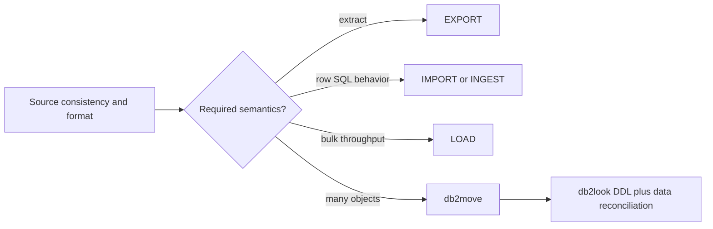

# C-05 — EXPORT, IMPORT, LOAD, INGEST, db2move, and db2look

**Procedure status: NOT YET EXECUTED.** This is a teaching procedure for Db2 LUW 12.1.0 on Linux x86-64, single-member topology. The exact fix pack is not pinned. Engine commands run on the Db2 server as the named instance/database authority; client checks run on the client; OS commands run on the named host and normally require read-only access. Windows, AIX, DPF, and pureScale differences are called out where material. The supplied environment has no Db2 CLI or disposable Db2 server, so no lab command is claimed as executed. Before production use, confirm each command against the installed fix pack and local change controls.

## 1. Quick answer

Use this lesson to make a bounded DBA decision about EXPORT formats consistency and hidden columns, IMPORT insert/replace commit/restart, LOAD phases copy/constraints/restart/terminate. The key is to identify the failing layer and scope before changing state.

**Safest first step:** Capture the current target, timestamp, release, and read-only state before acting.

## 2. Learn the concept

The useful mental model is to follow EXPORT formats consistency and hidden columns; IMPORT insert/replace commit/restart; LOAD phases copy/constraints/restart/terminate; INGEST merge/update and restart keys; db2move scale and staging files; db2look DDL capture not data; reject/message files and post-load verification from the service boundary inward. Record who owns each boundary and which evidence is authoritative there.

### Working model

Scope: EXPORT formats consistency and hidden columns → IMPORT insert/replace commit/restart → LOAD phases copy/constraints/restart/terminate → INGEST merge/update and restart keys → db2move scale and staging files → db2look DDL capture not data → reject/message files and post-load verification. The arrows represent dependency, not proof of a fault. Confirm each hop independently.



## 3. Choose an approach

| Variant | Choose it when | Do not choose it when / boundary |
|---|---|---|
| EXPORT | SQL SELECT into DEL or IXF; rows honor authorization/RCAC. | Export overwrites existing file; protect sensitive output. |
| IMPORT | SQL-level insertion/update workflows with constraints/triggers behavior. | Usually slower than LOAD; understand commit and restart. |
| LOAD | High-volume utility with phases, access restrictions and recovery states. | COPY/LOGGING and pending-state consequences must be designed. |
| INGEST | SQL-driven incremental insert/update/merge with restart semantics. | Not a synonym for LOAD; syntax and restart table differ. |
| db2move/db2look | Move many tables or extract DDL/statistics information. | Neither alone is a complete cross-version migration/reconciliation. |

## 4. Understand the lifecycle

- Define source consistency, target object, volume and allowed outage.
- Choose utility based on transactional semantics, constraints, triggers and recovery.
- Precheck file encoding, code page, columns, keys, logging and copy path.
- Run scoped utility and retain message/reject/exception files.
- Validate rows, keys, dependent objects, statistics and backup/recoverability.

**Pause/retry/stop/rollback rule:** Stop if the target identity, current state, authority, or rollback dependency is uncertain; preserve evidence and escalate.

## 5. Do the work

### Precheck

- Compare table DDL on source/target and test representative data types.
- Check remaining table-space/log capacity and all required paths.
- Record counts/checksums and decide whether concurrent writes are allowed.

### Scoped procedures

### Procedure 1: Delimited export

**Status:** NOT YET EXECUTED. **Run as:** Database user with SELECT/DATAACCESS. **Target:** Source SAMPLE database; file written on server host for direct engine utility. **Authority/prerequisite:** Ensure output path is private and does not exist if overwrite is unsafe.

```bash
EXPORT TO /tmp/items.del OF DEL MESSAGES /tmp/items.exp.msg SELECT item_id, description FROM APP.ITEMS WHERE active = 1
```

**Expected result:** Selected rows are written in DEL format; messages describe warnings/errors.

**Independent check:** Count and checksum output; compare selected source rows and protect sensitive data.

**Stop/rollback boundary:** Remove only this lab export after verifying path and retention.

### Procedure 2: Transactional import

**Status:** NOT YET EXECUTED. **Run as:** Database user with required insert privileges. **Target:** Disposable staging table on target. **Authority/prerequisite:** Staging table empty; validate input and use a private message file.

```bash
IMPORT FROM /tmp/items.del OF DEL COMMITCOUNT 500 INSERT INTO APP.ITEMS_STG
```

**Expected result:** Rows insert in commit batches; warning/reject counts appear.

**Independent check:** Compare source and target counts/keys; inspect import messages before promotion.

**Stop/rollback boundary:** If partial commits occurred, truncate only the disposable staging table after confirmation.

### Procedure 3: Bulk LOAD with copy

**Status:** NOT YET EXECUTED. **Run as:** Instance/database utility authority. **Target:** Server-side target staging table. **Authority/prerequisite:** Archive logging/copy destination/storage and table constraints checked.

```bash
LOAD FROM /tmp/items.del OF DEL INSERT INTO APP.ITEMS_STG COPY YES TO /db2backup/loadcopy MESSAGES /tmp/items.load.msg
```

**Expected result:** LOAD completes through utility phases; copy image and message file are produced.

**Independent check:** Check LOAD status, table access/pending state, counts, indexes, constraints, and later backup chain.

**Stop/rollback boundary:** Failed job: use documented LOAD RESTART or TERMINATE based on phase; do not blindly rerun.

### Procedure 4: Restartable INGEST

**Status:** NOT YET EXECUTED. **Run as:** Authorized database user. **Target:** Server-side APP.ITEMS_STG. **Authority/prerequisite:** Restart name unique; input schema and SQL types are reviewed; quote `$field` names if shell command.

```bash
INGEST FROM FILE /tmp/items.del FORMAT DELIMITED RESTART NEW 'items-load-20261027' INSERT INTO APP.ITEMS_STG;
```

**Expected result:** INGEST records a restart identity and inserts according to SQL semantics.

**Independent check:** Check command output, target keys/count and restart metadata; test RESTART CONTINUE in lab only.

**Stop/rollback boundary:** Use RESTART TERMINATE for the intended failed job if abandoning; do not reuse an active restart token.

### Procedure 5: Schema movement and DDL capture

**Status:** NOT YET EXECUTED. **Run as:** Instance owner / schema reader. **Target:** Source database APP schema. **Authority/prerequisite:** Run on server with db2move installed; secure files may include business schema.

```bash
db2move SAMPLE EXPORT -sn APP; db2look -d SAMPLE -e -z APP -o /tmp/app.ddl
```

**Expected result:** db2move stages selected data; db2look writes DDL to output file.

**Independent check:** Review object dependencies and compare data separately on destination.

**Stop/rollback boundary:** Delete generated files only after release evidence and retention review.

## 6. Worked example and verification

For a high-volume initial load, LOAD may be chosen, but only after a recovery copy/pending-state plan is set. For daily keyed merges, INGEST or SQL may better preserve row-level semantics. The source file size alone does not decide.

**Expected state/result:** The chosen utility, target access state, restart path, message outputs, row reconciliation and post-operation maintenance are explicit.

**Independent verification:**

- Compare the post-state with the captured pre-state.
- Confirm the intended service or data outcome independently of the command return code.

## 7. Diagnose problems

| Symptom or verified error | Evidence to collect | Likely cause | Safe correction and recheck | Avoid |
|---|---|---|---|---|
| LOAD ends but target is read access only or load pending. | LOAD messages/status, `ADMIN_GET_TAB_INFO`, utility history and recovery log config. | Failed/interrupted LOAD or recovery-copy/logging condition. | Choose LOAD RESTART/TERMINATE and table-state completion action from the documented current phase. | Issuing a new LOAD INSERT over the unfinished operation. |
| EXPORT/IMPORT totals differ or data is truncated. | message files, code page/file modifiers, hidden columns, delimiters and key-level reconciliation. | Format/encoding/column order loss or warning rows excluded from db2move list. | Correct format or mapping and reload into a clean staging target; reconcile every key. | Treating a zero process code as proof of semantic equality. |
| INGEST retry duplicates or refuses restart. | restart name state, target key counts and original job message. | New restart identity used instead of CONTINUE, or original job already committed rows. | Inspect restart metadata; resume exact job or terminate and reconcile target before a new identity. | Deleting restart metadata without reconciling committed rows. |

## 8. Practice

Prepare a small synthetic input with one valid row, one duplicate key and one malformed numeric field. Run each utility separately against disposable staging tables. Compare triggers/constraints, messages and restart behavior. Cleanup each staging table and remove only the generated lab files.

## 9. Check understanding

**Question:** Which utilities can preserve row-level SQL semantics and which optimize bulk movement?

**Answer and reasoning:** IMPORT/INGEST execute SQL-oriented row semantics; LOAD uses high-throughput utility phases with distinct constraint, trigger, copy and table-state behavior. EXPORT, db2move and db2look solve extraction/movement/DDL capture tasks, not full integrity proof.

## 10. Look it up later

### Short checklist

- Name the target and scope.
- Collect a baseline and confirm prerequisites.
- Choose the least disruptive supported branch.
- Verify state and service behavior.
- Record evidence and recovery limits.

### Related lessons

[C-02](../C/C-02.md) · [C-07](../C/C-07.md) · [F-03](../F/F-03.md) · [F-04](../F/F-04.md) · [I-04](../I/I-04.md)

### Authoritative references

- [IBM EXPORT command](https://www.ibm.com/docs/en/db2/12.1.x?topic=commands-export)
- [IBM LOAD overview](https://www.ibm.com/docs/en/db2/12.1.x?topic=utility-load-overview)
- [IBM INGEST command](https://www.ibm.com/docs/en/db2/12.1.x?topic=commands-ingest)
- [IBM db2move command](https://www.ibm.com/docs/en/db2/12.1.x?topic=commands-db2move-database-movement-tool)
- [IBM IMPORT command](https://www.ibm.com/docs/en/db2/12.1.x?topic=commands-import)
- [IBM db2look command](https://www.ibm.com/docs/en/db2/12.1.x?topic=commands-db2look)

---

[Domain index](README.md) · [Course index](../README.md) · [Glossary](../GLOSSARY.md)
