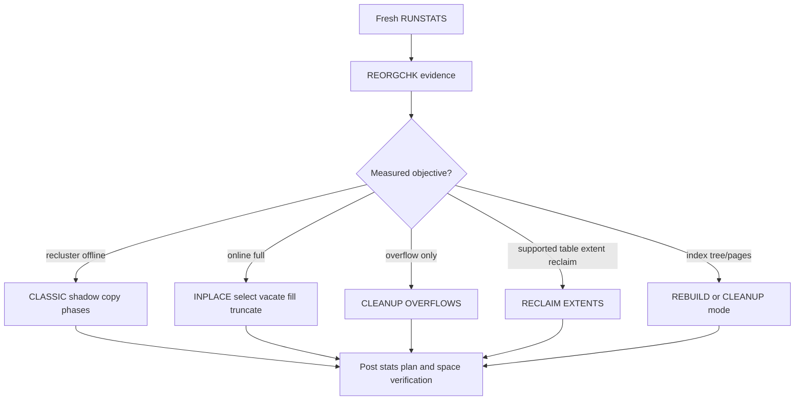

# C-06 — RUNSTATS, REORGCHK, table REORG, index REORG, types, phases, and monitoring

**Procedure status: NOT YET EXECUTED.** This is a teaching procedure for Db2 LUW 12.1.0 on Linux x86-64, single-member topology. The exact fix pack is not pinned. Engine commands run on the Db2 server as the named instance/database authority; client checks run on the client; OS commands run on the named host and normally require read-only access. Windows, AIX, DPF, and pureScale differences are called out where material. The supplied environment has no Db2 CLI or disposable Db2 server, so no lab command is claimed as executed. Before production use, confirm each command against the installed fix pack and local change controls.

## 1. Quick answer

Use this lesson to make a bounded DBA decision about RUNSTATS table/index/column/distribution/column groups/profiles, REORGCHK formulas and limitations, CLASSIC offline shadow-copy table REORG. The key is to identify the failing layer and scope before changing state.

**Safest first step:** Capture the current target, timestamp, release, and read-only state before acting.

## 2. Learn the concept

The useful mental model is to follow RUNSTATS table/index/column/distribution/column groups/profiles; REORGCHK formulas and limitations; CLASSIC offline shadow-copy table REORG; INPLACE FULL and CLEANUP OVERFLOWS; RECLAIM EXTENTS eligible table types; index REBUILD/CLEANUP PAGES/CLEANUP ALL/RECLAIM EXTENTS; phases progress pause/resume/stop and OLR state; partition scope temp/log/space/resource/post-RUNSTATS from the service boundary inward. Record who owns each boundary and which evidence is authoritative there.

### Working model

Scope: RUNSTATS table/index/column/distribution/column groups/profiles → REORGCHK formulas and limitations → CLASSIC offline shadow-copy table REORG → INPLACE FULL and CLEANUP OVERFLOWS → RECLAIM EXTENTS eligible table types → index REBUILD/CLEANUP PAGES/CLEANUP ALL/RECLAIM EXTENTS → phases progress pause/resume/stop and OLR state → partition scope temp/log/space/resource/post-RUNSTATS. The arrows represent dependency, not proof of a fault. Confirm each hop independently.



## 3. Choose an approach

| Variant | Choose it when | Do not choose it when / boundary |
|---|---|---|
| RUNSTATS | Refresh optimizer statistics after meaningful data change. | It changes statistics, not row layout. |
| CLASSIC table REORG | Choose for predictable offline window and best reclustering. | Requires shadow/temporary space and has access/locking phases; not pause/resume. |
| INPLACE FULL | Choose when online access matters and table is eligible. | Slower; default truncate phase takes an S lock; partitioned table requires ON DATA PARTITION. |
| CLEANUP OVERFLOWS | Convert pointer/overflow rows without full reclustering. | Does not shrink table size. |
| RECLAIM EXTENTS | Use only supported MDC/ITC/column-organized table types. | Does not mean a general table REORG. |
| Index REORG | REBUILD rebuilds tree; cleanup modes remove pseudo-deleted/empty pages; reclaim releases eligible extents. | Cleanup-only progress may not appear in db2pd reorg list. |

## 4. Understand the lifecycle

- Collect table/index stats with RUNSTATS and interpret REORGCHK as advice, not a mandate.
- Choose table or index operation by goal, access mode, eligibility and resource budget.
- Precheck free pages, temporary space, active log, old scanners, partition and recovery.
- Start one utility; monitor phase/count/access and resource use.
- Pause/resume/stop only online operation using supported state; do not remove `.OLR`.
- Run appropriate RUNSTATS/plan checks and verify object/table-space/OS space result.

**Pause/retry/stop/rollback rule:** Stop if the target identity, current state, authority, or rollback dependency is uncertain; preserve evidence and escalate.

## 5. Do the work

### Precheck

- Use current `REORG TABLE`, `REORG INDEXES`, `REORGCHK` and db2pd docs for exact level.
- Check table organization, append mode, XML/extended/expression indexes and partitioning restrictions.
- Estimate shadow/temp space for CLASSIC and active-log usage; online access does not mean zero impact.
- Capture current table statistics, index design, workload and table-space high-water.

### Scoped procedures

### Procedure 1: Statistics by workload-relevant columns

**Status:** NOT YET EXECUTED. **Run as:** Database maintenance authority/table control. **Target:** APP.ORDERS current database partition scope. **Authority/prerequisite:** Confirm schema and cardinality objective; schedule resource window.

```bash
RUNSTATS ON TABLE APP.ORDERS WITH DISTRIBUTION ON COLUMNS (STATUS, REGION) AND DETAILED INDEXES ALL
```

**Expected result:** Catalog statistics refresh for selected columns and indexes.

**Independent check:** Inspect SYSCAT.TABLES/SYSCAT.COLUMNS stats timestamps and compare EXPLAIN estimates.

**Stop/rollback boundary:** Statistics are not transactionally rolled back; restore by rerunning the former statistics profile/data state only if justified.

### Procedure 2: Evaluate reorganization evidence

**Status:** NOT YET EXECUTED. **Run as:** DBA with required authority. **Target:** APP.ORDERS current partition. **Authority/prerequisite:** Ensure statistics are current; prefer no UPDATE STATISTICS side effect during diagnosis.

```bash
REORGCHK CURRENT STATISTICS ON TABLE APP.ORDERS
```

**Expected result:** Formula output flags possible table/index reorganization benefit.

**Independent check:** Inspect table/index pages, overflow, clustering and measured query plans before action.

**Stop/rollback boundary:** Read-only decision; do not launch REORG from a formula flag alone.

### Procedure 3: CLASSIC offline table reorganization

**Status:** NOT YET EXECUTED. **Run as:** DBA / table control authority. **Target:** APP.ORDERS (scope follows database partition group; data partition clause as applicable). **Authority/prerequisite:** Plan access window, shadow/temp and active log capacity; confirm applications are quiesced or read-only behavior acceptable.

```bash
REORG TABLE APP.ORDERS CLASSIC
```

**Expected result:** Shadow copy is built and original replaced; indexes are recreated; utility terminates complete.

**Independent check:** Use LIST UTILITIES, db2pd -reorgs, catalog data and application smoke test; check table-space use.

**Stop/rollback boundary:** CLASSIC cannot be paused/resumed. On interruption use documented recovery/REORG state path; do not delete shadow files.

### Procedure 4: INPLACE FULL online table REORG

**Status:** NOT YET EXECUTED. **Run as:** DBA / table control authority. **Target:** Eligible non-append non-MDC/non-ITC non-expression/XML-index table; partitioned requires ON DATA PARTITION. **Authority/prerequisite:** Check eligibility; budget runtime, logs and concurrent DML. Default truncation causes S-lock pause in updates.

```bash
REORG TABLE APP.ORDERS INPLACE FULL ALLOW WRITE ACCESS
```

**Expected result:** Rows move through selected range, vacate, fill and default truncate phases; table stays available except truncate interval.

**Independent check:** Monitor `db2pd -db SAMPLE -reorgs`; table info status; sample blocked old scanners and verify physical/plan outcomes.

**Stop/rollback boundary:** PAUSE/RESUME/STOP only for in-place work. RESUME must restate important options; preserve `.OLR` files.

### Procedure 5: INPLACE cleanup and extent reclamation

**Status:** NOT YET EXECUTED. **Run as:** DBA / table control authority. **Target:** Eligible APP.ORDERS plus supported MDC/ITC/column-organized CUBE_FACT. **Authority/prerequisite:** Confirm separate eligibility: cleanup converts pointer/overflow records; table RECLAIM EXTENTS is restricted.

```bash
REORG TABLE APP.ORDERS INPLACE CLEANUP OVERFLOWS; REORG TABLE APP.CUBE_FACT RECLAIM EXTENTS
```

**Expected result:** First operation cleans overflows; second consolidates/reclaims extents; neither is general classic reclustering.

**Independent check:** Check table status, extent movement and measured table-space/file sizes independently.

**Stop/rollback boundary:** Stop only according to that operation docs; do not assume cleanup shrinks OS file.

### Procedure 6: Index rebuild and cleanup choices

**Status:** NOT YET EXECUTED. **Run as:** DBA / table control authority. **Target:** Indexes on APP.ORDERS. **Authority/prerequisite:** Check access-mode lock impact and select all versus named index; CLEANUP PAGES is not REBUILD.

```bash
REORG INDEXES ALL FOR TABLE APP.ORDERS ALLOW WRITE ACCESS; REORG INDEXES ALL FOR TABLE APP.ORDERS ALLOW WRITE ACCESS CLEANUP PAGES
```

**Expected result:** REBUILD creates new index trees; CLEANUP PAGES removes eligible pseudo-deleted pages.

**Independent check:** Monitor rebuild with `db2pd -db SAMPLE -reorgs index`; cleanup-only can have no running entry; check index pages/plan.

**Stop/rollback boundary:** Do not issue a second index REORG concurrently on same index; stop/recovery follows selected operation docs.

## 6. Worked example and verification

An APP.ORDERS table has fresh statistics but poor clustering. REORGCHK is only a signal. Compare a representative access plan and workload, then select classic for offline predictable reclustering or eligible inplace full for access continuity. Separately use cleanup overflows when pointer records are the problem; use extent reclaim only for supported organizations. Recheck statistics and space at each layer.

**Expected state/result:** The selected command maps to the stated objective and eligible table/index type; post-check distinguishes statistics, row organization, table-space high-water and OS release.

**Independent verification:**

- Capture `LIST UTILITIES SHOW DETAIL` and `db2pd -reorgs` at fixed intervals; phase-specific progress counters are not comparable across phases.
- Check table state via `ADMIN_GET_TAB_INFO`, current statistics, representative EXPLAIN, application access and actual space returned.
- Do not infer shrinkage from utility completion; compare table space and filesystem separately.

## 7. Diagnose problems

| Symptom or verified error | Evidence to collect | Likely cause | Safe correction and recheck | Avoid |
|---|---|---|---|---|
| INPLACE REORG is paused/aborted or cannot resume. | table reorg status, db2pd, diagnostic log, `.OLR` file existence and table life LSN. | State file deleted/corrupt or table state/LSN changed; resume options may differ. | Preserve all REORG files; follow IBM recovery path for SQL2219N/state mismatch, then restart only after approved plan. | Deleting `.OLR` or copying an unrelated state file. |
| Classic REORG runs out of temp/log space or blocks users at replacement. | phase, temporary tablespace, log utilization, active scanners and application waits. | Shadow copy/log capacity inadequate or replacement access boundary not scheduled. | Stop new work, preserve evidence and follow interrupted classic REORG recovery; expand/plan capacity before rerun. | Treating classic as pausable or killing the engine to clear utility state. |
| RECLAIM EXTENTS is rejected or no OS space appears free. | table organization, error reason, high-water, container type, filesystem size. | Unsupported table type or internal reclaimed extents remain inside a container. | Use only supported table type; if eligible, pair table/extent movement with supported table-space reduce and verify OS size. | Running extent reclaim on a regular table or claiming it is a full recluster. |
| Index cleanup has no db2pd progress entry. | utility return/message, selected cleanup option and index page state. | Monitoring is documented not to show CLEANUP ONLY operation as running. | Treat command status and index/table verification as primary; use db2pd progress for rebuild modes. | Rerunning cleanup because the monitor list is empty. |

## 8. Practice

In a disposable database, create a table with clustered and non-clustered indexes, update/delete rows, and capture RUNSTATS/REORGCHK. Compare the six distinct operations above by goal and eligible organization. Safe drill: pause/resume an inplace operation while restating options; verify preserved `.OLR`; never use `rm`. Cleanup via documented stop/complete flow, then drop lab objects.

## 9. Check understanding

**Question:** A table needs overflow cleanup but should not be reclustered or shrunk. Which operation fits?

**Answer and reasoning:** INPLACE CLEANUP OVERFLOWS addresses pointer/overflow rows; it does not shrink the table. Confirm eligibility and verify overflow status separately from extents.

## 10. Look it up later

### Short checklist

- Name the target and scope.
- Collect a baseline and confirm prerequisites.
- Choose the least disruptive supported branch.
- Verify state and service behavior.
- Record evidence and recovery limits.

### Related lessons

[C-04](../C/C-04.md) · [E-03](../E/E-03.md) · [H-03](../H/H-03.md) · [H-04](../H/H-04.md) · [K-02](../K/K-02.md)

### Authoritative references

- [IBM RUNSTATS command](https://www.ibm.com/docs/en/db2/12.1.x?topic=commands-runstats)
- [IBM REORGCHK command](https://www.ibm.com/docs/en/db2/12.1.x?topic=commands-reorgchk)
- [IBM REORG TABLE command](https://www.ibm.com/docs/en/db2/12.1.x?topic=commands-reorg-table)
- [IBM choosing a table REORG method](https://www.ibm.com/docs/en/db2/12.1.x?topic=reorganization-choosing-table-method)
- [IBM online table REORG phases](https://www.ibm.com/docs/en/db2/12.1.x?topic=reorganization-inplace-online-table)
- [IBM db2pd activity monitoring](https://www.ibm.com/docs/en/db2/12.1.x?topic=commands-db2pd-monitor-troubleshoot-db2-engine-activities)

---

[Domain index](README.md) · [Course index](../README.md) · [Glossary](../GLOSSARY.md)
