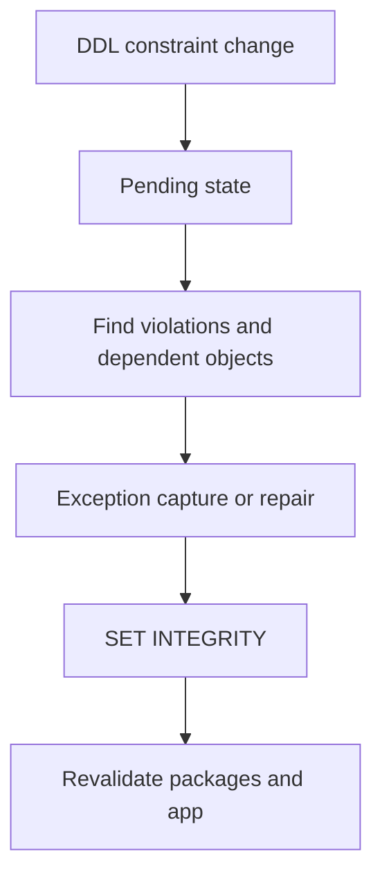

# C-07 — Integrity, pending states, exception tables, dependencies, and package maintenance

**Procedure status: NOT YET EXECUTED.** This is a teaching procedure for Db2 LUW 12.1.0 on Linux x86-64, single-member topology. The exact fix pack is not pinned. Engine commands run on the Db2 server as the named instance/database authority; client checks run on the client; OS commands run on the named host and normally require read-only access. Windows, AIX, DPF, and pureScale differences are called out where material. The supplied environment has no Db2 CLI or disposable Db2 server, so no lab command is claimed as executed. Before production use, confirm each command against the installed fix pack and local change controls.

## 1. Quick answer

Use this lesson to make a bounded DBA decision about constraint enablement and check-pending states, SET INTEGRITY immediate checked, exception table inspection. The key is to identify the failing layer and scope before changing state.

**Safest first step:** Capture the current target, timestamp, release, and read-only state before acting.

## 2. Learn the concept

The useful mental model is to follow constraint enablement and check-pending states; SET INTEGRITY immediate checked; exception table inspection; dependent view/routine/package invalidation; revalidation and REBIND; DDL dependency and utility interaction; SQL0668N reason codes/data proof from the service boundary inward. Record who owns each boundary and which evidence is authoritative there.

### Working model

Scope: constraint enablement and check-pending states → SET INTEGRITY immediate checked → exception table inspection → dependent view/routine/package invalidation → revalidation and REBIND → DDL dependency and utility interaction → SQL0668N reason codes/data proof. The arrows represent dependency, not proof of a fault. Confirm each hop independently.



## 3. Choose an approach

| Variant | Choose it when | Do not choose it when / boundary |
|---|---|---|
| New constraint | Validate existing rows before enforcing. | Do not assume ALTER statement checks every historical row immediately. |
| Check pending | Use SET INTEGRITY after identifying violations and exception design. | Do not force immediate checked without understanding rejected-row behavior. |
| Package/object invalidation | Revalidate dependent objects and rebind packages after DDL. | Successful SQL prepare in one app does not prove all static packages. |

## 4. Understand the lifecycle

- Identify pending state and exact reason code.
- Inspect constraint, dependent objects, package and data scope.
- Correct or quarantine invalid rows into approved exception table.
- Run SET INTEGRITY and revalidate dependent objects/packages.
- Test application path and confirm state is normal.

**Pause/retry/stop/rollback rule:** Stop if the target identity, current state, authority, or rollback dependency is uncertain; preserve evidence and escalate.

## 5. Do the work

### Precheck

- Save object DDL/grants and dependent-object list.
- Check table state with catalog/admin views and exact SQLCODE/SQLSTATE.
- Plan exception table columns and data-retention permissions.

### Scoped procedures

### Procedure 1: Check table status

**Status:** NOT YET EXECUTED. **Run as:** Catalog reader. **Target:** APP.ORDER_LINE. **Authority/prerequisite:** Read-only query; verify catalog column names on installed fix pack.

```bash
SELECT tabschema, tabname, status, access_mode FROM syscat.tables WHERE tabschema = 'APP' AND tabname = 'ORDER_LINE'
```

**Expected result:** Catalog status/access mode is displayed if visible.

**Independent check:** Cross-check `ADMIN_GET_TAB_INFO` and application error reason code.

**Stop/rollback boundary:** Read-only; do not ALTER/DROP constraints as a first action.

### Procedure 2: Revalidate after data repair

**Status:** NOT YET EXECUTED. **Run as:** Table owner/DBA with integrity authority. **Target:** APP.ORDER_LINE and its check-pending constraints. **Authority/prerequisite:** Repair/reject invalid rows first; review whether exception table is needed.

```bash
SET INTEGRITY FOR APP.ORDER_LINE IMMEDIATE CHECKED
```

**Expected result:** Db2 validates rows and clears check-pending when all rules pass.

**Independent check:** Requery table state, row counts, constraint catalog and app CRUD path.

**Stop/rollback boundary:** If violations remain, use exception handling path; preserve source rows before changing the constraint.

## 6. Worked example and verification

A constraint is enabled and a legacy row violates it. Create a reviewed exception destination, capture invalid rows and key values, repair source data, then set integrity and verify no pending state remains.

**Expected state/result:** Data and dependent objects are valid, table state is normal, and application packages execute after required rebind/revalidation.

**Independent verification:**

- Compare the post-state with the captured pre-state.
- Confirm the intended service or data outcome independently of the command return code.

## 7. Diagnose problems

| Symptom or verified error | Evidence to collect | Likely cause | Safe correction and recheck | Avoid |
|---|---|---|---|---|
| SQL0668N rejects access after ALTER TABLE. | reason code, table state, db2diag and exact ALTER action. | A pending state requires a documented utility or SET INTEGRITY completion step. | Use the reason-code-specific resolution, validate data, and recheck state. | Dropping the object or repeatedly retrying the application statement. |
| Static package fails after object change while dynamic SQL works. | package validity, dependency catalog, bind options and SQLCODE. | Dependent package invalidated or its static section needs rebind. | Revalidate object dependencies and rebind only the identified packages; test app package path. | REBIND ALL on production without scope and performance plan. |

## 8. Practice

In a lab schema, create rows including one constraint violation, add a constraint in a way that creates pending work, capture the reason state, then move/fix invalid rows and validate. Verify package validity after a harmless DDL change. Cleanup in dependency order.

## 9. Check understanding

**Question:** What evidence closes a check-pending incident?

**Answer and reasoning:** SET INTEGRITY succeeds, system catalogs/admin view show normal table state, invalid rows are accounted for, constraints are enabled, and the application read/write path passes.

## 10. Look it up later

### Short checklist

- Name the target and scope.
- Collect a baseline and confirm prerequisites.
- Choose the least disruptive supported branch.
- Verify state and service behavior.
- Record evidence and recovery limits.

### Related lessons

[C-02](../C/C-02.md) · [C-05](../C/C-05.md) · [H-02](../H/H-02.md) · [I-01](../I/I-01.md)

### Authoritative references

- [IBM monitoring interfaces](https://www.ibm.com/docs/en/db2/12.1.x?topic=monitoring-interfaces-database)
- [IBM SET INTEGRITY statement](https://www.ibm.com/docs/en/db2/12.1.x?topic=statements-set-integrity)

---

[Domain index](README.md) · [Course index](../README.md) · [Glossary](../GLOSSARY.md)
