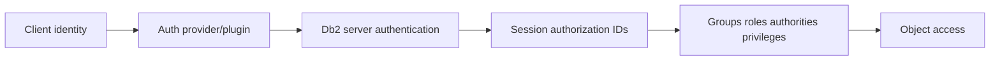

# D-01 — Authentication, operating-system identity, providers, and security plugins

**Procedure status: NOT YET EXECUTED.** This is a teaching procedure for Db2 LUW 12.1.0 on Linux x86-64, single-member topology. The exact fix pack is not pinned. Engine commands run on the Db2 server as the named instance/database authority; client checks run on the client; OS commands run on the named host and normally require read-only access. Windows, AIX, DPF, and pureScale differences are called out where material. The supplied environment has no Db2 CLI or disposable Db2 server, so no lab command is claimed as executed. Before production use, confirm each command against the installed fix pack and local change controls.

## 1. Quick answer

Use this lesson to make a bounded DBA decision about server/client authentication settings, OS local identity, LDAP/Kerberos/GSS provider boundary, plugin and case mapping. The key is to identify the failing layer and scope before changing state.

**Safest first step:** Capture the current target, timestamp, release, and read-only state before acting.

## 2. Learn the concept

The useful mental model is to follow server/client authentication settings; OS local identity, LDAP/Kerberos/GSS provider boundary; plugin and case mapping; service identities and trusted contexts; password/key rotation; connection identity verification; failed login evidence without secrets from the service boundary inward. Record who owns each boundary and which evidence is authoritative there.

### Working model

Scope: server/client authentication settings → OS local identity, LDAP/Kerberos/GSS provider boundary → plugin and case mapping → service identities and trusted contexts → password/key rotation → connection identity verification → failed login evidence without secrets. The arrows represent dependency, not proof of a fault. Confirm each hop independently.



## 3. Choose an approach

| Variant | Choose it when | Do not choose it when / boundary |
|---|---|---|
| OS authentication | Use local or directory identity that the server can resolve. | Db2 database user name is not automatically the OS service identity. |
| External provider/plugin | Use only the configured, supported server/client plugin and directory. | Changing plugin order can lock out service accounts. |
| Trusted context | Use when application identity propagation and trust attributes are explicitly designed. | It is not a bypass for authentication or authorization review. |

## 4. Understand the lifecycle

- Identify server and client authentication parameters/plugins.
- Resolve user and groups from the server’s actual provider.
- Connect using a controlled account.
- Verify effective session identity and failed-login evidence.
- Rotate provider credentials/certificates with overlap and rollback gates.

**Pause/retry/stop/rollback rule:** Stop if the target identity, current state, authority, or rollback dependency is uncertain; preserve evidence and escalate.

## 5. Do the work

### Precheck

- Record current auth/plugin configuration and Db2 release.
- Verify service-account lookup and group/case mapping on all nodes.
- Do not collect passwords or secret-bearing traces.

### Scoped procedures

### Procedure 1: Inspect server auth settings

**Status:** NOT YET EXECUTED. **Run as:** Instance owner. **Target:** Current Db2 server instance. **Authority/prerequisite:** Read-only; use platform-appropriate filtering on Windows/AIX.

```bash
db2 get dbm cfg | grep -i -E "authentication|srvcon_auth|group_plugin|server_plugin"; db2set -all
```

**Expected result:** Authentication/plugin values and registry configuration are printed.

**Independent check:** Compare with configured client provider and connection identity from SQL.

**Stop/rollback boundary:** No state change; preserve existing authentication path until alternate tested.

### Procedure 2: Verify authenticated identity

**Status:** NOT YET EXECUTED. **Run as:** Database test identity. **Target:** Connected target database. **Authority/prerequisite:** Connect through the same route/driver used by the application test.

```bash
VALUES CURRENT SERVER, CURRENT USER, SESSION_USER;
```

**Expected result:** Server, authorization ID and session ID are returned.

**Independent check:** Compare with application logs and expected group/role mapping.

**Stop/rollback boundary:** Disconnect; never echo credentials into transcript.

## 6. Worked example and verification

An application connects but cannot see an expected role. `SESSION_USER` confirms authentication succeeded; group resolution/effective authorization is a different step. Preserve both server plugin evidence and database grant evidence.

**Expected state/result:** Login identity, session identity, OS/provider mapping, and Db2 authorization are evidenced separately.

**Independent verification:**

- Compare the post-state with the captured pre-state.
- Confirm the intended service or data outcome independently of the command return code.

## 7. Diagnose problems

| Symptom or verified error | Evidence to collect | Likely cause | Safe correction and recheck | Avoid |
|---|---|---|---|---|
| SQL30082N authentication failure after directory maintenance. | client/server time, plugin logs, identity lookup, provider availability and sanitized db2diag. | Group/user case mapping, directory outage, credential rotation mismatch, or plugin load issue. | Restore provider reachability or synchronized credential mapping; test with one safe account. | Switching server authentication to a weaker mode during an incident. |
| User authenticates on one member but not another. | NSS/LDAP lookup and plugin/config values on each host/member. | Directory/cache/provider or case mapping differs by node. | Reconcile provider configuration and name lookup before routing users again. | Granting broad database privileges to mask an identity failure. |

## 8. Practice

Configure two synthetic identities in a disposable directory/lab model. Trace provider lookup, connection authentication, CURRENT USER/SESSION_USER and group authorization. Failure drill: disable only the test provider route, observe sanitized failure evidence, restore and retest.

## 9. Check understanding

**Question:** Does a successful login prove the user has SELECT on a table?

**Answer and reasoning:** No. Authentication establishes identity; authorization and object privileges/roles determine permitted operations. Verify session identity and effective grants independently.

## 10. Look it up later

### Short checklist

- Name the target and scope.
- Collect a baseline and confirm prerequisites.
- Choose the least disruptive supported branch.
- Verify state and service behavior.
- Record evidence and recovery limits.

### Related lessons

[D-02](../D/D-02.md) · [D-03](../D/D-03.md) · [D-06](../D/D-06.md) · [A-02](../A/A-02.md)

### Authoritative references

- [IBM authorization model](https://www.ibm.com/docs/en/db2/12.1.x?topic=model-authorization)
- [IBM authentication overview](https://www.ibm.com/docs/en/db2/12.1.x?topic=security-authentication)

---

[Domain index](README.md) · [Course index](../README.md) · [Glossary](../GLOSSARY.md)
