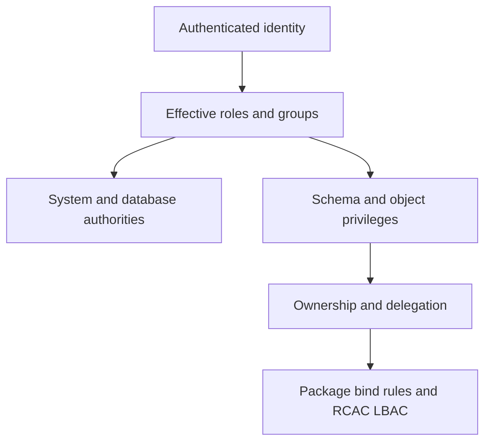

# D-02 — Authorities, privileges, roles, groups, ownership, and effective access

**Procedure status: NOT YET EXECUTED.** This is a teaching procedure for Db2 LUW 12.1.0 on Linux x86-64, single-member topology. The exact fix pack is not pinned. Engine commands run on the Db2 server as the named instance/database authority; client checks run on the client; OS commands run on the named host and normally require read-only access. Windows, AIX, DPF, and pureScale differences are called out where material. The supplied environment has no Db2 CLI or disposable Db2 server, so no lab command is claimed as executed. Before production use, confirm each command against the installed fix pack and local change controls.

## 1. Quick answer

Use this lesson to make a bounded DBA decision about SYSADM/SYSCTRL/SYSMAINT/SYSMON boundaries, SECADM/DBADM/DATAACCESS/ACCESSCTRL/SQLADM, database schema and object grants. The key is to identify the failing layer and scope before changing state.

**Safest first step:** Capture the current target, timestamp, release, and read-only state before acting.

## 2. Learn the concept

The useful mental model is to follow SYSADM/SYSCTRL/SYSMAINT/SYSMON boundaries; SECADM/DBADM/DATAACCESS/ACCESSCTRL/SQLADM; database schema and object grants; roles/groups/PUBLIC/ownership/delegation; effective access and grant option; dynamic versus static package checks; least privilege and break glass; Db2 12.1 DBADM default changes from the service boundary inward. Record who owns each boundary and which evidence is authoritative there.

### Working model

Scope: SYSADM/SYSCTRL/SYSMAINT/SYSMON boundaries → SECADM/DBADM/DATAACCESS/ACCESSCTRL/SQLADM → database schema and object grants → roles/groups/PUBLIC/ownership/delegation → effective access and grant option → dynamic versus static package checks → least privilege and break glass → Db2 12.1 DBADM default changes. The arrows represent dependency, not proof of a fault. Confirm each hop independently.



## 3. Choose an approach

| Variant | Choose it when | Do not choose it when / boundary |
|---|---|---|
| Authority | System/database capability bundle. | DBADM does not imply every data/security privilege in 12.1. |
| Object privilege/role | Grant only the needed action on named objects. | A role/group grant can interact differently with static SQL binding. |
| Ownership/delegation | Object owner and GRANT OPTION control administration. | Avoid changing ownership to solve one missing privilege. |

## 4. Understand the lifecycle

- Identify authenticated session and SQL execution authorization ID.
- List direct, role, group, PUBLIC, authority and ownership grants.
- Compare package DYNAMICRULES/bind owner for static SQL.
- Grant the narrowest missing privilege with approval.
- Retest under the real app identity; audit and expire break-glass access.

**Pause/retry/stop/rollback rule:** Stop if the target identity, current state, authority, or rollback dependency is uncertain; preserve evidence and escalate.

## 5. Do the work

### Precheck

- Query effective grant sources and the 12.1 authority behavior reference.
- Confirm whether command runs as SECADM, DBADM or object owner.
- Capture existing grant/revoke statements before change.

### Scoped procedures

### Procedure 1: Grant scoped read privilege

**Status:** NOT YET EXECUTED. **Run as:** Object owner or ACCESSCTRL authority. **Target:** APP.ORDERS and role REPORT_READER. **Authority/prerequisite:** Confirm role exists and contains only approved users; ensure schema/table target.

```bash
GRANT SELECT ON TABLE APP.ORDERS TO ROLE REPORT_READER;
```

**Expected result:** Grant is cataloged.

**Independent check:** Reconnect as an intended role member; run allowed SELECT and denied write test.

**Stop/rollback boundary:** REVOKE SELECT only if this is the new grant and no dependent workflow relies on it.

### Procedure 2: Explicit Db2 12.1 DBADM choice

**Status:** NOT YET EXECUTED. **Run as:** SECADM. **Target:** One database and DBA_OPS principal. **Authority/prerequisite:** Db2 12.1.0 behavior; verify exact grant syntax and approved scope.

```bash
GRANT DBADM ON DATABASE TO USER DBA_OPS WITHOUT DATAACCESS WITHOUT ACCESSCTRL;
```

**Expected result:** DBADM is granted without implicitly adding data or access-control authority.

**Independent check:** Inspect database authority catalog and test object/security administration separately.

**Stop/rollback boundary:** REVOKE DBADM from this newly granted principal after confirming no broader assignment.

## 6. Worked example and verification

After a 12.1 migration, a DBA with DBADM can perform administration but lacks DATAACCESS and ACCESSCTRL by default unless explicitly granted. A failed SELECT or GRANT is not corrected by assuming legacy bundled authority; add only what the role needs.

**Expected state/result:** The principal’s access is derived from authenticated ID, group/role membership, authority, privilege, ownership, package rules and RCAC/LBAC.

**Independent verification:**

- Compare the post-state with the captured pre-state.
- Confirm the intended service or data outcome independently of the command return code.

## 7. Diagnose problems

| Symptom or verified error | Evidence to collect | Likely cause | Safe correction and recheck | Avoid |
|---|---|---|---|---|
| DBA can manage objects but cannot query protected table. | 12.1 grant semantics, DBADM/DATAACCESS catalogs, RCAC/LBAC policy and session identity. | DBADM no longer automatically includes DATAACCESS in Db2 12.1. | Use a separately approved DATAACCESS or object-level grant; test under intended identity. | Setting an alternate global authorization behavior solely to preserve legacy assumptions. |
| Dynamic query succeeds but static package fails authorization. | package owner/bind options, group memberships at bind/runtime and effective privilege. | Static SQL privilege checking follows package binding rules; group grants may differ. | Correct the package owner/grants and rebind only affected package after review. | Granting DATAACCESS to PUBLIC. |

## 8. Practice

Create a reader role, grant SELECT on one synthetic table, assign one test group/user, and verify allowed/denied operations. Then model Db2 12.1 DBADM without DATAACCESS/ACCESSCTRL. Cleanup: revoke only lab grants and drop role after removing memberships.

## 9. Check understanding

**Question:** In Db2 12.1, what must be checked before assuming DBADM permits row reads and grant administration?

**Answer and reasoning:** Check DATAACCESS and ACCESSCTRL separately because DBADM no longer adds those authorities by default. Confirm direct/effective grants and the exact connected identity.

## 10. Look it up later

### Short checklist

- Name the target and scope.
- Collect a baseline and confirm prerequisites.
- Choose the least disruptive supported branch.
- Verify state and service behavior.
- Record evidence and recovery limits.

### Related lessons

[D-01](../D/D-01.md) · [D-05](../D/D-05.md) · [C-02](../C/C-02.md) · [I-01](../I/I-01.md)

### Authoritative references

- [IBM Db2 12.1 changed authority behavior](https://www.ibm.com/docs/en/db2/12.1.x?topic=121-changed-functionality)
- [IBM DBADM authority](https://www.ibm.com/docs/en/db2/12.1.x?topic=authorities-database-administration-authority-dbadm)
- [IBM authorization and ownership](https://www.ibm.com/docs/en/db2/12.1.x?topic=model-authorization-privileges-object-ownership)

---

[Domain index](README.md) · [Course index](../README.md) · [Glossary](../GLOSSARY.md)
