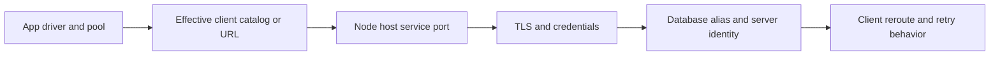

# D-03 — Client catalogs, aliases, drivers, connection configuration, and reroute

**Procedure status: NOT YET EXECUTED.** This is a teaching procedure for Db2 LUW 12.1.0 on Linux x86-64, single-member topology. The exact fix pack is not pinned. Engine commands run on the Db2 server as the named instance/database authority; client checks run on the client; OS commands run on the named host and normally require read-only access. Windows, AIX, DPF, and pureScale differences are called out where material. The supplied environment has no Db2 CLI or disposable Db2 server, so no lab command is claimed as executed. Before production use, confirm each command against the installed fix pack and local change controls.

## 1. Quick answer

Use this lesson to make a bounded DBA decision about TCPIP node/database catalog and alias, uncatalog and cache behavior, wrong-target guard. The key is to identify the failing layer and scope before changing state.

**Safest first step:** Capture the current target, timestamp, release, and read-only state before acting.

## 2. Learn the concept

The useful mental model is to follow TCPIP node/database catalog and alias; uncatalog and cache behavior; wrong-target guard; CLI ODBC JDBC .NET levels; db2dsdriver.cfg and db2cli.ini; driver/client trace; pool keepalive and client reroute; SQL1013N and SQL30081N layers from the service boundary inward. Record who owns each boundary and which evidence is authoritative there.

### Working model

Scope: TCPIP node/database catalog and alias → uncatalog and cache behavior → wrong-target guard → CLI ODBC JDBC .NET levels → db2dsdriver.cfg and db2cli.ini → driver/client trace → pool keepalive and client reroute → SQL1013N and SQL30081N layers. The arrows represent dependency, not proof of a fault. Confirm each hop independently.



## 3. Choose an approach

| Variant | Choose it when | Do not choose it when / boundary |
|---|---|---|
| Cataloged CLI client | Use catalog entries for node/service/database alias mapping. | Alias is local client metadata, not a database name guarantee. |
| Driver config | Use documented driver-specific settings and match client level. | A JDBC URL is not controlled by a CLI catalog in every application. |
| Reroute/pooling | Use only after primary/alternate host and transaction behavior are tested. | Reroute does not make an in-flight transaction replay safe. |

## 4. Understand the lifecycle

- Identify application driver/version and runtime host.
- Resolve alias/DSN/URL to endpoint/database and TLS settings.
- Check listener reachability then authenticate and verify server identity.
- Exercise failover/reroute in a client test harness.
- Check pooled connections and application transaction retry policy.

**Pause/retry/stop/rollback rule:** Stop if the target identity, current state, authority, or rollback dependency is uncertain; preserve evidence and escalate.

## 5. Do the work

### Precheck

- Obtain sanitized effective client configuration and driver build.
- Protect credentials in configuration/trace; redact before sharing.
- Use a distinct test alias so production routing is not modified.

### Scoped procedures

### Procedure 1: Catalog a test TCP node/database

**Status:** NOT YET EXECUTED. **Run as:** Client administrator / Db2 client user. **Target:** One isolated client catalog. **Authority/prerequisite:** Host/port/database verified; no password is included.

```bash
CATALOG TCPIP NODE LABNODE REMOTE db2host.example.net SERVER 50000; CATALOG DATABASE SAMPLE AS LABDB AT NODE LABNODE AUTHENTICATION SERVER
```

**Expected result:** Node and database alias catalog entries are added.

**Independent check:** `LIST NODE DIRECTORY`, `LIST DATABASE DIRECTORY`, then connect and query CURRENT SERVER.

**Stop/rollback boundary:** Uncatalog only LABDB/LABNODE after confirming no other alias depends on LABNODE.

### Procedure 2: Validate CLI driver

**Status:** NOT YET EXECUTED. **Run as:** Client operator. **Target:** CLI/ODBC driver on application test host. **Authority/prerequisite:** CLI driver installed; use secure credential prompt/config for authentication.

```bash
db2cli validate -dsn LABDB -connect
```

**Expected result:** Validation prints driver configuration and successful connection or layer-specific failure.

**Independent check:** Compare with application’s actual driver/version and database server identity.

**Stop/rollback boundary:** No server change; remove only temporary test catalog entries.

## 6. Worked example and verification

`SQL1013N` indicates the requested alias is not found in the local catalog, while a `SQL30081N` reports a communication protocol error. Check client catalog first for the former; for the latter inspect endpoint, port, TLS and client/server traces.

**Expected state/result:** A client connects to the intended server/database with a compatible driver and verified TLS/reroute behavior.

**Independent verification:**

- Compare the post-state with the captured pre-state.
- Confirm the intended service or data outcome independently of the command return code.

## 7. Diagnose problems

| Symptom or verified error | Evidence to collect | Likely cause | Safe correction and recheck | Avoid |
|---|---|---|---|---|
| SQL1013N for an alias used by the application. | effective process user, DB2INSTANCE/client profile and database directory listing. | Alias is absent in that user’s client catalog or app uses another config file. | Catalog the intended alias for the actual runtime identity and test target name. | Cataloging an unverified server under the production alias. |
| Failover reconnect works but transaction is duplicated. | application idempotency key, commit outcome and client retry log. | Driver/pool retries connection without business-level outcome check. | Reconcile outcome by idempotency key and implement bounded transaction-aware retry. | Assuming client reroute safely replays SQL. |

## 8. Practice

Create an isolated alias to SAMPLE, test with db2cli validate, then change its host to a closed test port and capture the error layer. Restore correct host, connect and confirm CURRENT SERVER. Cleanup: uncatalog only the test alias/node.

## 9. Check understanding

**Question:** What does client reroute not prove?

**Answer and reasoning:** It does not prove the database role changed, transaction outcome is known, or the application can safely replay a non-idempotent UOW. Verify server role and business request outcome.

## 10. Look it up later

### Short checklist

- Name the target and scope.
- Collect a baseline and confirm prerequisites.
- Choose the least disruptive supported branch.
- Verify state and service behavior.
- Record evidence and recovery limits.

### Related lessons

[A-05](../A/A-05.md) · [D-01](../D/D-01.md) · [D-04](../D/D-04.md) · [D-06](../D/D-06.md) · [J-03](../J/J-03.md)

### Authoritative references

- [IBM cataloging TCP/IP nodes](https://www.ibm.com/docs/en/db2/12.1.x?topic=clients-cataloging-tcpip-node)
- [IBM client reroute](https://www.ibm.com/docs/en/db2/12.1.x?topic=parameters-alternate-server-database-parameter)

---

[Domain index](README.md) · [Course index](../README.md) · [Glossary](../GLOSSARY.md)
