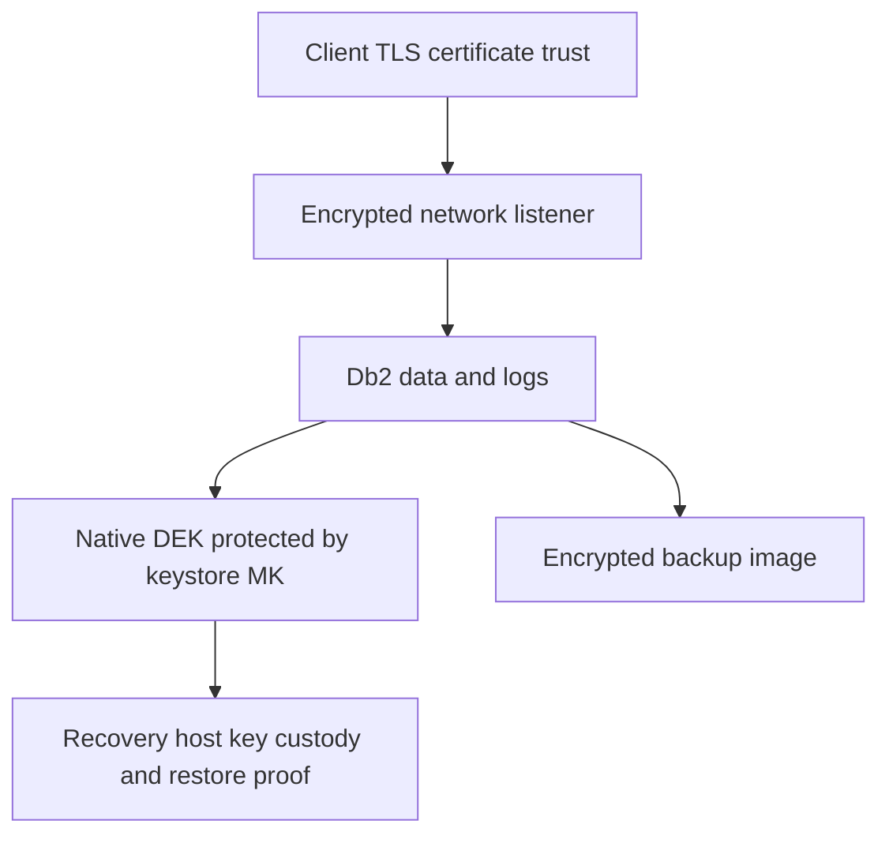

# D-04 — TLS, certificates, keystores, native database encryption, and backup encryption

**Procedure status: NOT YET EXECUTED.** This is a teaching procedure for Db2 LUW 12.1.0 on Linux x86-64, single-member topology. The exact fix pack is not pinned. Engine commands run on the Db2 server as the named instance/database authority; client checks run on the client; OS commands run on the named host and normally require read-only access. Windows, AIX, DPF, and pureScale differences are called out where material. The supplied environment has no Db2 CLI or disposable Db2 server, so no lab command is claimed as executed. Before production use, confirm each command against the installed fix pack and local change controls.

## 1. Quick answer

Use this lesson to make a bounded DBA decision about TLS server keydb/stash/certificate label/listener, DB2COMM TCPIP and SSL ports/restart, client trust and certificate rotation. The key is to identify the failing layer and scope before changing state.

**Safest first step:** Capture the current target, timestamp, release, and read-only state before acting.

## 2. Learn the concept

The useful mental model is to follow TLS server keydb/stash/certificate label/listener; DB2COMM TCPIP and SSL ports/restart; client trust and certificate rotation; Db2 native encryption DEK/MK/keystore; database-at-rest encryption versus encrypted backup; LOAD copy/log encryption; HADR key synchronization; key custody/restore drill from the service boundary inward. Record who owns each boundary and which evidence is authoritative there.

### Working model

Scope: TLS server keydb/stash/certificate label/listener → DB2COMM TCPIP and SSL ports/restart → client trust and certificate rotation → Db2 native encryption DEK/MK/keystore → database-at-rest encryption versus encrypted backup → LOAD copy/log encryption → HADR key synchronization → key custody/restore drill. The arrows represent dependency, not proof of a fault. Confirm each hop independently.



## 3. Choose an approach

| Variant | Choose it when | Do not choose it when / boundary |
|---|---|---|
| TLS in transit | Encrypts client/server or supported HADR network traffic. | TLS does not encrypt data files or backups at rest. |
| Native database encryption | Encrypts database files/logs using DEK protected by master key. | Keystore/key availability is required for restore and restart. |
| Encrypted backup | Encrypts image even when source database is not encrypted. | Compression/dedup after encryption is ineffective; key label must be recoverable. |

## 4. Understand the lifecycle

- Inventory data paths, backup paths, network paths and key owners.
- Create/manage certificate or keystore with protected permissions.
- Configure TLS listener and client trust; restart only as documented.
- Test database/backups with keys in approved recovery location.
- Rotate certificates/keys with overlap, restore proof and custody evidence.

**Pause/retry/stop/rollback rule:** Stop if the target identity, current state, authority, or rollback dependency is uncertain; preserve evidence and escalate.

## 5. Do the work

### Precheck

- Confirm release and GSKit/driver compatibility; inspect cipher/protocol policy.
- Back up keystore/stash securely and prove access as Db2 service identity.
- Schedule listener port cutover and test a rollback client.

### Scoped procedures

### Procedure 1: Enable server TLS listener

**Status:** NOT YET EXECUTED. **Run as:** Instance owner/Db2 security administrator. **Target:** Db2 server instance. **Authority/prerequisite:** Keystore/cert label provisioned; SSL and TCP use distinct ports; restart planned.

```bash
db2 update dbm cfg using SSL_SVR_KEYDB /secure/keystore/server.p12; db2 update dbm cfg using SSL_SVR_STASH /secure/keystore/server.sth; db2 update dbm cfg using SSL_SVCENAME 25001; db2set DB2COMM=SSL,TCPIP; db2stop; db2start
```

**Expected result:** Instance starts with TLS and TCP/IP listeners configured.

**Independent check:** Use a TLS client with approved CA; inspect connection and server diagnostics; confirm plaintext port policy.

**Stop/rollback boundary:** Restore captured DBM CFG/DB2COMM and prior certificate only under change plan; no password is printed.

### Procedure 2: Create encrypted backup

**Status:** NOT YET EXECUTED. **Run as:** Backup authority; instance/DBA context. **Target:** SAMPLE backup image at private destination. **Authority/prerequisite:** Native encryption configured and key is backed up/custodied.

```bash
BACKUP DATABASE SAMPLE ENCRYPT TO /db2backup/enc
```

**Expected result:** Encrypted backup image is produced.

**Independent check:** `db2ckbkp -h` validates image structure, then restore in isolated host proves key availability.

**Stop/rollback boundary:** Retain image and key together under custody controls; delete only by retention policy.

## 6. Worked example and verification

A TLS handshake succeeds but a backup file is exposed on removable media. TLS cannot address that at-rest risk. Use backup encryption or protected media; separately retain the required master-key label/keystore for recovery.

**Expected state/result:** Transport encryption, database encryption, backup encryption, key custody and restore are tested as independent controls.

**Independent verification:**

- Compare the post-state with the captured pre-state.
- Confirm the intended service or data outcome independently of the command return code.

## 7. Diagnose problems

| Symptom or verified error | Evidence to collect | Likely cause | Safe correction and recheck | Avoid |
|---|---|---|---|---|
| Db2 will not start after SSL config change. | db2diag, keydb/stash paths, owner permissions, label, SSL_SVCENAME/SVCENAME and port binding. | Unreadable keystore/stash, invalid label or conflicting listener ports. | Restore previous DBM CFG/DB2COMM and valid certificate; restart and retest baseline before retry. | Disabling TLS globally without incident/change approval. |
| Encrypted image cannot be restored on DR host. | master key label, keystore type, key-manager reachability, image header and audit trail. | Recovery environment lacks correct key or key service/identity. | Retrieve the authorized key through custody process and test restore in isolated environment. | Copying stash/password material into logs or ticket text. |
| TLS validation fails after certificate rotation. | client trust chain, SAN, time, driver TLS support and server label. | Missing CA chain, mismatched hostname, expired cert or downlevel client. | Install approved chain/route by DNS name and stage client support; verify both ends. | Setting trust-all/hostname-ignore options. |

## 8. Practice

In a disposable pair, create a local test certificate, configure a second TLS port, connect with trusted and untrusted clients, and restore an encrypted backup using a separately custodied test key. Cleanup certificates/images with secure deletion procedure; never reuse key material.

## 9. Check understanding

**Question:** What must a restore rehearsal prove beyond `db2ckbkp`?

**Answer and reasoning:** That the destination can locate/authorize the encryption key and that Db2 can restore/open and validate the data. Image header integrity is not proof of key availability or successful recovery.

## 10. Look it up later

### Short checklist

- Name the target and scope.
- Collect a baseline and confirm prerequisites.
- Choose the least disruptive supported branch.
- Verify state and service behavior.
- Record evidence and recovery limits.

### Related lessons

[D-03](../D/D-03.md) · [F-02](../F/F-02.md) · [F-03](../F/F-03.md) · [F-05](../F/F-05.md) · [G-02](../G/G-02.md)

### Authoritative references

- [IBM configure TLS on a Db2 server](https://www.ibm.com/docs/en/db2/12.1?topic=ctcsc-configure-tls-db2-server)
- [IBM Db2 native encryption](https://www.ibm.com/docs/en/db2/12.1.x?topic=rest-db2-native-encryption)
- [IBM encrypted backups](https://www.ibm.com/docs/en/db2/12.1.x?topic=encryption-encrypted-backups)
- [IBM BACKUP DATABASE command](https://www.ibm.com/docs/en/db2/12.1.x?topic=commands-backup-database)

---

[Domain index](README.md) · [Course index](../README.md) · [Glossary](../GLOSSARY.md)
