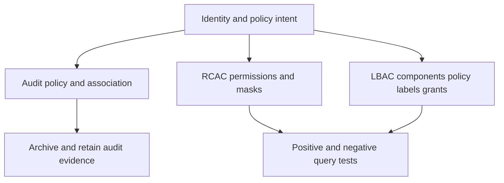

# D-05 — Auditing, RCAC, masks, LBAC, and sensitive-data controls

**Procedure status: NOT YET EXECUTED.** This is a teaching procedure for Db2 LUW 12.1.0 on Linux x86-64, single-member topology. The exact fix pack is not pinned. Engine commands run on the Db2 server as the named instance/database authority; client checks run on the client; OS commands run on the named host and normally require read-only access. Windows, AIX, DPF, and pureScale differences are called out where material. The supplied environment has no Db2 CLI or disposable Db2 server, so no lab command is claimed as executed. Before production use, confirm each command against the installed fix pack and local change controls.

## 1. Quick answer

Use this lesson to make a bounded DBA decision about instance versus database audit logs, SECADM audit policy create/apply/archive/extract, RCAC row permission and column mask activation. The key is to identify the failing layer and scope before changing state.

**Safest first step:** Capture the current target, timestamp, release, and read-only state before acting.

## 2. Learn the concept

The useful mental model is to follow instance versus database audit logs; SECADM audit policy create/apply/archive/extract; RCAC row permission and column mask activation; LBAC component policy label/grant; audit data retention and privacy; utility/application access under controls; policy test identities and negative tests from the service boundary inward. Record who owns each boundary and which evidence is authoritative there.

### Working model

Scope: instance versus database audit logs → SECADM audit policy create/apply/archive/extract → RCAC row permission and column mask activation → LBAC component policy label/grant → audit data retention and privacy → utility/application access under controls → policy test identities and negative tests. The arrows represent dependency, not proof of a fault. Confirm each hop independently.



## 3. Choose an approach

| Variant | Choose it when | Do not choose it when / boundary |
|---|---|---|
| Audit | Records selected events for accountability and evidence. | Audit collection is not itself access prevention. |
| RCAC | Filters rows and masks column values for SQL access. | Create controls before activation; no-data can be intended policy behavior. |
| LBAC | Uses security labels/components and rules to protect rows/columns. | LBAC labels are not roles or ordinary grants. |

## 4. Understand the lifecycle

- Classify the sensitive data and threat/access case.
- Design role/user test matrix and expected visible rows/columns.
- Create audit policy, row permissions/masks or LBAC components/labels.
- Activate/associate policy and commit; test positive and negative identities.
- Archive/extract audit evidence; review retention, storage and break-glass.

**Pause/retry/stop/rollback rule:** Stop if the target identity, current state, authority, or rollback dependency is uncertain; preserve evidence and escalate.

## 5. Do the work

### Precheck

- Use SECADM or approved delegated authority; never use SYSADM as a substitute for policy design.
- Copy DDL and test query outputs for every identity.
- Review package invalidation, utility behavior and data access by DBADM/DATAACCESS.

### Scoped procedures

### Procedure 1: Apply an audit policy

**Status:** NOT YET EXECUTED. **Run as:** SECADM. **Target:** One disposable database. **Authority/prerequisite:** Confirm exact 12.1 SQL syntax/category intent; set log retention and privacy controls first.

```bash
CREATE AUDIT POLICY APP_AUDIT CATEGORIES EXECUTE STATUS BOTH, CONTEXT STATUS BOTH ERROR TYPE NORMAL; AUDIT DATABASE USING POLICY APP_AUDIT; COMMIT;
```

**Expected result:** Policy is committed and associated with the database.

**Independent check:** Query SYSCAT.AUDITPOLICIES/AUDITUSE and generate a controlled audited event; archive/extract and inspect records.

**Stop/rollback boundary:** Remove policy association and policy only after preserving required lab audit evidence.

### Procedure 2: Row and column policy pattern

**Status:** NOT YET EXECUTED. **Run as:** SECADM. **Target:** Synthetic table with matching REGION identity values. **Authority/prerequisite:** This is a design pattern: validate exact Db2 LUW statement semantics and ensure no default-deny outage before activation.

```bash
CREATE PERMISSION APP.REGION_ROWS ON APP.CUSTOMER FOR ROWS WHERE REGION = SESSION_USER ENFORCED FOR ALL ACCESS ENABLE; ALTER TABLE APP.CUSTOMER ACTIVATE ROW ACCESS CONTROL;
```

**Expected result:** Enabled permission filters visible rows after activation and commit.

**Independent check:** Test as two distinct users, query row counts and inspect control catalog; test utilities/app packages too.

**Stop/rollback boundary:** Deactivate row access control only through approved rollback after restoring expected least-privilege grants.

### Procedure 3: LBAC label verification

**Status:** NOT YET EXECUTED. **Run as:** SECADM/security auditor. **Target:** LBAC grants in current database. **Authority/prerequisite:** Read-only catalog check; labels require complete component/policy design.

```bash
SELECT A.grantee, B.secpolicyname, C.seclabelname FROM syscat.securitylabelaccess A JOIN syscat.securitypolicies B ON A.secpolicyid=B.secpolicyid JOIN syscat.securitylabels C ON A.seclabelid=C.seclabelid
```

**Expected result:** Granted security labels map to principals/policies.

**Independent check:** Run read/write tests as authorized and unauthorized identities; verify data is blocked/visible as designed.

**Stop/rollback boundary:** Revoke only lab security-label grants after documenting test evidence.

## 6. Worked example and verification

A user can query a protected table and receives fewer rows without an error; that can be correct RCAC behavior. Compare expected row set as both permitted and restricted identities. Separately verify audit policy produced evidence for the operation.

**Expected state/result:** Control is activated, positive and negative tests match policy, and evidence is archived with least-privilege custody.

**Independent verification:**

- Compare the post-state with the captured pre-state.
- Confirm the intended service or data outcome independently of the command return code.

## 7. Diagnose problems

| Symptom or verified error | Evidence to collect | Likely cause | Safe correction and recheck | Avoid |
|---|---|---|---|---|
| Users see zero rows after activating row access control. | policy expression, session identity/group/role, commit state and per-role expected data. | Filter expression or identity mapping excludes all rows; activation may have occurred before a valid permission. | Pause release; use SECADM to correct/test policy on a copy, then reapply with staged activation. | Deactivating controls as a production workaround without security approval. |
| Audit is configured but no records are available. | SYSCAT.AUDITUSE, policy scope/status, commit, event category, db2audit logs and retention destination. | Policy was not associated/committed, event category did not cover action or archive was not run. | Generate a controlled event and validate collection/archive/extract lifecycle. | Assuming policy creation alone means auditing is active. |
| Sensitive result differs between application and DBA query. | SESSION_USER, RCAC expression, LBAC credentials, package identity and client role. | Data-centric filters apply to all access and identities differ. | Run controlled queries under same app identity and inspect policy path. | Granting broad exemptions merely to make result sets match. |

## 8. Practice

Create a three-row customer table with two regions and a masked test column. Build row permission and mask in a disposable database; test as two app users and SECADM. Add an audit policy, execute one SELECT and extract a record. Separately draw LBAC component/policy/label steps. Cleanup only lab objects and audit logs.

## 9. Check understanding

**Question:** What is the difference between audit and RCAC?

**Answer and reasoning:** Audit produces evidence of selected activity; RCAC changes which rows/column values a session can see or modify. A system can need both, each independently tested.

## 10. Look it up later

### Short checklist

- Name the target and scope.
- Collect a baseline and confirm prerequisites.
- Choose the least disruptive supported branch.
- Verify state and service behavior.
- Record evidence and recovery limits.

### Related lessons

[D-02](../D/D-02.md) · [D-04](../D/D-04.md) · [D-06](../D/D-06.md) · [E-05](../E/E-05.md)

### Authoritative references

- [IBM audit facility](https://www.ibm.com/docs/en/db2/12.1.x?topic=activities-introduction-db2-audit-facility)
- [IBM RCAC overview](https://www.ibm.com/docs/en/db2/12.1.x?topic=security-row-column-access-control-rcac)
- [IBM LBAC labels](https://www.ibm.com/docs/en/db2/12.1.x?topic=lbac-security-labels)
- [IBM authorization model](https://www.ibm.com/docs/en/db2/12.1.x?topic=model-authorization)

---

[Domain index](README.md) · [Course index](../README.md) · [Glossary](../GLOSSARY.md)
