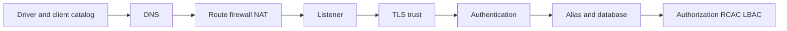

# D-06 — Layer-by-layer security and connectivity failure diagnosis

**Procedure status: NOT YET EXECUTED.** This is a teaching procedure for Db2 LUW 12.1.0 on Linux x86-64, single-member topology. The exact fix pack is not pinned. Engine commands run on the Db2 server as the named instance/database authority; client checks run on the client; OS commands run on the named host and normally require read-only access. Windows, AIX, DPF, and pureScale differences are called out where material. The supplied environment has no Db2 CLI or disposable Db2 server, so no lab command is claimed as executed. Before production use, confirm each command against the installed fix pack and local change controls.

## 1. Quick answer

Use this lesson to make a bounded DBA decision about client config and DNS, network/firewall/listener, TLS certificate trust. The key is to identify the failing layer and scope before changing state.

**Safest first step:** Capture the current target, timestamp, release, and read-only state before acting.

## 2. Learn the concept

The useful mental model is to follow client config and DNS; network/firewall/listener; TLS certificate trust; authentication provider; database alias and authorization; SQLCODE/SQLSTATE/client OS evidence; trace/privacy/evidence package from the service boundary inward. Record who owns each boundary and which evidence is authoritative there.

### Working model

Scope: client config and DNS → network/firewall/listener → TLS certificate trust → authentication provider → database alias and authorization → SQLCODE/SQLSTATE/client OS evidence → trace/privacy/evidence package. The arrows represent dependency, not proof of a fault. Confirm each hop independently.



## 3. Choose an approach

| Variant | Choose it when | Do not choose it when / boundary |
|---|---|---|
| Name/route/port | Test before credentials to isolate reachability. | Ping/ICMP does not prove Db2 listener. |
| TLS/authentication | Test certificate chain and provider identity after TCP. | Do not bypass TLS or lower authentication. |
| Database/authorization | Verify CURRENT SERVER/USER and object access. | Successful connect does not prove grant or RCAC visibility. |

## 4. Understand the lifecycle

- Start from exact client symptom and timestamp.
- Map client driver/config and DNS to endpoint.
- Test TCP listener then TLS handshake.
- Test authentication then database alias and CURRENT USER/SERVER.
- Test one least-privilege SQL operation and capture sanitized diagnostics.

**Pause/retry/stop/rollback rule:** Stop if the target identity, current state, authority, or rollback dependency is uncertain; preserve evidence and escalate.

## 5. Do the work

### Precheck

- Use one reproducible client and test identity.
- Collect client driver, OS, server Db2 level, resolved IP/port and UTC timestamps.
- Redact statements, user names, tokens and certificates before sharing.

### Scoped procedures

### Procedure 1: Client endpoint resolution and route

**Status:** NOT YET EXECUTED. **Run as:** Windows client operator. **Target:** Application client host. **Authority/prerequisite:** PowerShell on Windows; Linux uses getent/nc; use agreed host and port.

```bash
Resolve-DnsName db2host.example.net; Test-NetConnection db2host.example.net -Port 50000
```

**Expected result:** DNS address and TCP test result are displayed.

**Independent check:** Pair with server listener and firewall counters; do not conclude TLS/auth from TCP alone.

**Stop/rollback boundary:** Read-only.

### Procedure 2: Server log evidence

**Status:** NOT YET EXECUTED. **Run as:** Instance owner. **Target:** Current instance diagnostic log. **Authority/prerequisite:** Read-only filter; exact `db2diag` options vary by Db2 release—confirm installed help.

```bash
db2pd -db SAMPLE -connections; db2pd -db SAMPLE -applications
```

**Expected result:** Recent severe diagnostic records are selected.

**Independent check:** Correlate record timestamp/EDUID/member with same client retry and server listener evidence.

**Stop/rollback boundary:** Do not edit or truncate diagnostic logs.

## 6. Worked example and verification

A client gets SQL30081N reason `10061` on Windows. Treat the client OS value as a transport clue; check listener bind and port first, then server-side firewall/network. Do not jump to password reset or alias change.

**Expected state/result:** The earliest failing layer is named and corrected, then the full path is retested through SQL and application behavior.

**Independent verification:**

- Compare the post-state with the captured pre-state.
- Confirm the intended service or data outcome independently of the command return code.

## 7. Diagnose problems

| Symptom or verified error | Evidence to collect | Likely cause | Safe correction and recheck | Avoid |
|---|---|---|---|---|
| SQL30081N transport error. | client protocol reason, DNS answer, TCP probe, listener, firewall and paired db2diag. | Port blocked/unbound, endpoint stale, network reset, or TLS listener mismatch. | Repair the earliest network/listener layer and repeat a controlled port then Db2 connection test. | Opening all ports or rotating credentials without auth evidence. |
| Connection succeeds but query returns no protected rows. | CURRENT SERVER/USER, role, RCAC/LBAC and audit controls. | Authorization/data filter is active, or connected database differs. | Confirm target then evaluate policy with an approved test identity. | Weakening RCAC to diagnose a connection issue. |

## 8. Practice

Walk four intentionally distinct cases on a test pair: wrong alias, blocked test port, untrusted CA and valid connection with missing SELECT. For each record symptom, proof, owner and layer-specific fix. Cleanup: restore aliases/firewall test rule/certificate and remove test grants.

## 9. Check understanding

**Question:** Why diagnose connectivity in order?

**Answer and reasoning:** Testing each layer in sequence prevents a later-layer guess from obscuring the first failure. A TCP success only advances the investigation to TLS/authentication/catalog/authorization.

## 10. Look it up later

### Short checklist

- Name the target and scope.
- Collect a baseline and confirm prerequisites.
- Choose the least disruptive supported branch.
- Verify state and service behavior.
- Record evidence and recovery limits.

### Related lessons

[A-05](../A/A-05.md) · [D-01](../D/D-01.md) · [D-02](../D/D-02.md) · [D-03](../D/D-03.md) · [D-04](../D/D-04.md)

### Authoritative references

- [IBM troubleshooting Db2 servers](https://www.ibm.com/docs/en/db2/12.1.x?topic=techniques-troubleshooting-db2-servers)
- [IBM configure TLS on a Db2 server](https://www.ibm.com/docs/en/db2/12.1?topic=ctcsc-configure-tls-db2-server)
- [IBM Db2 12.1 changed authority behavior](https://www.ibm.com/docs/en/db2/12.1.x?topic=121-changed-functionality)

---

[Domain index](README.md) · [Course index](../README.md) · [Glossary](../GLOSSARY.md)
