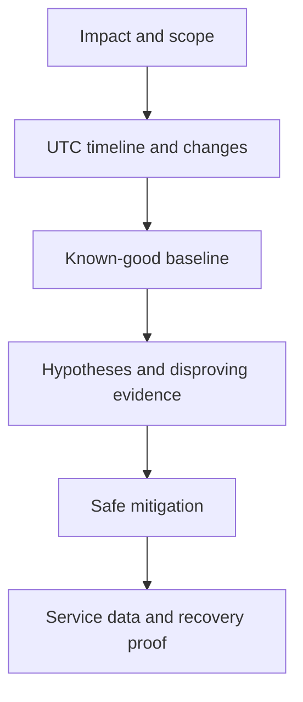

# E-01 — Incident scope, timeline, baseline, and evidence quality

**Procedure status: NOT YET EXECUTED.** This is a teaching procedure for Db2 LUW 12.1.0 on Linux x86-64, single-member topology. The exact fix pack is not pinned. Engine commands run on the Db2 server as the named instance/database authority; client checks run on the client; OS commands run on the named host and normally require read-only access. Windows, AIX, DPF, and pureScale differences are called out where material. The supplied environment has no Db2 CLI or disposable Db2 server, so no lab command is claimed as executed. Before production use, confirm each command against the installed fix pack and local change controls.

## 1. Quick answer

Use this lesson to make a bounded DBA decision about impact and scope boundary, UTC timeline and clock skew, baseline and comparison window. The key is to identify the failing layer and scope before changing state.

**Safest first step:** Capture the current target, timestamp, release, and read-only state before acting.

## 2. Learn the concept

The useful mental model is to follow impact and scope boundary; UTC timeline and clock skew; baseline and comparison window; evidence chain and reproducible commands; customer/privacy redaction; hypothesis log and stop criteria from the service boundary inward. Record who owns each boundary and which evidence is authoritative there.

### Working model

Scope: impact and scope boundary → UTC timeline and clock skew → baseline and comparison window → evidence chain and reproducible commands → customer/privacy redaction → hypothesis log and stop criteria. The arrows represent dependency, not proof of a fault. Confirm each hop independently.



## 3. Choose an approach

| Variant | Choose it when | Do not choose it when / boundary |
|---|---|---|
| Service restoration | Prioritize customer impact and reversible restoration step. | Do not destroy evidence when a safe copy is possible. |
| Root-cause analysis | Compare event against known-good interval and change history. | A single coincident event is not causation. |
| Escalation | Package enough timestamped evidence for next owner/support. | Avoid broad FODC collection unless resource/storage planned. |

## 4. Understand the lifecycle

- Establish incident lead, impact, start and current state.
- Name affected database/instance/member/application/site.
- Capture time-aligned baseline and recent changes.
- Write hypotheses with evidence that would disprove them.
- Mitigate safely, verify service/data, and preserve final timeline.

**Pause/retry/stop/rollback rule:** Stop if the target identity, current state, authority, or rollback dependency is uncertain; preserve evidence and escalate.

## 5. Do the work

### Precheck

- Synchronize UTC timestamps and record any clock offset.
- Use read-only commands first; record command, host, user and return code.
- Redact secrets and minimize customer data in captures.

### Scoped procedures

### Procedure 1: Incident context bundle

**Status:** NOT YET EXECUTED. **Run as:** On-call DBA/host operator. **Target:** Client or server as noted per command. **Authority/prerequisite:** PowerShell example; Linux uses `date -Is`, `hostname`, `id`; capture target explicitly.

```bash
Get-Date -Format o; hostname; whoami; db2level; db2 get instance
```

**Expected result:** Timestamp, host, actor, Db2 release and instance are recorded.

**Independent check:** Compare with application/OS clocks and verify database alias/server separately.

**Stop/rollback boundary:** Read-only; preserve original output and copy before redaction.

### Procedure 2: Bounded baseline sample

**Status:** NOT YET EXECUTED. **Run as:** Instance owner. **Target:** SAMPLE current member. **Authority/prerequisite:** Read-only, bounded one-time snapshot; do not run broad loops without interval limit.

```bash
db2pd -db SAMPLE -applications; db2pd -db SAMPLE -transactions
```

**Expected result:** Application and transaction states are emitted.

**Independent check:** Capture again at a known interval and compare handles/states.

**Stop/rollback boundary:** Read-only; stop collection if it materially affects an unhealthy server.

## 6. Worked example and verification

At 10:04 UTC users report timeout. Host clock is 90 seconds ahead of app logs. Record the offset before ordering events. The timeline can then align listener restart, client retry and Db2 diagnostic records without falsely reversing cause/effect.

**Expected state/result:** An incident packet has impact, target, timeline, baseline, hypothesis evidence and safe escalation boundary.

**Independent verification:**

- Compare the post-state with the captured pre-state.
- Confirm the intended service or data outcome independently of the command return code.

## 7. Diagnose problems

| Symptom or verified error | Evidence to collect | Likely cause | Safe correction and recheck | Avoid |
|---|---|---|---|---|
| Different teams report events in an impossible order. | NTP status, timezone, log timestamp fields and collector clock. | Host/client clock drift or local timezone conversion. | Normalize to UTC and preserve original timestamp plus measured offset. | Editing original diagnostic timestamps. |
| Evidence bundle contains credentials or customer rows. | Search filenames/output for tokens, authorization IDs and data values. | Unfiltered trace/export or shell history included secrets. | Restrict access, redact a working copy and follow security retention/incident policy. | Sending raw package to broad ticket or email distribution. |

## 8. Practice

Create a timeline for a fictional connectivity outage with client, firewall, listener and db2diag times across three timezones. Normalize to UTC and mark uncertainty. Cleanup: redact invented user identifiers in the report.

## 9. Check understanding

**Question:** What makes a baseline useful?

**Answer and reasoning:** It matches the same workload and scope, includes units/time window, and can be compared with a known-good state; a random snapshot is context, not a baseline.

## 10. Look it up later

### Short checklist

- Name the target and scope.
- Collect a baseline and confirm prerequisites.
- Choose the least disruptive supported branch.
- Verify state and service behavior.
- Record evidence and recovery limits.

### Related lessons

[E-02](../E/E-02.md) · [E-03](../E/E-03.md) · [E-06](../E/E-06.md) · [I-01](../I/I-01.md) · [K-01](../K/K-01.md)

### Authoritative references

- [IBM diagnostic log interpretation](https://www.ibm.com/docs/en/db2/12.1.x?topic=files-interpreting-diagnostic-log-file-entries)
- [IBM monitoring interfaces](https://www.ibm.com/docs/en/db2/12.1.x?topic=monitoring-interfaces-database)

---

[Domain index](README.md) · [Course index](../README.md) · [Glossary](../GLOSSARY.md)
