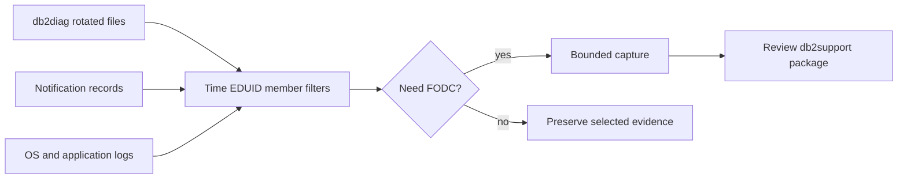

# E-02 — db2diag.log, notification logs, diagnostic signatures, and FODC

**Procedure status: NOT YET EXECUTED.** This is a teaching procedure for Db2 LUW 12.1.0 on Linux x86-64, single-member topology. The exact fix pack is not pinned. Engine commands run on the Db2 server as the named instance/database authority; client checks run on the client; OS commands run on the named host and normally require read-only access. Windows, AIX, DPF, and pureScale differences are called out where material. The supplied environment has no Db2 CLI or disposable Db2 server, so no lab command is claimed as executed. Before production use, confirm each command against the installed fix pack and local change controls.

## 1. Quick answer

Use this lesson to make a bounded DBA decision about diagnostic path/rotation/diagsize, db2diag filters and record fields, notification log correlation. The key is to identify the failing layer and scope before changing state.

**Safest first step:** Capture the current target, timestamp, release, and read-only state before acting.

## 2. Learn the concept

The useful mental model is to follow diagnostic path/rotation/diagsize; db2diag filters and record fields; notification log correlation; EDUID/member/timestamp/signature; FODC trigger/collection size; db2support package and privacy; evidence preservation from the service boundary inward. Record who owns each boundary and which evidence is authoritative there.

### Working model

Scope: diagnostic path/rotation/diagsize → db2diag filters and record fields → notification log correlation → EDUID/member/timestamp/signature → FODC trigger/collection size → db2support package and privacy → evidence preservation. The arrows represent dependency, not proof of a fault. Confirm each hop independently.



## 3. Choose an approach

| Variant | Choose it when | Do not choose it when / boundary |
|---|---|---|
| Log read | Use db2diag filters around a precise time/EDUID. | Do not grep a whole huge rotated tree without bounds. |
| FODC | Collect first-occurrence evidence when a specific hang/crash scenario fits. | FODC may gather large sensitive files. |
| db2support | Package evidence for IBM support after scoped collection. | Review contents and remove secrets only via approved process. |

## 4. Understand the lifecycle

- Resolve `DIAGPATH` and log rotation settings.
- Filter logs by incident time, level, component, EDUID/member and database.
- Correlate notification entries with OS/app evidence.
- Choose FODC type based on symptom and IBM instruction.
- Run db2support and review/transfer by secure support channel.

**Pause/retry/stop/rollback rule:** Stop if the target identity, current state, authority, or rollback dependency is uncertain; preserve evidence and escalate.

## 5. Do the work

### Precheck

- Record exact `db2level`, instance, DIAGPATH and log size.
- Check disk capacity before support capture.
- Do not alter diagsize or remove FODC/log directories during incident.

### Scoped procedures

### Procedure 1: Filter recent severe records

**Status:** NOT YET EXECUTED. **Run as:** Instance owner. **Target:** Current diagnostic log plus rotation policy. **Authority/prerequisite:** Use installed command help to verify option syntax; capture original unfiltered file separately.

```bash
db2diag -g "LEVEL: Severe" -H 2d
```

**Expected result:** Filtered records include timestamp, process/EDUID, database/member and message tokens.

**Independent check:** Correlate matching interval with application and OS log.

**Stop/rollback boundary:** Read-only; preserve copies and avoid truncation.

### Procedure 2: Support data collection

**Status:** NOT YET EXECUTED. **Run as:** Instance owner/authorized support collector. **Target:** SAMPLE and local instance evidence. **Authority/prerequisite:** Check capacity/privacy and IBM case scope first; use exact installed syntax.

```bash
db2support /secure/case/CASE-2026-001 -d SAMPLE -c
```

**Expected result:** Support package is created with collection summary.

**Independent check:** Inspect file list, size and sensitive fields; verify upload destination and case access.

**Stop/rollback boundary:** Remove local copy only under retention policy after confirmed secure transfer.

## 6. Worked example and verification

Repeated `ADM` records with the same EDUID and database context narrow an engine symptom. A matching kernel I/O error at the same UTC minute points to the host/storage layer; preserve both before asking for restart.

**Expected state/result:** A concise evidence bundle points to the first known failure and can be securely reviewed by support.

**Independent verification:**

- Compare the post-state with the captured pre-state.
- Confirm the intended service or data outcome independently of the command return code.

## 7. Diagnose problems

| Symptom or verified error | Evidence to collect | Likely cause | Safe correction and recheck | Avoid |
|---|---|---|---|---|
| db2diag.log appears incomplete after a long incident. | diagsize, rotated file names, DIAGPATH and FODC directory timestamps. | Rotation removed logs outside configured span or evidence is in another instance path. | Collect all relevant rotated files and support data before changing log retention. | Increasing DIAGSIZE during a full filesystem without capacity plan. |
| FODC collection consumes unexpected disk or contains sensitive material. | collector status, destination size, file list and access controls. | Capture scope is wider than incident need or retained trace includes values. | Stop only via documented collector control, secure destination, inspect and minimize transfer. | Uploading an unreviewed package to an unrestricted location. |

## 8. Practice

Use a sample diagnostic log from IBM documentation or a disposable instance. Filter a known timestamp/signature, map EDUID/member, and create an evidence checklist. Simulate low disk by quota planning only; do not fill production logs.

## 9. Check understanding

**Question:** Why is db2support not the first reflex for every incident?

**Answer and reasoning:** The package can be large and sensitive; choose FODC/support collection based on a concrete failure signature and capacity/privacy plan.

## 10. Look it up later

### Short checklist

- Name the target and scope.
- Collect a baseline and confirm prerequisites.
- Choose the least disruptive supported branch.
- Verify state and service behavior.
- Record evidence and recovery limits.

### Related lessons

[E-01](../E/E-01.md) · [E-03](../E/E-03.md) · [K-01](../K/K-01.md) · [K-02](../K/K-02.md)

### Authoritative references

- [IBM diagnostic log interpretation](https://www.ibm.com/docs/en/db2/12.1.x?topic=files-interpreting-diagnostic-log-file-entries)
- [IBM FODC collection](https://www.ibm.com/docs/en/db2/12.1.x?topic=fodc-data-collected-as-part)
- [IBM db2support tool](https://www.ibm.com/docs/en/db2/12.1.x?topic=commands-db2support)

---

[Domain index](README.md) · [Course index](../README.md) · [Glossary](../GLOSSARY.md)
