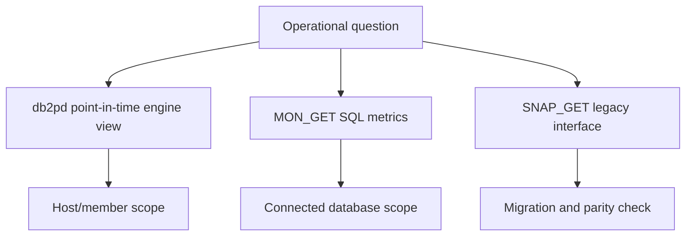

# E-03 — db2pd, monitor table functions, and snapshots

**Procedure status: NOT YET EXECUTED.** This is a teaching procedure for Db2 LUW 12.1.0 on Linux x86-64, single-member topology. The exact fix pack is not pinned. Engine commands run on the Db2 server as the named instance/database authority; client checks run on the client; OS commands run on the named host and normally require read-only access. Windows, AIX, DPF, and pureScale differences are called out where material. The supplied environment has no Db2 CLI or disposable Db2 server, so no lab command is claimed as executed. Before production use, confirm each command against the installed fix pack and local change controls.

## 1. Quick answer

Use this lesson to make a bounded DBA decision about point-in-time db2pd, current MON_GET functions, legacy SNAP_GET monitoring. The key is to identify the failing layer and scope before changing state.

**Safest first step:** Capture the current target, timestamp, release, and read-only state before acting.

## 2. Learn the concept

The useful mental model is to follow point-in-time db2pd; current MON_GET functions; legacy SNAP_GET monitoring; scope/member selectors; counter deltas and resets; monitor privileges; low-overhead and empty-result interpretation from the service boundary inward. Record who owns each boundary and which evidence is authoritative there.

### Working model

Scope: point-in-time db2pd → current MON_GET functions → legacy SNAP_GET monitoring → scope/member selectors → counter deltas and resets → monitor privileges → low-overhead and empty-result interpretation. The arrows represent dependency, not proof of a fault. Confirm each hop independently.



## 3. Choose an approach

| Variant | Choose it when | Do not choose it when / boundary |
|---|---|---|
| db2pd | Use engine-oriented local evidence without SQL connection for many options. | Member-local unless global/member scope is requested. |
| MON_GET | Use SQL reporting for current database metrics. | MON routines generally report connected database; specify columns. |
| SNAP_GET | Retain for legacy scripts that require it. | Older infrastructure; migrate where possible. |

## 4. Understand the lifecycle

- Choose point-in-time, SQL metric, or historical event evidence.
- Select host/database/member and collector identity.
- Record timestamp, units and exact filters.
- Repeat for rates/counters and handle resets.
- Store result with scope and collection overhead.

**Pause/retry/stop/rollback rule:** Stop if the target identity, current state, authority, or rollback dependency is uncertain; preserve evidence and escalate.

## 5. Do the work

### Precheck

- Check command scope in DPF/pureScale; avoid assuming one member is cluster-wide.
- Use least-privilege monitor role and named output columns.
- Set interval and count to bound repeated collection.

### Scoped procedures

### Procedure 1: Local engine snapshot

**Status:** NOT YET EXECUTED. **Run as:** Instance owner. **Target:** Active SAMPLE local member. **Authority/prerequisite:** Read-only; first command can run without a database connection for many db2pd options; verify option support.

```bash
db2pd -db SAMPLE -applications -transactions
```

**Expected result:** Current application and transaction view is printed.

**Independent check:** Compare with MON_GET_CONNECTION and host process evidence.

**Stop/rollback boundary:** Read-only; do not poll aggressively on stressed engine.

### Procedure 2: SQL monitor sample

**Status:** NOT YET EXECUTED. **Run as:** Database user with monitor privilege. **Target:** Connected database; all supported member scope for -2. **Authority/prerequisite:** Name columns explicitly; current database must be connected.

```bash
SELECT application_handle, client_applname, client_hostname FROM TABLE(mon_get_connection(NULL,-2)) AS c
```

**Expected result:** Current connection rows are returned.

**Independent check:** Take two timestamped samples or join to unit-of-work/lock functions for context.

**Stop/rollback boundary:** Read-only; migrate SNAP_GET consumers after comparing scope/privileges.

## 6. Worked example and verification

`db2pd -db SAMPLE -applications` on one DPF host is local evidence. MON_GET with member selector `-2` can provide broader current database scope. Compare member columns and do not sum duplicate global metrics.

**Expected state/result:** A metric is tagged as current gauge, cumulative counter, or delta and has explicit database/member/time scope.

**Independent verification:**

- Compare the post-state with the captured pre-state.
- Confirm the intended service or data outcome independently of the command return code.

## 7. Diagnose problems

| Symptom or verified error | Evidence to collect | Likely cause | Safe correction and recheck | Avoid |
|---|---|---|---|---|
| db2pd says database is not active on local member. | local catalog, active member list, command host and `db2instance -list`. | Wrong host/member or database not active in local scope. | Run on correct host/member or use documented global scope; verify activation. | Assuming an empty/local error means whole database is down. |
| Monitor SQL returns an authorization error. | connected ID, monitor authority, function scope and SQLSTATE. | Query identity lacks required monitor privilege or view access. | Use least-privilege monitor privilege approved for target; retest with explicit columns. | Granting DBADM to monitoring service. |

## 8. Practice

Collect a one-time db2pd sample and a MON_GET_CONNECTION sample against disposable SAMPLE. Add second samples five seconds apart, classify counters/gauges, and document member scope. Cleanup: disconnect test session.

## 9. Check understanding

**Question:** When should legacy snapshots be retained?

**Answer and reasoning:** Only where an existing integration still depends on them or the migrated monitoring interface does not answer a needed scope; document older infrastructure and comparison.

## 10. Look it up later

### Short checklist

- Name the target and scope.
- Collect a baseline and confirm prerequisites.
- Choose the least disruptive supported branch.
- Verify state and service behavior.
- Record evidence and recovery limits.

### Related lessons

[E-04](../E/E-04.md) · [E-05](../E/E-05.md) · [E-06](../E/E-06.md) · [C-03](../C/C-03.md)

### Authoritative references

- [IBM monitoring interfaces](https://www.ibm.com/docs/en/db2/12.1.x?topic=monitoring-interfaces-database)
- [IBM MON routines](https://www.ibm.com/docs/en/db2/12.1.x?topic=functions-monitor-mon-routines)
- [IBM db2pd reference](https://www.ibm.com/docs/en/db2/12.1.x?topic=commands-db2pd-monitor-troubleshoot-db2-engine-activities)

---

[Domain index](README.md) · [Course index](../README.md) · [Glossary](../GLOSSARY.md)
