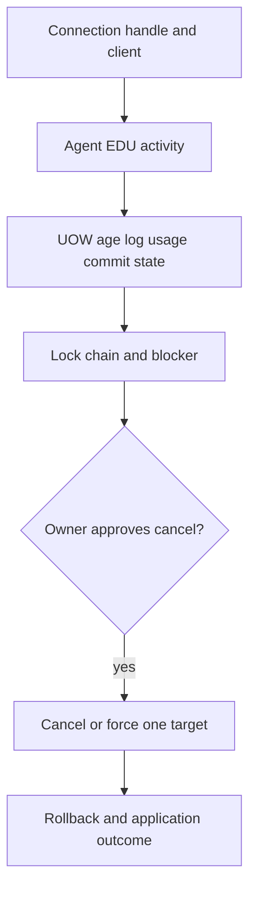

# E-04 — Connections, applications, agents, transactions, and long-running work

**Procedure status: NOT YET EXECUTED.** This is a teaching procedure for Db2 LUW 12.1.0 on Linux x86-64, single-member topology. The exact fix pack is not pinned. Engine commands run on the Db2 server as the named instance/database authority; client checks run on the client; OS commands run on the named host and normally require read-only access. Windows, AIX, DPF, and pureScale differences are called out where material. The supplied environment has no Db2 CLI or disposable Db2 server, so no lab command is claimed as executed. Before production use, confirm each command against the installed fix pack and local change controls.

## 1. Quick answer

Use this lesson to make a bounded DBA decision about application handles and client identity, agent/EDU state, UOW start and log usage. The key is to identify the failing layer and scope before changing state.

**Safest first step:** Capture the current target, timestamp, release, and read-only state before acting.

## 2. Learn the concept

The useful mental model is to follow application handles and client identity; agent/EDU state; UOW start and log usage; active statement and package; blocking and transaction age; cancellation/force consequences; pool cleanup and request proof from the service boundary inward. Record who owns each boundary and which evidence is authoritative there.

### Working model

Scope: application handles and client identity → agent/EDU state → UOW start and log usage → active statement and package → blocking and transaction age → cancellation/force consequences → pool cleanup and request proof. The arrows represent dependency, not proof of a fault. Confirm each hop independently.



## 3. Choose an approach

| Variant | Choose it when | Do not choose it when / boundary |
|---|---|---|
| Idle connection | Inspect last activity and client pool owner. | Do not force every idle pooled session. |
| Long active UOW | Review statement, locks, log use and commit boundary. | Age alone does not prove a hung transaction. |
| Intervention | Prefer app cancel/transaction-safe action; force only after impact review. | Force can trigger rollback and hold resources. |

## 4. Understand the lifecycle

- Find handle and client identity.
- Inspect EDU/statement/UOW and lock chain.
- Ask owner whether request is live and whether cancellation is safe.
- If approved, cancel/force the specific handle and monitor rollback.
- Verify application recovery and commit/data outcome.

**Pause/retry/stop/rollback rule:** Stop if the target identity, current state, authority, or rollback dependency is uncertain; preserve evidence and escalate.

## 5. Do the work

### Precheck

- Capture handle, member, auth ID, client host, app name and UOW start.
- Check whether application owns a larger transaction or connection pool.
- Estimate rollback time/log consequence before forced action.

### Scoped procedures

### Procedure 1: Find applications and transactions

**Status:** NOT YET EXECUTED. **Run as:** Instance owner. **Target:** SAMPLE active member. **Authority/prerequisite:** Read-only; choose database/member and capture UTC.

```bash
db2pd -db SAMPLE -applications -transactions; db2 list applications show detail
```

**Expected result:** Application handles, status, UOW and client details are shown.

**Independent check:** Correlate with MON_GET_ACTIVITY/UNIT_OF_WORK and application owner.

**Stop/rollback boundary:** No state change; preserve output before intervention.

### Procedure 2: Force one approved handle

**Status:** NOT YET EXECUTED. **Run as:** Instance owner/authorized administrator. **Target:** Application handle 12345 in verified database. **Authority/prerequisite:** Example handle is synthetic; recheck handle/member/owner immediately before action and obtain incident authorization.

```bash
FORCE APPLICATION (12345)
```

**Expected result:** Connection is terminated and rollback begins; client receives disconnect.

**Independent check:** Watch transaction/log/lock state until rollback completes; ask app owner to verify outcome.

**Stop/rollback boundary:** Force is not reversible. If commit outcome is uncertain, reconcile by request key; do not force additional handles to clear symptoms.

## 6. Worked example and verification

A 90-minute UOW blocks a batch. The session owner confirms it is abandoned and idempotent. Record handle and key, stop the worker at its source, then force that one handle and watch rollback; only close incident after locks/log space recover.

**Expected state/result:** The active request is identified by handle and owner; cancellation decision accounts for rollback and business commit outcome.

**Independent verification:**

- Compare the post-state with the captured pre-state.
- Confirm the intended service or data outcome independently of the command return code.

## 7. Diagnose problems

| Symptom or verified error | Evidence to collect | Likely cause | Safe correction and recheck | Avoid |
|---|---|---|---|---|
| `FORCE APPLICATION` returns but lock waits remain. | rollback state, other blocker handles, lock tree and transaction age. | Forced unit is rolling back or a different blocker remains. | Track rollback to completion and identify current root blocker before another action. | Repeatedly forcing waiters instead of the owner. |
| Aged transaction belongs to a connection pool and app denies ownership. | client metadata, app deployment/host, connection pool and request correlation ID. | Missing client attribution or leaked connection/work unit. | Use app logs and pool admin to locate owner; preserve state until cancellation is approved. | Killing the whole Db2 instance to remove one unknown transaction. |

## 8. Practice

Create two lab sessions: one holds a row lock and one waits. Observe handles/UOWs, cancel the waiter, then use a second disposable run to terminate only the blocker and watch rollback. Verify no open test locks remain.

## 9. Check understanding

**Question:** What should be checked after forcing an application?

**Answer and reasoning:** Rollback completion, released locks/log space, client pool state, and business outcome keyed to the request. A force return alone does not prove transaction resolution.

## 10. Look it up later

### Short checklist

- Name the target and scope.
- Collect a baseline and confirm prerequisites.
- Choose the least disruptive supported branch.
- Verify state and service behavior.
- Record evidence and recovery limits.

### Related lessons

[B-05](../B/B-05.md) · [H-05](../H/H-05.md) · [K-01](../K/K-01.md)

### Authoritative references

- [IBM MON routines](https://www.ibm.com/docs/en/db2/12.1.x?topic=functions-monitor-mon-routines)
- [IBM diagnostic log interpretation](https://www.ibm.com/docs/en/db2/12.1.x?topic=files-interpreting-diagnostic-log-file-entries)

---

[Domain index](README.md) · [Course index](../README.md) · [Glossary](../GLOSSARY.md)
