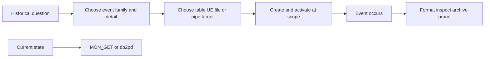

# E-05 — Event-monitor families, targets, lifecycle, storage, and interpretation

**Procedure status: NOT YET EXECUTED.** This is a teaching procedure for Db2 LUW 12.1.0 on Linux x86-64, single-member topology. The exact fix pack is not pinned. Engine commands run on the Db2 server as the named instance/database authority; client checks run on the client; OS commands run on the named host and normally require read-only access. Windows, AIX, DPF, and pureScale differences are called out where material. The supplied environment has no Db2 CLI or disposable Db2 server, so no lab command is claimed as executed. Before production use, confirm each command against the installed fix pack and local change controls.

## 1. Quick answer

Use this lesson to make a bounded DBA decision about database/table/connection/statement/transaction/activity/statistics events, lock/deadlock/threshold/package-cache/change-history families, table/unformatted/file/pipe targets. The key is to identify the failing layer and scope before changing state.

**Safest first step:** Capture the current target, timestamp, release, and read-only state before acting.

## 2. Learn the concept

The useful mental model is to follow database/table/connection/statement/transaction/activity/statistics events; lock/deadlock/threshold/package-cache/change-history families; table/unformatted/file/pipe targets; create activate flush/deactivate/drop lifecycle; storage overhead/privacy and retention; no-data and lost-event causes from the service boundary inward. Record who owns each boundary and which evidence is authoritative there.

### Working model

Scope: database/table/connection/statement/transaction/activity/statistics events → lock/deadlock/threshold/package-cache/change-history families → table/unformatted/file/pipe targets → create activate flush/deactivate/drop lifecycle → storage overhead/privacy and retention → no-data and lost-event causes. The arrows represent dependency, not proof of a fault. Confirm each hop independently.



## 3. Choose an approach

| Variant | Choose it when | Do not choose it when / boundary |
|---|---|---|
| Point-in-time | MON/`db2pd` answers what is happening now. | Cannot reconstruct an event that already ended. |
| Event monitor | Captures selected event history at configured detail. | Requires event type, target, activation scope and retention. |
| Lock event monitor | Captures waits/timeouts/deadlocks with participants and activities. | SQL history/values increase overhead and privacy exposure. |

## 4. Understand the lifecycle

- Define question and event type/detail threshold.
- Choose output target and size/retention plan.
- Create monitor, activate collection at database/workload scope.
- Generate controlled event and verify output.
- Deactivate/flush, interpret, archive/prune and drop object/table only if approved.

**Pause/retry/stop/rollback rule:** Stop if the target identity, current state, authority, or rollback dependency is uncertain; preserve evidence and escalate.

## 5. Do the work

### Precheck

- Check target table space/file capacity and protected access.
- Avoid collecting statement values unless needed and privacy-approved.
- Confirm correct workload/database scope and member coverage.

### Scoped procedures

### Procedure 1: Create a lock event monitor

**Status:** NOT YET EXECUTED. **Run as:** DBADM or SQLADM. **Target:** Current database, lock events. **Authority/prerequisite:** Create only in disposable database; configure needed workload/database event scope and retention.

```bash
CREATE EVENT MONITOR LOCKLAB FOR LOCKING WRITE TO TABLE; SET EVENT MONITOR LOCKLAB STATE 1;
```

**Expected result:** Lock event output tables exist and monitor is active.

**Independent check:** Generate one test lock event, query output/control rows, and verify timestamp/participants.

**Stop/rollback boundary:** Deactivate with `SET EVENT MONITOR LOCKLAB STATE 0`; drop monitor and associated tables only after export/retention check.

### Procedure 2: Create statement event monitor to file

**Status:** NOT YET EXECUTED. **Run as:** DBADM or SQLADM. **Target:** Current database and server output directory. **Authority/prerequisite:** Confirm file target syntax/path, owner permission, disk quota and privacy before activation.

```bash
CREATE EVENT MONITOR STMTLAB FOR STATEMENTS WRITE TO FILE '/db2diag/evmon'; SET EVENT MONITOR STMTLAB STATE 1;
```

**Expected result:** Event files created on events; monitor status active.

**Independent check:** Generate one known statement and verify event output with formatter; compare file count/bytes.

**Stop/rollback boundary:** Deactivate and flush using documented family lifecycle; preserve/rotate files before cleanup.

## 6. Worked example and verification

A lock event monitor created successfully but outputs no data because the capture setting/workload scope was not enabled or no qualifying lock event occurred. Test lifecycle with a deliberate lock in a lab before treating empty tables as failure.

**Expected state/result:** Monitor definition, event type, output target, activation state, event capture scope and retention are all known.

**Independent verification:**

- Compare the post-state with the captured pre-state.
- Confirm the intended service or data outcome independently of the command return code.

## 7. Diagnose problems

| Symptom or verified error | Evidence to collect | Likely cause | Safe correction and recheck | Avoid |
|---|---|---|---|---|
| Event tables are empty although the event monitor is active. | SYSCAT.EVENTMONITORS, SET EVENT MONITOR state, workload/database capture parameters, target/member. | Monitor exists but capture was not enabled at required scope or event threshold was not met. | Enable the specific event data source and trigger a controlled qualifying event. | Broadly enabling statement values on every workload. |
| Event monitor stops or misses events as disk fills. | file/table-space capacity, PCTDEACTIVATE/target status, overflow records. | Output target full or storage growth unbounded. | Deactivate/rotate/export then prune according to retention and increase bounded capacity. | Dropping output tables before preserving evidence. |

## 8. Practice

Create a lock event monitor in a lab, activate capture, induce a short lock wait and one deadlock between test sessions, then query formatted events. Deactivate and archive outputs. Cleanup monitor plus only its lab tables/files.

## 9. Check understanding

**Question:** Why are event monitors not a replacement for MON_GET?

**Answer and reasoning:** MON_GET is a current database observation; event monitors capture selected events over time. Their scopes, storage, overhead and lifecycle differ.

## 10. Look it up later

### Short checklist

- Name the target and scope.
- Collect a baseline and confirm prerequisites.
- Choose the least disruptive supported branch.
- Verify state and service behavior.
- Record evidence and recovery limits.

### Related lessons

[E-03](../E/E-03.md) · [E-06](../E/E-06.md) · [D-05](../D/D-05.md) · [H-05](../H/H-05.md)

### Authoritative references

- [IBM creating event monitors](https://www.ibm.com/docs/en/db2/12.1.0?topic=monitors-creating-event)
- [IBM lock and deadlock event monitoring](https://www.ibm.com/docs/en/db2/12.1.x?topic=events-lock-deadlock-event-monitoring)
- [IBM monitoring interfaces](https://www.ibm.com/docs/en/db2/12.1.x?topic=monitoring-interfaces-database)

---

[Domain index](README.md) · [Course index](../README.md) · [Glossary](../GLOSSARY.md)
