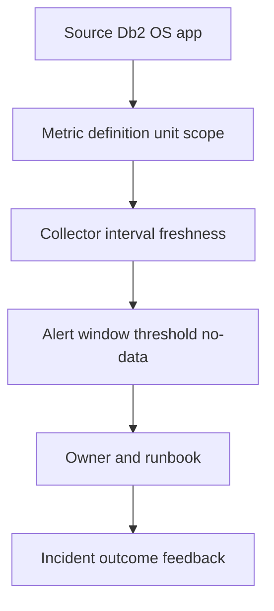

# E-06 — Db2/OS observability, metric definitions, alerts, and operational reporting

**Procedure status: NOT YET EXECUTED.** This is a teaching procedure for Db2 LUW 12.1.0 on Linux x86-64, single-member topology. The exact fix pack is not pinned. Engine commands run on the Db2 server as the named instance/database authority; client checks run on the client; OS commands run on the named host and normally require read-only access. Windows, AIX, DPF, and pureScale differences are called out where material. The supplied environment has no Db2 CLI or disposable Db2 server, so no lab command is claimed as executed. Before production use, confirm each command against the installed fix pack and local change controls.

## 1. Quick answer

Use this lesson to make a bounded DBA decision about counter/gauge/rate/histogram definitions, database/member/host dimensions, CPU memory I/O network log space metrics. The key is to identify the failing layer and scope before changing state.

**Safest first step:** Capture the current target, timestamp, release, and read-only state before acting.

## 2. Learn the concept

The useful mental model is to follow counter/gauge/rate/histogram definitions; database/member/host dimensions; CPU memory I/O network log space metrics; sampling/reset and source freshness; alert thresholds seasonality and baseline; dashboard data lineage; false-positive/no-data detection; symptom to runbook mapping from the service boundary inward. Record who owns each boundary and which evidence is authoritative there.

### Working model

Scope: counter/gauge/rate/histogram definitions → database/member/host dimensions → CPU memory I/O network log space metrics → sampling/reset and source freshness → alert thresholds seasonality and baseline → dashboard data lineage → false-positive/no-data detection → symptom to runbook mapping. The arrows represent dependency, not proof of a fault. Confirm each hop independently.



## 3. Choose an approach

| Variant | Choose it when | Do not choose it when / boundary |
|---|---|---|
| Gauge | Measure current value such as bytes used or active connections. | Threshold should consider capacity and duration. |
| Counter/rate | Use interval delta or monotonic rate. | Handle reset, restart, wrap and member scope. |
| Histogram/latency | Report percentiles from request-level samples. | Average latency hides tail behavior. |

## 4. Understand the lifecycle

- Define SLI/SLO and exact metric name/unit/scope.
- Collect aligned host/Db2/application samples.
- Set threshold duration, reset and no-data semantics.
- Route alert to a runbook and accountable owner.
- Review false positives and outcome after each incident.

**Pause/retry/stop/rollback rule:** Stop if the target identity, current state, authority, or rollback dependency is uncertain; preserve evidence and escalate.

## 5. Do the work

### Precheck

- Inventory source, exporter version, scrape interval and labels.
- Confirm sample freshness and metric reset behavior.
- Avoid combining host and member series without dimensions.

### Scoped procedures

### Procedure 1: Host interval telemetry

**Status:** NOT YET EXECUTED. **Run as:** Linux observability operator. **Target:** One host over five seconds. **Authority/prerequisite:** sysstat installed; align sample with Db2 dashboard window.

```bash
sar -u 1 5; sar -r 1 5; sar -d 1 5
```

**Expected result:** CPU, memory and device samples appear with interval data.

**Independent check:** Compare exporter series, units and timestamp; check gaps.

**Stop/rollback boundary:** Read-only; no alert threshold edits from a single sample.

### Procedure 2: Db2 log metric query

**Status:** NOT YET EXECUTED. **Run as:** Database monitor user. **Target:** Current database member scope. **Authority/prerequisite:** Column/function signature should be confirmed on installed fix pack.

```bash
SELECT member, total_log_used, total_log_available FROM TABLE(mon_get_transaction_log(-2)) AS l
```

**Expected result:** Current log usage/available metrics by member are returned.

**Independent check:** Compute percent used with units and compare log filesystem/active UOWs.

**Stop/rollback boundary:** Read-only; do not alert on total bytes without capacity denominator.

## 6. Worked example and verification

An alert fires when log usage exceeds 85%. Validate whether it is a gauge sampled every 30 seconds, whether delayed-member data is stale, and whether the denominator is per member. A single stale series should trigger a telemetry-health alert, not a log-full incident.

**Expected state/result:** Every alert has metric definition, unit, scope, window, threshold rationale, owner, and runbook.

**Independent verification:**

- Compare the post-state with the captured pre-state.
- Confirm the intended service or data outcome independently of the command return code.

## 7. Diagnose problems

| Symptom or verified error | Evidence to collect | Likely cause | Safe correction and recheck | Avoid |
|---|---|---|---|---|
| Dashboard appears normal but Db2 is slow. | scrape freshness, exporter errors, member labels and app latency source. | Telemetry gap or aggregation hid a hot member/tail latency. | Repair collection and compare raw per-member/per-host series; preserve app timing. | Raising thresholds to silence missing-data symptoms. |
| Alert storms on a counter reset after restart. | process restart, counter monotonicity and scrape timestamps. | Counter reset interpreted as a negative/huge rate. | Apply reset-aware rate calculation and test restart boundary. | Treating lifetime counter as instantaneous load. |

## 8. Practice

Define an alert for log capacity and one for query latency. For each write unit, scope, sampling interval, sustained threshold, reset/no-data condition, owner and response. Feed synthetic reset and missing data into a spreadsheet/test harness; do not change production alert routes.

## 9. Check understanding

**Question:** What is the difference between a zero metric and no metric?

**Answer and reasoning:** Zero is a measured value; no metric may indicate missing collection, scope mismatch or an inactive series. Alerting must distinguish them.

## 10. Look it up later

### Short checklist

- Name the target and scope.
- Collect a baseline and confirm prerequisites.
- Choose the least disruptive supported branch.
- Verify state and service behavior.
- Record evidence and recovery limits.

### Related lessons

[E-01](../E/E-01.md) · [E-03](../E/E-03.md) · [E-05](../E/E-05.md) · [I-01](../I/I-01.md) · [J-05](../J/J-05.md)

### Authoritative references

- [IBM MON routines](https://www.ibm.com/docs/en/db2/12.1.x?topic=functions-monitor-mon-routines)
- [IBM monitoring interfaces](https://www.ibm.com/docs/en/db2/12.1.x?topic=monitoring-interfaces-database)
- [Linux sar manual](https://man7.org/linux/man-pages/man1/sar.1.html)

---

[Domain index](README.md) · [Course index](../README.md) · [Glossary](../GLOSSARY.md)
