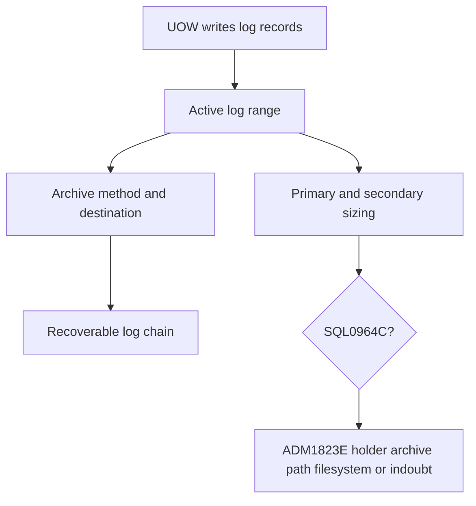

# F-01 — Circular/archive logging, log paths, sizing, log chains, and log-full diagnosis

**Procedure status: NOT YET EXECUTED.** This is a teaching procedure for Db2 LUW 12.1.0 on Linux x86-64, single-member topology. The exact fix pack is not pinned. Engine commands run on the Db2 server as the named instance/database authority; client checks run on the client; OS commands run on the named host and normally require read-only access. Windows, AIX, DPF, and pureScale differences are called out where material. The supplied environment has no Db2 CLI or disposable Db2 server, so no lab command is claimed as executed. Before production use, confirm each command against the installed fix pack and local change controls.

## 1. Quick answer

Use this lesson to make a bounded DBA decision about circular versus archive recovery, primary/secondary logs and LOGFILSIZ, active/archive/mirror/overflow paths. The key is to identify the failing layer and scope before changing state.

**Safest first step:** Capture the current target, timestamp, release, and read-only state before acting.

## 2. Learn the concept

The useful mental model is to follow circular versus archive recovery; primary/secondary logs and LOGFILSIZ; active/archive/mirror/overflow paths; archive methods LOGRETAIN USEREXIT DISK DB2REMOTE TSM VENDOR; log chain sequence and infinite logging; log buffer and pinned logs; SQL0964C/ADM1823E log-full diagnosis; restart/backup implications from the service boundary inward. Record who owns each boundary and which evidence is authoritative there.

### Working model

Scope: circular versus archive recovery → primary/secondary logs and LOGFILSIZ → active/archive/mirror/overflow paths → archive methods LOGRETAIN USEREXIT DISK DB2REMOTE TSM VENDOR → log chain sequence and infinite logging → log buffer and pinned logs → SQL0964C/ADM1823E log-full diagnosis → restart/backup implications. The arrows represent dependency, not proof of a fault. Confirm each hop independently.



## 3. Choose an approach

| Variant | Choose it when | Do not choose it when / boundary |
|---|---|---|
| Circular | Suitable for simple crash recovery where roll-forward is not required. | No roll-forward recovery from backup. |
| Archive logging | Required for roll-forward recovery and online backup. | Archive destination and log chain become recovery dependencies. |
| Infinite logging | Archive logs to extend active history where designed. | Archive failure can still exhaust active log resources. |

## 4. Understand the lifecycle

- Inspect log mode, sizes, active path and archive method.
- Design log/active/archive filesystems and retention.
- Enable archive method if converting, take required offline backup/reactivation boundary.
- Monitor log usage and archive latency.
- For SQL0964C identify pinned UOW/indoubt/archive failure, resolve and recheck rollback completion.

**Pause/retry/stop/rollback rule:** Stop if the target identity, current state, authority, or rollback dependency is uncertain; preserve evidence and escalate.

## 5. Do the work

### Precheck

- Capture DB CFG log settings and current log state.
- Measure log filesystem blocks/inodes and archive destination reachability.
- Before enabling archive logging, plan activation and mandatory backup boundary.

### Scoped procedures

### Procedure 1: Inspect current log configuration

**Status:** NOT YET EXECUTED. **Run as:** Instance owner/monitor operator. **Target:** SAMPLE log stream. **Authority/prerequisite:** Read-only; correct database/member.

```bash
db2 get db cfg for SAMPLE show detail; db2pd -db SAMPLE -logs
```

**Expected result:** Log mode, sizes, paths and current log use are visible.

**Independent check:** Compare active log range with archive method, filesystem and oldest UOW.

**Stop/rollback boundary:** Read-only.

### Procedure 2: Configure a lab archive destination

**Status:** NOT YET EXECUTED. **Run as:** SYSADM, SYSCTRL or SYSMAINT. **Target:** Database SAMPLE. **Authority/prerequisite:** Existing empty private path; confirm owner permissions, backup boundary and archive retrieval procedure.

```bash
db2 update db cfg for SAMPLE using logarchmeth1 DISK:/db2archive/SAMPLE
```

**Expected result:** DB CFG value changes; if logarchmeth2 is OFF, transition takes effect after reactivation and requires an offline backup before reactivation.

**Independent check:** GET DB CFG, create required offline backup, reactivate, then verify archive files from a controlled log switch.

**Stop/rollback boundary:** Restore captured configuration only with documented transition/backup sequence; do not manually delete logs.

### Procedure 3: Diagnose a full active log

**Status:** NOT YET EXECUTED. **Run as:** Instance owner / monitor user. **Target:** SAMPLE active log holders. **Authority/prerequisite:** Use exact handle/transaction evidence; query all DPF members where applicable.

```bash
db2pd -db SAMPLE -transactions; db2 "select application_handle, uow_start_time, uow_log_space_used from table(mon_get_unit_of_work(null,-2)) as u"
```

**Expected result:** Long UOW and log usage are identified; ADM1823E may identify application handle.

**Independent check:** After transaction commit/rollback or approved force, wait for rollback completion and confirm log use clears.

**Stop/rollback boundary:** Do not force an indoubt transaction; use resolution procedure. Avoid manual log deletion.

## 6. Worked example and verification

SQL0964C plus ADM1823E identifies one application holding active log space. The condition can persist while a large rollback runs. Resolve the UOW safely, monitor rollback, and only use temporary LOGSECOND growth if the documented incident procedure requires it and filesystem headroom exists.

**Expected state/result:** Logging mode and archive chain are understood; a log-full incident has an identified holder/archive fault and successful post-recovery log rotation.

**Independent verification:**

- Compare the post-state with the captured pre-state.
- Confirm the intended service or data outcome independently of the command return code.

## 7. Diagnose problems

| Symptom or verified error | Evidence to collect | Likely cause | Safe correction and recheck | Avoid |
|---|---|---|---|---|
| SQL0964C and ADM1823E names an application handle. | transaction log metrics, UOW start/log use, member notification logs and rollback state. | Large/long unit of work pins active log range. | Have owner commit/rollback or approve targeted force; monitor rollback to completion. | Increasing log space indefinitely while leaving the pinned transaction running. |
| Archive log path stops receiving files. | archive method, permissions, free blocks/inodes, archive utility logs and db2diag. | Destination full, inaccessible, misconfigured or failing external vendor/API. | Restore destination/archive service and verify a new archived log is retrievable. | Switching to circular logging to clear pressure without accepting loss of roll-forward recovery. |

## 8. Practice

In a disposable recoverable database, set a small log configuration, generate a bounded transaction, observe UOW/log usage, and commit/rollback. Demonstrate archive path capacity fault only using a controlled test directory. Re-establish log archive and test archive retrieval.

## 9. Check understanding

**Question:** Why does `LOGARCHMETH1` changing from OFF not immediately mean recoverability is ready?

**Answer and reasoning:** Depending on `LOGARCHMETH2`, activation boundary and mandatory offline backup apply. Archive destination must work, and restore/log-chain proof is required.

## 10. Look it up later

### Short checklist

- Name the target and scope.
- Collect a baseline and confirm prerequisites.
- Choose the least disruptive supported branch.
- Verify state and service behavior.
- Record evidence and recovery limits.

### Related lessons

[A-04](../A/A-04.md) · [B-03](../B/B-03.md) · [F-03](../F/F-03.md) · [F-07](../F/F-07.md) · [K-01](../K/K-01.md)

### Authoritative references

- [IBM logging configuration](https://www.ibm.com/docs/en/db2/12.1.x?topic=availability-configuring-database-logging)
- [IBM log file allocation](https://www.ibm.com/docs/en/db2/12.1.x?topic=management-log-file-allocation-removal)
- [IBM SQL0964C troubleshooting](https://www.ibm.com/docs/en/db2/12.1.x?topic=servers-troubleshooting-full-transaction-log-error)

---

[Domain index](README.md) · [Course index](../README.md) · [Glossary](../GLOSSARY.md)
