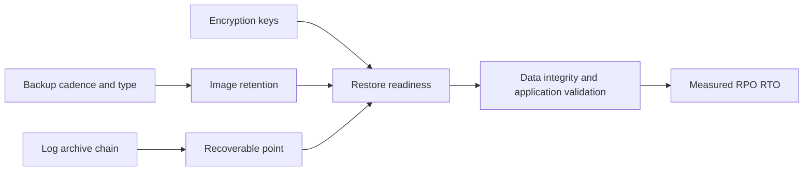

# F-02 — RPO/RTO, backup design, retention, capacity, encryption, and restore rehearsal

**Procedure status: NOT YET EXECUTED.** This is a teaching procedure for Db2 LUW 12.1.0 on Linux x86-64, single-member topology. The exact fix pack is not pinned. Engine commands run on the Db2 server as the named instance/database authority; client checks run on the client; OS commands run on the named host and normally require read-only access. Windows, AIX, DPF, and pureScale differences are called out where material. The supplied environment has no Db2 CLI or disposable Db2 server, so no lab command is claimed as executed. Before production use, confirm each command against the installed fix pack and local change controls.

## 1. Quick answer

Use this lesson to make a bounded DBA decision about business consistency point and RPO, service restoration target and RTO, full/incremental/delta cadence. The key is to identify the failing layer and scope before changing state.

**Safest first step:** Capture the current target, timestamp, release, and read-only state before acting.

## 2. Learn the concept

The useful mental model is to follow business consistency point and RPO; service restoration target and RTO; full/incremental/delta cadence; retention and image/log capacity; off-host/off-site/immutable copies; encryption/key availability; snapshot/vendor integration; backup window and workload; measured restore rehearsal from the service boundary inward. Record who owns each boundary and which evidence is authoritative there.

### Working model

Scope: business consistency point and RPO → service restoration target and RTO → full/incremental/delta cadence → retention and image/log capacity → off-host/off-site/immutable copies → encryption/key availability → snapshot/vendor integration → backup window and workload → measured restore rehearsal. The arrows represent dependency, not proof of a fault. Confirm each hop independently.



## 3. Choose an approach

| Variant | Choose it when | Do not choose it when / boundary |
|---|---|---|
| RPO | Maximum tolerable data loss, measured in recoverable commit time. | A backup schedule alone does not state actual RPO. |
| RTO | Time to restore service including infrastructure, restore, rollforward, validation and routing. | Backup duration is not full RTO. |
| Backup topology | Native images, snapshot or vendor media must map to restore capability. | A second copy in the same failure domain is not independent. |

## 4. Understand the lifecycle

- Identify transaction/data consistency objective and business owner.
- Choose full/incremental/delta and log retention by recovery scenarios.
- Budget primary/secondary copies, staging and encryption keys.
- Rehearse restore to an isolated target and measure every step.
- Set acceptance thresholds, retention and renewal cadence.

**Pause/retry/stop/rollback rule:** Stop if the target identity, current state, authority, or rollback dependency is uncertain; preserve evidence and escalate.

## 5. Do the work

### Precheck

- Collect data, log and growth rates plus backup image sizes.
- Include restore staging, temp space, catalog/metadata and key custody.
- Measure current restore/validation/application startup; record actual timestamp.

### Scoped procedures

### Procedure 1: Inspect backup history

**Status:** NOT YET EXECUTED. **Run as:** Instance owner/backup authority. **Target:** SAMPLE database history. **Authority/prerequisite:** Read-only; history can be pruned and is not the sole copy of evidence.

```bash
LIST HISTORY BACKUP ALL FOR SAMPLE
```

**Expected result:** Backup type/time/device/status are listed.

**Independent check:** Compare image storage inventory and log archive chain; perform a restore rehearsal.

**Stop/rollback boundary:** Do not prune history until retention and incremental-chain requirements are proven.

### Procedure 2: RPO/RTO calculation example

**Status:** NOT YET EXECUTED. **Run as:** DBA with service owner. **Target:** Named recovery scenario/site. **Authority/prerequisite:** Use a real drill stopwatch and business-approved consistency point; formulas are planning definitions, not Db2 commands.

```bash
RPO_actual = incident_time - latest_recoverable_commit_time
RTO_actual = infrastructure + restore + rollforward + validation + routing
```

**Expected result:** Recovery design has measured values and a stated acceptance gap.

**Independent check:** Run a restore rehearsal and compare with objective.

**Stop/rollback boundary:** If targets fail, change backup frequency/capacity/topology, then retest.

## 6. Worked example and verification

A 15-minute backup interval does not guarantee 15-minute RPO if log archiving is delayed. A four-hour database restore does not meet a two-hour RTO even when the image is valid. Test log retrieval and application validation at alternate site.

**Expected state/result:** One written design maps each failure scenario to recoverable point, image/log chain, keys, target capacity, measured RTO and responsible owner.

**Independent verification:**

- Compare the post-state with the captured pre-state.
- Confirm the intended service or data outcome independently of the command return code.

## 7. Diagnose problems

| Symptom or verified error | Evidence to collect | Likely cause | Safe correction and recheck | Avoid |
|---|---|---|---|---|
| Backup meets daily schedule but restore exceeds RTO. | image sizes, restore bandwidth, log replay rate, key service and app startup timeline. | Policy optimized for backup completion, not recovery throughput/validation. | Measure bottleneck and add restore capacity/parallelism or alternate method; repeat full drill. | Estimating RTO from backup duration. |
| Retained images exist but needed log chain is missing. | history records, archive inventory, chain IDs and missing sequence list. | Retention pruned required base/log or copies are not independent. | Repair retention and test from surviving image to intended point; accept lost RPO if no legal chain. | Deleting logs based only on age or filename. |

## 8. Practice

Design backup policy for a 2 TB OLTP database with 15-minute RPO and 2-hour RTO. Estimate image, logs, staging and offsite capacity from stated rates. Run a timed lab restore and compare with objective. Cleanup: keep test evidence, delete only disposable images under retention.

## 9. Check understanding

**Question:** What proves a backup plan meets its objective?

**Answer and reasoning:** A successful independent restore/rollforward and application/data check with measured RPO and total RTO, including keys, logs, routing and validation.

## 10. Look it up later

### Short checklist

- Name the target and scope.
- Collect a baseline and confirm prerequisites.
- Choose the least disruptive supported branch.
- Verify state and service behavior.
- Record evidence and recovery limits.

### Related lessons

[F-03](../F/F-03.md) · [F-04](../F/F-04.md) · [F-09](../F/F-09.md) · [G-01](../G/G-01.md) · [I-06](../I/I-06.md)

### Authoritative references

- [IBM BACKUP DATABASE command](https://www.ibm.com/docs/en/db2/12.1.x?topic=commands-backup-database)
- [IBM RESTORE DATABASE command](https://www.ibm.com/docs/en/db2/12.1.x?topic=commands-restore-database)
- [IBM RECOVER DATABASE command](https://www.ibm.com/docs/en/db2/12.1.x?topic=commands-recover-database)
- [IBM Db2 native encryption](https://www.ibm.com/docs/en/db2/12.1.x?topic=rest-db2-native-encryption)

---

[Domain index](README.md) · [Course index](../README.md) · [Glossary](../GLOSSARY.md)
