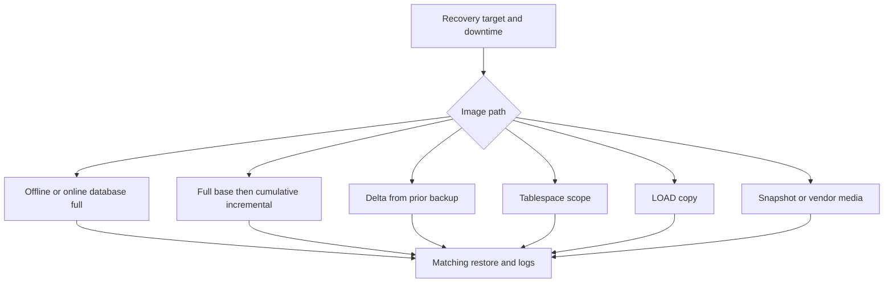

# F-03 — Backup types and command selection: offline, online, full, incremental, delta, database, tablespace, LOAD copy, snapshot, and vendor media

**Procedure status: NOT YET EXECUTED.** This is a teaching procedure for Db2 LUW 12.1.0 on Linux x86-64, single-member topology. The exact fix pack is not pinned. Engine commands run on the Db2 server as the named instance/database authority; client checks run on the client; OS commands run on the named host and normally require read-only access. Windows, AIX, DPF, and pureScale differences are called out where material. The supplied environment has no Db2 CLI or disposable Db2 server, so no lab command is claimed as executed. Before production use, confirm each command against the installed fix pack and local change controls.

## 1. Quick answer

Use this lesson to make a bounded DBA decision about offline full versus online full, incremental cumulative versus delta noncumulative, database versus table-space image. The key is to identify the failing layer and scope before changing state.

**Safest first step:** Capture the current target, timestamp, release, and read-only state before acting.

## 2. Learn the concept

The useful mental model is to follow offline full versus online full; incremental cumulative versus delta noncumulative; database versus table-space image; LOAD COPY image; snapshot API path and restrictions; TSM/vendor media; online archive-log inclusion; backup target and topology selection from the service boundary inward. Record who owns each boundary and which evidence is authoritative there.

### Working model

Scope: offline full versus online full → incremental cumulative versus delta noncumulative → database versus table-space image → LOAD COPY image → snapshot API path and restrictions → TSM/vendor media → online archive-log inclusion → backup target and topology selection. The arrows represent dependency, not proof of a fault. Confirm each hop independently.



## 3. Choose an approach

| Variant | Choose it when | Do not choose it when / boundary |
|---|---|---|
| Offline database full | Use when downtime is acceptable and simple consistent image is desired. | Database must be unavailable to applications. |
| Online database full | Use for live recoverable database; archive logging is prerequisite. | Requires rollforward and log-chain plan. |
| Incremental/delta | Choose based on change since last full versus last successful backup. | Restore chain and history must be retained. |
| Tablespace | Use for granular recovery only with rest of database/log consistency planned. | A tablespace image is not a complete database backup. |
| LOAD copy | Use as utility copy material under LOAD semantics. | It is not interchangeable with normal database backup image. |
| Snapshot/vendor media | Use only with supported Db2 ACS/vendor interface and tested restore. | Snapshot restrictions differ from normal incremental options. |

## 4. Understand the lifecycle

- Verify database log mode, backup history, image path/media and workload window.
- Select image scope/type and LOGS behavior.
- Precheck capacity, target permissions, topology, encryption keys and concurrent utilities.
- Run one backup branch and monitor utility lifecycle.
- Verify image metadata, required logs and documented limitations.

**Pause/retry/stop/rollback rule:** Stop if the target identity, current state, authority, or rollback dependency is uncertain; preserve evidence and escalate.

## 5. Do the work

### Precheck

- Run `GET DB CFG` for logarchmeth1 and backup settings.
- Confirm target is server path or vendor/snapshot destination according to utility type.
- Use target-specific retention and key procedures; protect image metadata.

### Scoped procedures

### Procedure 1: Offline full database

**Status:** NOT YET EXECUTED. **Run as:** SYSADM/SYSCTRL/SYSMAINT or backup authority. **Target:** Whole single-member SAMPLE. **Authority/prerequisite:** Schedule outage; disconnect applications; confirm no recovery conflict.

```bash
BACKUP DATABASE SAMPLE TO /db2backup/offline COMPRESS
```

**Expected result:** Full consistent offline image completes.

**Independent check:** LIST HISTORY and `db2ckbkp -h`; independent restore test remains required.

**Stop/rollback boundary:** No live database change; preserve image through retention.

### Procedure 2: Online full with logs

**Status:** NOT YET EXECUTED. **Run as:** Backup authority. **Target:** Whole recoverable SAMPLE. **Authority/prerequisite:** Archive logging configured and archive path healthy; include logs for point after backup.

```bash
BACKUP DATABASE SAMPLE ONLINE TO /db2backup/online INCLUDE LOGS COMPRESS
```

**Expected result:** Online image and required log range are written.

**Independent check:** Check utility status/history/image header and restore+rollforward to consistent endpoint.

**Stop/rollback boundary:** If failure, preserve partial media/log evidence and follow utility failure state; retry with unique target.

### Procedure 3: Cumulative incremental and delta

**Status:** NOT YET EXECUTED. **Run as:** Backup authority. **Target:** Whole database. **Authority/prerequisite:** Successful full base for incremental; prior successful image for delta; log chain/cadence validated.

```bash
BACKUP DATABASE SAMPLE ONLINE INCREMENTAL TO /db2backup/inc; BACKUP DATABASE SAMPLE ONLINE INCREMENTAL DELTA TO /db2backup/delta
```

**Expected result:** First image includes changes since most recent full; delta includes changes since most recent backup of any type.

**Independent check:** Read history to build chain; test automatic/manual restore and retain every dependency.

**Stop/rollback boundary:** Do not delete base/delta images until dependent chain retention expires.

### Procedure 4: Tablespace image

**Status:** NOT YET EXECUTED. **Run as:** Backup authority. **Target:** USERSPACE1 within SAMPLE. **Authority/prerequisite:** Check tablespace state, archive logging, concurrent work and recovery dependency of other spaces.

```bash
BACKUP DATABASE SAMPLE TABLESPACE (USERSPACE1) ONLINE TO /db2backup/ts
```

**Expected result:** Image includes selected tablespace, not complete database.

**Independent check:** Verify image and record compatible database backup/log position; test tablespace restore.

**Stop/rollback boundary:** Retain full image/logs needed to recover related objects.

### Procedure 5: LOAD copy path

**Status:** NOT YET EXECUTED. **Run as:** LOAD utility authority. **Target:** Target table and LOAD copy directory. **Authority/prerequisite:** COPY YES path is writable and recovery model permits it; validate load options/constraints.

```bash
LOAD FROM /tmp/items.del OF DEL INSERT INTO APP.ITEMS COPY YES TO /db2backup/loadcopy MESSAGES /tmp/items.load.msg
```

**Expected result:** Load copy is created for that utility operation.

**Independent check:** Preserve LOAD message/copy ID; verify backup-pending/state and subsequent database backup plan.

**Stop/rollback boundary:** Failed LOAD requires RESTART/TERMINATE; copy image only addresses supported LOAD recovery.

### Procedure 6: Snapshot or vendor media

**Status:** NOT YET EXECUTED. **Run as:** Backup authority/vendor administrator. **Target:** Media manager or supported snapshot integration. **Authority/prerequisite:** Run one branch only; verify installed ACS/vendor support and command restrictions.

```bash
BACKUP DATABASE SAMPLE USE TSM OPEN 2 SESSIONS; BACKUP DATABASE SAMPLE USE SNAPSHOT
```

**Expected result:** Media session or coordinated storage snapshot completes.

**Independent check:** Use matching RESTORE interface/media and application-consistent snapshot validation.

**Stop/rollback boundary:** Vendor/snapshot abort and cleanup are product-specific; do not treat as ordinary filesystem copy.

## 6. Worked example and verification

Choose an offline full for planned maintenance when downtime is accepted; online full when business service must stay open and archive logs are healthy; incremental/delta only when every dependency is retained. A LOAD copy is tied to LOAD table-state rules, while TSM/snapshot requires matching media integration.

**Expected state/result:** Each backup branch records database/table-space scope, image type, LOGS, target/media, encryption, monitoring, history, recovery chain and restore test.

**Independent verification:**

- Compare the post-state with the captured pre-state.
- Confirm the intended service or data outcome independently of the command return code.

## 7. Diagnose problems

| Symptom or verified error | Evidence to collect | Likely cause | Safe correction and recheck | Avoid |
|---|---|---|---|---|
| Online backup is refused or cannot include required logs. | archive mode, archive destination, utility messages and log chain. | Database is not recoverable or required log retrieval is unavailable. | Enable archive logging through required backup/reactivation process or correct archive path; then retry with a unique image. | Changing to offline and assuming rollforward logs are captured. |
| Delta image exists but automatic restore chain fails. | LIST HISTORY, base/full timestamp, last-successful backup and missing image inventory. | Delta restores require intervening successful backups; chain item pruned/misidentified. | Use db2ckrst/history to map exact chain and restore manually only from complete set. | Deleting incremental base or pruning history with force. |
| Snapshot restore fails using normal REDIRECT options. | image type/header, backup media API and restore restrictions. | Snapshot uses ACS/vendor path and excludes many RESTORE combinations. | Restore with supported snapshot/ACS method and test integration path. | Copying live database files as a substitute. |

## 8. Practice

For each branch create a written command choice and recovery sequence: offline, online full, incremental, delta, database, tablespace, LOAD copy, snapshot and vendor media. In a lab, run offline/online/incremental only if authorized Db2 environment exists. This package environment has none, so all are not executed.

## 9. Check understanding

**Question:** How does a delta backup differ from a cumulative incremental?

**Answer and reasoning:** Cumulative incremental includes changes since the last full backup; delta includes changes since the last successful backup of any type. Their restore chain differs.

## 10. Look it up later

### Short checklist

- Name the target and scope.
- Collect a baseline and confirm prerequisites.
- Choose the least disruptive supported branch.
- Verify state and service behavior.
- Record evidence and recovery limits.

### Related lessons

[F-01](../F/F-01.md) · [F-04](../F/F-04.md) · [F-05](../F/F-05.md) · [F-06](../F/F-06.md) · [F-08](../F/F-08.md)

### Authoritative references

- [IBM BACKUP DATABASE command](https://www.ibm.com/docs/en/db2/12.1.x?topic=commands-backup-database)
- [IBM RESTORE DATABASE command](https://www.ibm.com/docs/en/db2/12.1.x?topic=commands-restore-database)
- [IBM LOAD overview](https://www.ibm.com/docs/en/db2/12.1.x?topic=utility-load-overview)

---

[Domain index](README.md) · [Course index](../README.md) · [Glossary](../GLOSSARY.md)
