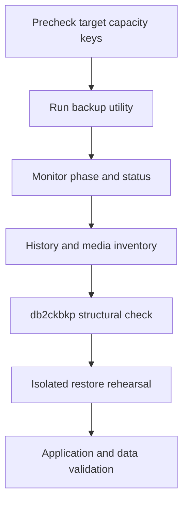

# F-04 — Backup execution, progress, history, image verification, and failure handling

**Procedure status: NOT YET EXECUTED.** This is a teaching procedure for Db2 LUW 12.1.0 on Linux x86-64, single-member topology. The exact fix pack is not pinned. Engine commands run on the Db2 server as the named instance/database authority; client checks run on the client; OS commands run on the named host and normally require read-only access. Windows, AIX, DPF, and pureScale differences are called out where material. The supplied environment has no Db2 CLI or disposable Db2 server, so no lab command is claimed as executed. Before production use, confirm each command against the installed fix pack and local change controls.

## 1. Quick answer

Use this lesson to make a bounded DBA decision about utility lifecycle and concurrency, progress monitoring and list utilities, history file/catalog and PRUNE. The key is to identify the failing layer and scope before changing state.

**Safest first step:** Capture the current target, timestamp, release, and read-only state before acting.

## 2. Learn the concept

The useful mental model is to follow utility lifecycle and concurrency; progress monitoring and list utilities; history file/catalog and PRUNE; db2ckbkp image structure limits; multi-piece images and storage; backup pending and failure/retry; retention evidence and restore drill from the service boundary inward. Record who owns each boundary and which evidence is authoritative there.

### Working model

Scope: utility lifecycle and concurrency → progress monitoring and list utilities → history file/catalog and PRUNE → db2ckbkp image structure limits → multi-piece images and storage → backup pending and failure/retry → retention evidence and restore drill. The arrows represent dependency, not proof of a fault. Confirm each hop independently.



## 3. Choose an approach

| Variant | Choose it when | Do not choose it when / boundary |
|---|---|---|
| Progress | Observe active utility and phase/resource. | A completed CLP process does not prove media durability. |
| History | Use history as Db2 metadata with external copy. | History pruning can break automated chain discovery. |
| Image check | Use db2ckbkp for structural validation. | Header/check does not prove full restore or application correctness. |

## 4. Understand the lifecycle

- Precheck path/media, capacity, permission, backup chain and no conflicting operation.
- Start backup with unique target and selected options.
- Monitor utility and output; distinguish warning, failed, complete.
- Record timestamp/history/image pieces and run header/integrity checks.
- Restore to isolated target and validate data to close proof.

**Pause/retry/stop/rollback rule:** Stop if the target identity, current state, authority, or rollback dependency is uncertain; preserve evidence and escalate.

## 5. Do the work

### Precheck

- Check `LIST UTILITIES SHOW DETAIL`, history and target size.
- Ensure destination supports required encryption/compression/media manager.
- Protect logs, image, history export and key labels together.

### Scoped procedures

### Procedure 1: Monitor backup utility

**Status:** NOT YET EXECUTED. **Run as:** Instance owner/backup authority. **Target:** Current instance and SAMPLE history. **Authority/prerequisite:** Run during a backup, then after completion.

```bash
LIST UTILITIES SHOW DETAIL; LIST HISTORY BACKUP ALL FOR SAMPLE
```

**Expected result:** Active utility phase and backup history entry appear.

**Independent check:** Compare output with backup process code and media inventory.

**Stop/rollback boundary:** Do not terminate active backup until understanding consistency and vendor cleanup.

### Procedure 2: Inspect Db2 image header

**Status:** NOT YET EXECUTED. **Run as:** Instance owner/backup verifier. **Target:** Specific image file as named by actual output. **Authority/prerequisite:** Image path and all pieces verified; filename shown is synthetic example.

```bash
db2ckbkp -h /db2backup/online/SAMPLE.0.db2inst1.DBPART000.20261027103000.001
```

**Expected result:** Header shows database, timestamp, platform, level and image metadata if valid.

**Independent check:** For multi-piece images inspect all pieces; then perform actual restore rehearsal.

**Stop/rollback boundary:** A failed check does not authorize deleting source copy; retain and investigate.

## 6. Worked example and verification

An online backup command succeeds but one stripe is missing in object storage. Db2 history lists the backup, but full media inventory/db2ckbkp reveals incomplete package. Mark backup unfit until restore verification; retain prior good chain.

**Expected state/result:** Backup acceptance requires Db2 completion, media durability, history/image evidence, needed log/key availability and restore proof.

**Independent verification:**

- Compare the post-state with the captured pre-state.
- Confirm the intended service or data outcome independently of the command return code.

## 7. Diagnose problems

| Symptom or verified error | Evidence to collect | Likely cause | Safe correction and recheck | Avoid |
|---|---|---|---|---|
| Backup utility fails with destination I/O or full-media error. | LIST UTILITIES, Db2 messages, mount/inodes, vendor session and target quota. | Filesystem/media manager capacity, permission or connection failure. | Repair destination, preserve incomplete image/messages, retry using unique target after utility is clear. | Overwriting the only known-good image. |
| `db2ckbkp -h` passes but restore fails. | all image pieces, platform/version, encryption key, target capacity and restore diagnostics. | Header check is structural and does not exercise restore engine/key/recovery path. | Restore copy in isolated host and validate data; correct media/key/compatibility dependency. | Reporting full recovery readiness from header check alone. |

## 8. Practice

Run a backup to a disposable directory, monitor LIST UTILITIES, inspect history and `db2ckbkp -h`, then restore a copy to an isolated alias if lab exists. Deliberate safe drill: rename one copy of a multi-piece lab image and verify validation failure; restore filename and recheck.

## 9. Check understanding

**Question:** What does a passing `db2ckbkp -h` establish?

**Answer and reasoning:** It verifies image structural/header conditions; it does not prove all required media, encryption keys, log chain, restore completion or application/data correctness.

## 10. Look it up later

### Short checklist

- Name the target and scope.
- Collect a baseline and confirm prerequisites.
- Choose the least disruptive supported branch.
- Verify state and service behavior.
- Record evidence and recovery limits.

### Related lessons

[F-02](../F/F-02.md) · [F-03](../F/F-03.md) · [F-05](../F/F-05.md) · [F-09](../F/F-09.md)

### Authoritative references

- [IBM BACKUP DATABASE command](https://www.ibm.com/docs/en/db2/12.1.x?topic=commands-backup-database)
- [IBM LIST UTILITIES command](https://www.ibm.com/docs/en/db2/12.1.x?topic=commands-list-utilities)
- [IBM RESTORE DATABASE command](https://www.ibm.com/docs/en/db2/12.1.x?topic=commands-restore-database)

---

[Domain index](README.md) · [Course index](../README.md) · [Glossary](../GLOSSARY.md)
