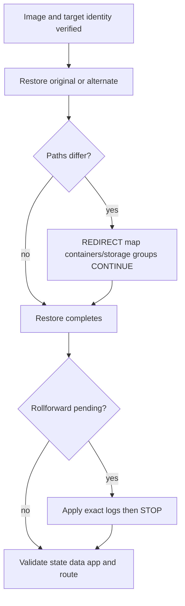

# F-05 — Full and redirected restore, alternate targets, path changes, and post-restore validation

**Procedure status: NOT YET EXECUTED.** This is a teaching procedure for Db2 LUW 12.1.0 on Linux x86-64, single-member topology. The exact fix pack is not pinned. Engine commands run on the Db2 server as the named instance/database authority; client checks run on the client; OS commands run on the named host and normally require read-only access. Windows, AIX, DPF, and pureScale differences are called out where material. The supplied environment has no Db2 CLI or disposable Db2 server, so no lab command is claimed as executed. Before production use, confirm each command against the installed fix pack and local change controls.

## 1. Quick answer

Use this lesson to make a bounded DBA decision about original alias versus alternate target, REPLACE EXISTING safeguards, redirected restore REDIRECT/SET/CONTINUE. The key is to identify the failing layer and scope before changing state.

**Safest first step:** Capture the current target, timestamp, release, and read-only state before acting.

## 2. Learn the concept

The useful mental model is to follow original alias versus alternate target; REPLACE EXISTING safeguards; redirected restore REDIRECT/SET/CONTINUE; automatic storage path change; DMS container/path conflicts; online image rollforward pending; encryption key retrieval; restore pending SQL1117N and validation from the service boundary inward. Record who owns each boundary and which evidence is authoritative there.

### Working model

Scope: original alias versus alternate target → REPLACE EXISTING safeguards → redirected restore REDIRECT/SET/CONTINUE → automatic storage path change → DMS container/path conflicts → online image rollforward pending → encryption key retrieval → restore pending SQL1117N and validation. The arrows represent dependency, not proof of a fault. Confirm each hop independently.



## 3. Choose an approach

| Variant | Choose it when | Do not choose it when / boundary |
|---|---|---|
| Restore to original alias | Use for full replacement only with target identity gate. | REPLACE EXISTING can overwrite existing database without interactive prompt. |
| Alternate alias | Use for isolated recovery or migration within supported platform family. | Verify database name/path and application isolation. |
| Redirected restore | Use for new host, storage path or inaccessible containers. | Same CLP session must carry REDIRECT/SET/CONTINUE; cannot convert OS platform. |

## 4. Understand the lifecycle

- Verify selected image, timestamp, platform, database name and all pieces.
- Reserve target paths/capacity and key availability.
- Start restore to alternate or guarded original target.
- For redirect: REDIRECT, set every target path/container, CONTINUE in same session.
- Roll forward if needed, then verify table spaces, data, integrity, app and routing.

**Pause/retry/stop/rollback rule:** Stop if the target identity, current state, authority, or rollback dependency is uncertain; preserve evidence and escalate.

## 5. Do the work

### Precheck

- Use history and image header plus db2ckrst to identify exact image.
- Check `REPLACE EXISTING`, alias, `INTO`, `ON`, path and encryption options before execution.
- Protect source production database and preserve original backup/logs.

### Scoped procedures

### Procedure 1: Full alternate restore from image

**Status:** NOT YET EXECUTED. **Run as:** SYSADM/SYSCTRL/SYSMAINT; SYSCTRL/SYSMAINT/SYSADM depending target. **Target:** New isolated database QA1. **Authority/prerequisite:** Confirm timestamp/image/platform, target path space and absent alias QA1.

```bash
RESTORE DATABASE SAMPLE FROM /db2backup/offline TAKEN AT 20261027103000 INTO QA1
```

**Expected result:** Database is restored under QA1; online image may be rollforward pending.

**Independent check:** List directory, connect only to QA1, inspect table-space state, roll forward if required, and run app/data checks.

**Stop/rollback boundary:** Drop only isolated QA1 after confirming exact alias/path and no needed evidence.

### Procedure 2: Redirected restore sequence

**Status:** NOT YET EXECUTED. **Run as:** Recovery DBA with restore authority. **Target:** New alternate QA1 database and new storage group path. **Authority/prerequisite:** Precreate/measure path, use same CLP window, review every storage group/table-space mapping; no cross-OS move.

```bash
RESTORE DATABASE SAMPLE FROM /db2backup/offline TAKEN AT 20261027103000 INTO QA1 REDIRECT; SET STOGROUP PATHS FOR SG_HOT ON '/db2new/fast'; RESTORE DATABASE QA1 CONTINUE
```

**Expected result:** CONTINUE restores data using changed path definitions.

**Independent check:** After completion, inspect containers/storage group associations and run integrity/application validation.

**Stop/rollback boundary:** If redirect is incomplete, use documented restore abort/cleanup; never use replace-existing on source alias.

### Procedure 3: Roll forward and open restored database

**Status:** NOT YET EXECUTED. **Run as:** SYSADM/SYSCTRL/SYSMAINT. **Target:** Restored QA1 in rollforward pending state. **Authority/prerequisite:** Required log sequence is available and destination key works.

```bash
ROLLFORWARD DATABASE QA1 TO END OF LOGS AND STOP OVERFLOW LOG PATH (/db2archive/SAMPLE)
```

**Expected result:** Recovery reaches end-of-logs and STOP completes rollforward.

**Independent check:** Connect, check table-space states, compare expected data counts and execute application smoke tests.

**Stop/rollback boundary:** STOP is terminal for that recovery point; do not issue until target point/log completeness is confirmed.

## 6. Worked example and verification

Restore an online image to `QA1`, not the production `SAMPLE`, then roll forward only the intended logs. This isolates recovered point from active application commits and avoids accidental overwrite while validation is in progress.

**Expected state/result:** Recovered database opens at the intended alias/path/time, table spaces are normal and application/data validation passes before routing.

**Independent verification:**

- Compare the post-state with the captured pre-state.
- Confirm the intended service or data outcome independently of the command return code.

## 7. Diagnose problems

| Symptom or verified error | Evidence to collect | Likely cause | Safe correction and recheck | Avoid |
|---|---|---|---|---|
| SQL1117N indicates rollforward pending. | restore message, log chain, current rollforward query and archived log retrieval. | Image was online/recoverable and restore is awaiting log application. | Supply complete correct logs and roll forward to chosen endpoint; stop only at approved target. | Trying ordinary CONNECT or WITHOUT ROLLING FORWARD on unsupported image. |
| Redirected restore reports container/path error or SQL2563W. | script path mapping, table-space sizes, storage groups, device/directory container type and db2diag. | A container mapping is missing, inaccessible or too small for restored data. | Rebuild mapping with full container set and enough capacity, then continue/restart documented restore. | Changing storage paths after data restore starts without supported flow. |
| Restore overwrites wrong database alias. | command echo, catalog directory, database path and ticket target. | Unsafe alias/REPLACE EXISTING option or target variable error. | Stop before start if possible; if execution began, preserve logs and activate recovery plan for overwritten target. | Using scripts with silent REPLACE EXISTING and no target confirmation. |

## 8. Practice

Restore an offline test image to QA1, then generate and review a redirected script for a second disposable target. Check every path and storage group before running. For online image test, supply archived logs and STOP at an agreed endpoint. Cleanup only test aliases.

## 9. Check understanding

**Question:** When does an online restore become available to applications?

**Answer and reasoning:** After required rollforward logs are applied and recovery is stopped/completed at an approved endpoint, table-space state is normal, and application/data validation succeeds.

## 10. Look it up later

### Short checklist

- Name the target and scope.
- Collect a baseline and confirm prerequisites.
- Choose the least disruptive supported branch.
- Verify state and service behavior.
- Record evidence and recovery limits.

### Related lessons

[F-02](../F/F-02.md) · [F-03](../F/F-03.md) · [F-06](../F/F-06.md) · [F-07](../F/F-07.md) · [F-09](../F/F-09.md) · [I-04](../I/I-04.md)

### Authoritative references

- [IBM RESTORE DATABASE command](https://www.ibm.com/docs/en/db2/12.1.x?topic=commands-restore-database)
- [IBM redirected restore procedure](https://www.ibm.com/docs/en/db2/12.1.x?topic=restore-performing-redirected-operation)
- [IBM generated redirected script](https://www.ibm.com/docs/en/db2/12.1.x?topic=operation-performing-redirected-restore-using-automatically-generated-script)
- [IBM rollforward recovery](https://www.ibm.com/docs/en/db2/12.1.x?topic=recover-rollforward-recovery)

---

[Domain index](README.md) · [Course index](../README.md) · [Glossary](../GLOSSARY.md)
