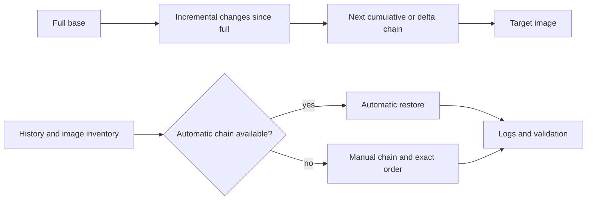

# F-06 — Automatic/manual incremental and delta restore chains

**Procedure status: NOT YET EXECUTED.** This is a teaching procedure for Db2 LUW 12.1.0 on Linux x86-64, single-member topology. The exact fix pack is not pinned. Engine commands run on the Db2 server as the named instance/database authority; client checks run on the client; OS commands run on the named host and normally require read-only access. Windows, AIX, DPF, and pureScale differences are called out where material. The supplied environment has no Db2 CLI or disposable Db2 server, so no lab command is claimed as executed. Before production use, confirm each command against the installed fix pack and local change controls.

## 1. Quick answer

Use this lesson to make a bounded DBA decision about identify base and required images, automatic incremental restore/history mapping, manual cumulative restore image order. The key is to identify the failing layer and scope before changing state.

**Safest first step:** Capture the current target, timestamp, release, and read-only state before acting.

## 2. Learn the concept

The useful mental model is to follow identify base and required images; automatic incremental restore/history mapping; manual cumulative restore image order; delta chain semantics; missing/misordered image recovery; alternate target and image identity; member/partition image scope; platform/version limits from the service boundary inward. Record who owns each boundary and which evidence is authoritative there.

### Working model

Scope: identify base and required images → automatic incremental restore/history mapping → manual cumulative restore image order → delta chain semantics → missing/misordered image recovery → alternate target and image identity → member/partition image scope → platform/version limits. The arrows represent dependency, not proof of a fault. Confirm each hop independently.



## 3. Choose an approach

| Variant | Choose it when | Do not choose it when / boundary |
|---|---|---|
| Automatic incremental | Use when history provides a complete chain. | Requires complete history/image set; may require abort on failed chain. |
| Manual incremental | Use when chain must be explicitly supplied or automatic reconstruction fails. | Order is target image metadata, then base and successive images per documented sequence. |
| Delta series | Track every intervening successful backup since base. | Pruning history with force can remove automatic chain data. |

## 4. Understand the lifecycle

- List history and determine target image timestamp.
- Run db2ckrst/history inventory to enumerate required images.
- Choose automatic chain or manual one-command-per-image flow.
- Restore all image pieces in documented order; handle abort if automatic fails.
- Roll forward required logs and validate final state.

**Pause/retry/stop/rollback rule:** Stop if the target identity, current state, authority, or rollback dependency is uncertain; preserve evidence and escalate.

## 5. Do the work

### Precheck

- Copy complete image set to protected staging path.
- Verify timestamps, database names, platform levels, image pieces and history.
- Never use PRUNE HISTORY WITH FORCE during chain investigation.

### Scoped procedures

### Procedure 1: Automatic cumulative incremental restore

**Status:** NOT YET EXECUTED. **Run as:** Recovery authority. **Target:** New isolated QA2 database. **Authority/prerequisite:** Target timestamp is intended endpoint and history includes full base plus all incrementals.

```bash
RESTORE DATABASE SAMPLE INCREMENTAL AUTOMATIC TAKEN AT 20261027120000 FROM /db2backup/inc INTO QA2
```

**Expected result:** Db2 reads target metadata, resolves chain and restores required images automatically.

**Independent check:** Check restore completion, history and database state; roll forward as necessary.

**Stop/rollback boundary:** If chain resolution fails, issue documented INCREMENTAL ABORT and cleanly choose manual path.

### Procedure 2: Manual incremental sequence guide

**Status:** NOT YET EXECUTED. **Run as:** Recovery authority. **Target:** New isolated target; each image timestamp is illustrative. **Authority/prerequisite:** Use db2ckrst-generated chain and the exact release-documented order; keep sequence/time in a recovery worksheet.

```bash
RESTORE DATABASE SAMPLE INCREMENTAL TAKEN AT 20261027120000 FROM /db2backup/inc; RESTORE DATABASE SAMPLE INCREMENTAL TAKEN AT 20261027080000 FROM /db2backup/full; RESTORE DATABASE SAMPLE INCREMENTAL TAKEN AT 20261027100000 FROM /db2backup/inc
```

**Expected result:** Each command applies the target/base/intermediate image as specified by manual procedure.

**Independent check:** After every command verify return and target state; final logs/app validation close recovery.

**Stop/rollback boundary:** Do not retry one step on uncertain partial state; use RESTORE INCREMENTAL ABORT if operation is pending and documented.

## 6. Worked example and verification

The target is 12:00. History shows full at 08:00 and incremental at 10:00 plus target incremental at 12:00. Automatic restore uses history; manual restore requires the set and order. A missing 10:00 image means automatic chain cannot complete; do not substitute a later delta.

**Expected state/result:** The exact base/target/intermediate image set is preserved; restore reaches intended timestamp and log endpoint.

**Independent verification:**

- Compare the post-state with the captured pre-state.
- Confirm the intended service or data outcome independently of the command return code.

## 7. Diagnose problems

| Symptom or verified error | Evidence to collect | Likely cause | Safe correction and recheck | Avoid |
|---|---|---|---|---|
| Automatic incremental restore cannot build chain. | db2ckrst output, history entries, image timestamps and missing storage objects. | Image/history dependency absent or incompatible chain. | Abort automatic operation as documented, retrieve missing object or use complete manual chain. | Pruning history or guessing filenames. |
| Manual restore leaves target in inconsistent pending state. | per-command restore messages, image types/order and restore-pending state. | Wrong image sequence, target/base reversed or one intermediate missing. | Use generated recovery sequence and restart cleanly only after documented abort/cleanup. | Connecting applications to partial restore. |

## 8. Practice

Build a chain worksheet from fictional full/incremental/delta timestamps. Resolve a missing middle image and identify whether any legal restore reaches target. In a disposable Db2 lab, test automatic restore and db2ckrst; none was available in current environment. Cleanup QA2 and media only after validation.

## 9. Check understanding

**Question:** Why should the last image timestamp not be the only item retained?

**Answer and reasoning:** Restore needs every base/intermediate image and history/log dependency. A target image alone may contain only changed pages, not a complete database.

## 10. Look it up later

### Short checklist

- Name the target and scope.
- Collect a baseline and confirm prerequisites.
- Choose the least disruptive supported branch.
- Verify state and service behavior.
- Record evidence and recovery limits.

### Related lessons

[F-03](../F/F-03.md) · [F-04](../F/F-04.md) · [F-05](../F/F-05.md) · [F-07](../F/F-07.md) · [K-02](../K/K-02.md)

### Authoritative references

- [IBM incremental restore procedures](https://www.ibm.com/docs/en/db2/12.1.x?topic=recovery-restoring-from-incremental-backup-images)
- [IBM RESTORE DATABASE command](https://www.ibm.com/docs/en/db2/12.1.x?topic=commands-restore-database)
- [IBM db2ckrst command](https://www.ibm.com/docs/en/db2/12.1.x?topic=commands-db2ckrst)

---

[Domain index](README.md) · [Course index](../README.md) · [Glossary](../GLOSSARY.md)
