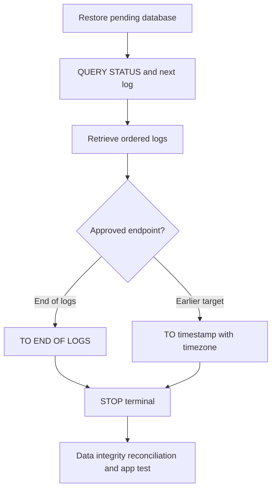

# F-07 — Rollforward, end-of-logs, point-in-time recovery, STOP/COMPLETE decisions, and missing logs

**Procedure status: NOT YET EXECUTED.** This is a teaching procedure for Db2 LUW 12.1.0 on Linux x86-64, single-member topology. The exact fix pack is not pinned. Engine commands run on the Db2 server as the named instance/database authority; client checks run on the client; OS commands run on the named host and normally require read-only access. Windows, AIX, DPF, and pureScale differences are called out where material. The supplied environment has no Db2 CLI or disposable Db2 server, so no lab command is claimed as executed. Before production use, confirm each command against the installed fix pack and local change controls.

## 1. Quick answer

Use this lesson to make a bounded DBA decision about rollforward pending after restore, end-of-logs vs PIT, archive/overflow path and log chain. The key is to identify the failing layer and scope before changing state.

**Safest first step:** Capture the current target, timestamp, release, and read-only state before acting.

## 2. Learn the concept

The useful mental model is to follow rollforward pending after restore; end-of-logs vs PIT; archive/overflow path and log chain; database vs tablespace recovery; time zone and consistency point; STOP/COMPLETE terminal state; SQL4970N/missing/wrong logs; active-log handling; post-recovery data validation from the service boundary inward. Record who owns each boundary and which evidence is authoritative there.

### Working model

Scope: rollforward pending after restore → end-of-logs vs PIT → archive/overflow path and log chain → database vs tablespace recovery → time zone and consistency point → STOP/COMPLETE terminal state → SQL4970N/missing/wrong logs → active-log handling → post-recovery data validation. The arrows represent dependency, not proof of a fault. Confirm each hop independently.



## 3. Choose an approach

| Variant | Choose it when | Do not choose it when / boundary |
|---|---|---|
| END OF LOGS | Use to recover to latest complete available log point. | Only if all required logs are present and valid. |
| Point in time | Use to stop before corruption/business error timestamp. | PIT affects whole database consistency and timezone conversion. |
| STOP/COMPLETE | Stop closes rollforward and opens database at selected endpoint. | It is a terminal choice; later logs need a new recovery strategy. |

## 4. Understand the lifecycle

- Confirm image and current rollforward state.
- Map exact required log sequence and archive retrieval.
- Choose endpoint: end of logs or PIT in documented timestamp format/timezone.
- Apply logs without stopping prematurely; inspect query status and missing sequence.
- Issue STOP/COMPLETE only at approved endpoint; validate data and application.

**Pause/retry/stop/rollback rule:** Stop if the target identity, current state, authority, or rollback dependency is uncertain; preserve evidence and escalate.

## 5. Do the work

### Precheck

- Use `ROLLFORWARD QUERY STATUS` to see next log/time and pending state.
- Identify cutoff from business/system timeline with UTC and timezone conversion.
- Preserve current copy and all available logs before the terminal command.

### Scoped procedures

### Procedure 1: Inspect rollforward boundary

**Status:** NOT YET EXECUTED. **Run as:** Recovery authority. **Target:** Restored QA1 in rollforward pending state. **Authority/prerequisite:** Do not connect app users; identify current log/last committed point.

```bash
ROLLFORWARD DATABASE QA1 QUERY STATUS
```

**Expected result:** Output reports log files needed and rollforward progress/status.

**Independent check:** Compare next log/time with archive inventory and recovery worksheet.

**Stop/rollback boundary:** Read-only query; preserve exact output.

### Procedure 2: Recover to end of available logs

**Status:** NOT YET EXECUTED. **Run as:** SYSADM/SYSCTRL/SYSMAINT. **Target:** Isolated QA1 recovery copy. **Authority/prerequisite:** Only use after all required logs are staged and end-of-logs target is approved.

```bash
ROLLFORWARD DATABASE QA1 TO END OF LOGS OVERFLOW LOG PATH (/db2archive/SAMPLE); ROLLFORWARD DATABASE QA1 STOP
```

**Expected result:** Db2 replays logs and STOP completes recovery at last available consistent point.

**Independent check:** Check rollforward status, connect, inspect table spaces and run business integrity checks.

**Stop/rollback boundary:** STOP is terminal at this point; if the endpoint is wrong, restore/recover again rather than expecting to resume forward.

### Procedure 3: Point-in-time recovery

**Status:** NOT YET EXECUTED. **Run as:** Recovery authority. **Target:** Isolated QA1, intended PIT at 10:30 UTC after explicit timezone mapping. **Authority/prerequisite:** Confirm exact timestamp syntax for release, time zone, business point and required logs.

```bash
ROLLFORWARD DATABASE QA1 TO 2026-10-27-10.30.00.000000 AND STOP OVERFLOW LOG PATH (/db2archive/SAMPLE)
```

**Expected result:** Logs replay through target point; database opens at target.

**Independent check:** Query status, compare known transactions before/after boundary and run app validation.

**Stop/rollback boundary:** Do not issue STOP if timestamp/zone or log completeness is unresolved.

## 6. Worked example and verification

A corruption begins at 10:33 UTC; database logs are local time UTC+5:30. Convert the selected recovery point carefully and record both timestamps. Restore to a separate alias, roll forward through the last safe commit, then stop and reconcile affected business requests.

**Expected state/result:** Recovery is open at an approved and documented log point; data/transactions after PIT are understood and reconciled.

**Independent verification:**

- Compare the post-state with the captured pre-state.
- Confirm the intended service or data outcome independently of the command return code.

## 7. Diagnose problems

| Symptom or verified error | Evidence to collect | Likely cause | Safe correction and recheck | Avoid |
|---|---|---|---|---|
| SQL4970N or missing log sequence during rollforward. | query status, expected next log, chain ID, archive catalog/retrieval and filename checksum. | Archive retrieval failed, wrong chain/path, corrupt log or endpoint beyond available logs. | Retrieve the exact next log from approved archive and retry; if permanently absent, select a legal earlier point or escalate data-loss decision. | Renaming unrelated log files to satisfy sequence. |
| Database opens but includes unwanted late transactions. | chosen timestamp, timezone conversion, PIT status and transaction commit time. | PIT chosen after the bad commit or clock/timezone mismatch. | Repeat recovery to earlier point on isolated target and reconcile lost work. | Using `STOP` without verifying business cutoff. |

## 8. Practice

Use a disposable restore and create timestamped transactions around an announced bad commit. Recover once to end-of-logs and once to an earlier PIT; compare rows and explain data loss. Practice query status before STOP. Cleanup recovered lab aliases.

## 9. Check understanding

**Question:** Why is STOP a decision gate?

**Answer and reasoning:** It completes rollforward at a selected endpoint. If the selected point or logs are wrong, STOP can make further log application unavailable without a new restore/recovery path.

## 10. Look it up later

### Short checklist

- Name the target and scope.
- Collect a baseline and confirm prerequisites.
- Choose the least disruptive supported branch.
- Verify state and service behavior.
- Record evidence and recovery limits.

### Related lessons

[F-05](../F/F-05.md) · [F-06](../F/F-06.md) · [F-08](../F/F-08.md) · [F-09](../F/F-09.md) · [K-02](../K/K-02.md)

### Authoritative references

- [IBM rollforward recovery](https://www.ibm.com/docs/en/db2/12.1.x?topic=recover-rollforward-recovery)
- [IBM RECOVER DATABASE command](https://www.ibm.com/docs/en/db2/12.1.x?topic=commands-recover-database)
- [IBM RESTORE DATABASE command](https://www.ibm.com/docs/en/db2/12.1.x?topic=commands-restore-database)
- [IBM rollforward command](https://www.ibm.com/docs/en/db2/12.1.x?topic=commands-rollforward-database)

---

[Domain index](README.md) · [Course index](../README.md) · [Glossary](../GLOSSARY.md)
