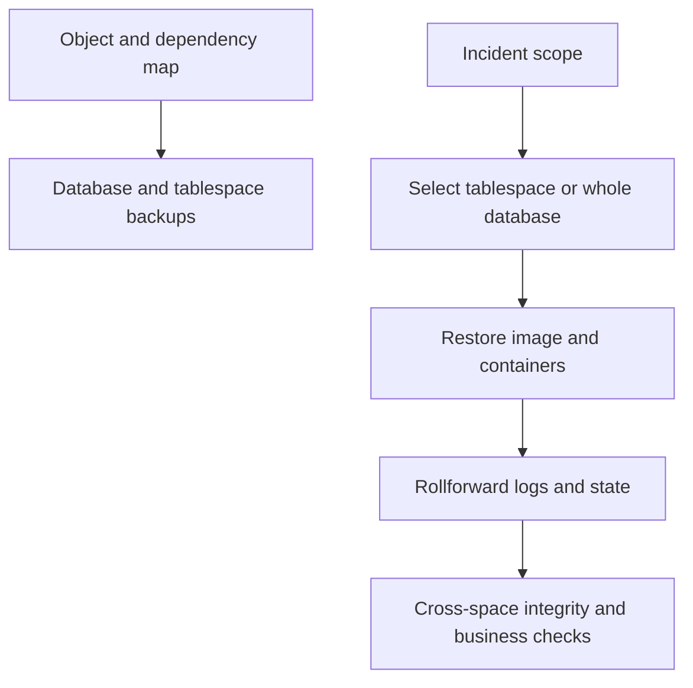

# F-08 — Tablespace backup and recovery, online/offline behavior, and consistency checks

**Procedure status: NOT YET EXECUTED.** This is a teaching procedure for Db2 LUW 12.1.0 on Linux x86-64, single-member topology. The exact fix pack is not pinned. Engine commands run on the Db2 server as the named instance/database authority; client checks run on the client; OS commands run on the named host and normally require read-only access. Windows, AIX, DPF, and pureScale differences are called out where material. The supplied environment has no Db2 CLI or disposable Db2 server, so no lab command is claimed as executed. Before production use, confirm each command against the installed fix pack and local change controls.

## 1. Quick answer

Use this lesson to make a bounded DBA decision about tablespace backup vs database image, online/offline restore and rollforward state, table-space point in time vs database PIT. The key is to identify the failing layer and scope before changing state.

**Safest first step:** Capture the current target, timestamp, release, and read-only state before acting.

## 2. Learn the concept

The useful mental model is to follow tablespace backup vs database image; online/offline restore and rollforward state; table-space point in time vs database PIT; multiple spaces and partition scope; logging requirements and active HADR restrictions; space-state inspection; object and cross-tablespace application consistency from the service boundary inward. Record who owns each boundary and which evidence is authoritative there.

### Working model

Scope: tablespace backup vs database image → online/offline restore and rollforward state → table-space point in time vs database PIT → multiple spaces and partition scope → logging requirements and active HADR restrictions → space-state inspection → object and cross-tablespace application consistency. The arrows represent dependency, not proof of a fault. Confirm each hop independently.



## 3. Choose an approach

| Variant | Choose it when | Do not choose it when / boundary |
|---|---|---|
| Tablespace backup | Reduce backup scope for isolated objects with tested dependency map. | It does not protect catalog, other tablespaces or application consistency by itself. |
| Tablespace restore | Use when one space is damaged and rest database is sound. | Requires appropriate database/table-space backup and logs. |
| Table-space PIT | Recover a selected space to a point while coordinating interdependent spaces. | May create inconsistent business state across objects. |

## 4. Understand the lifecycle

- Map object-to-tablespace and FK/application dependencies.
- Take database/tablespace image with required logging.
- Inspect state and restore pending scope after incident.
- Restore selected spaces/images; roll forward correct spaces/logs.
- Check integrity, cross-space consistency, application and backup status.

**Pause/retry/stop/rollback rule:** Stop if the target identity, current state, authority, or rollback dependency is uncertain; preserve evidence and escalate.

## 5. Do the work

### Precheck

- Capture `LIST TABLESPACES SHOW DETAIL` and object placement.
- Identify if online backup and required log chain are available.
- Coordinate all related tablespaces and HADR role before restore.

### Scoped procedures

### Procedure 1: Back up one online tablespace

**Status:** NOT YET EXECUTED. **Run as:** Backup authority. **Target:** USERSPACE1 in recoverable SAMPLE. **Authority/prerequisite:** Archive logging, tablespace online state and media capacity confirmed.

```bash
BACKUP DATABASE SAMPLE TABLESPACE (USERSPACE1) ONLINE TO /db2backup/ts1 INCLUDE LOGS
```

**Expected result:** Selected tablespace image and required logs are stored.

**Independent check:** History/image checks and test restore into isolated recovery copy.

**Stop/rollback boundary:** Retain coordinating database backup/log chain; do not discard full recovery dependency.

### Procedure 2: Restore and roll forward tablespace

**Status:** NOT YET EXECUTED. **Run as:** Recovery authority. **Target:** Selected USERSPACE1 and database context. **Authority/prerequisite:** Check exact image scope, state, member, table-space dependency and expected log endpoint.

```bash
RESTORE DATABASE SAMPLE TABLESPACE (USERSPACE1) FROM /db2backup/ts1 TAKEN AT 20261027103000; ROLLFORWARD DATABASE SAMPLE TO END OF LOGS AND STOP TABLESPACE (USERSPACE1)
```

**Expected result:** Table space restore completes then selected space rollforward clears pending state.

**Independent check:** Check `LIST TABLESPACES SHOW DETAIL`, table/object integrity, cross-space FKs and application reads.

**Stop/rollback boundary:** Do not open app before space state is normal; stop point can require full coordinated recovery if wrong.

## 6. Worked example and verification

An isolated table in USERSPACE1 is damaged, while its parent rows reside in another tablespace. Recovering USERSPACE1 alone can restore Db2 physical state but still require business reconciliation across both objects.

**Expected state/result:** Target tablespace is normal and its rows are valid; related application objects and transactions are consistent.

**Independent verification:**

- Compare the post-state with the captured pre-state.
- Confirm the intended service or data outcome independently of the command return code.

## 7. Diagnose problems

| Symptom or verified error | Evidence to collect | Likely cause | Safe correction and recheck | Avoid |
|---|---|---|---|---|
| One tablespace remains restore-pending after restore. | tablespace state, restore messages, container capacity and missing log range. | Data image incomplete, container too small or rollforward not completed. | Complete required image chain/logs or correct redirected path, then verify state. | Restarting applications against partially available database. |
| Table-space PIT yields invalid referential business state. | cross-table constraints, related tablespaces and commit point alignment. | Related objects were recovered to different points. | Coordinate recovery points for all dependent spaces or recover whole database to common PIT. | Assuming physical space recovery equals application consistency. |

## 8. Practice

Place parent and child tables in separate lab tablespaces. Back up them and perform an isolated table-space restore/rollforward in a clone. Check dependencies and data time point. No lab server is available here, so command path is not executed. Cleanup the clone only after preserving evidence.

## 9. Check understanding

**Question:** When is full-database PIT safer than one-table-space PIT?

**Answer and reasoning:** When business consistency spans objects in different table spaces or when the failure time affects multiple areas; a common database endpoint avoids mixed-time relationships.

## 10. Look it up later

### Short checklist

- Name the target and scope.
- Collect a baseline and confirm prerequisites.
- Choose the least disruptive supported branch.
- Verify state and service behavior.
- Record evidence and recovery limits.

### Related lessons

[C-04](../C/C-04.md) · [F-03](../F/F-03.md) · [F-05](../F/F-05.md) · [F-07](../F/F-07.md) · [K-02](../K/K-02.md)

### Authoritative references

- [IBM BACKUP DATABASE command](https://www.ibm.com/docs/en/db2/12.1.x?topic=commands-backup-database)
- [IBM RESTORE DATABASE command](https://www.ibm.com/docs/en/db2/12.1.x?topic=commands-restore-database)
- [IBM rollforward recovery](https://www.ibm.com/docs/en/db2/12.1.x?topic=recover-rollforward-recovery)
- [IBM table-space recovery](https://www.ibm.com/docs/en/db2/12.1.x?topic=recovery-table-space-recovery)

---

[Domain index](README.md) · [Course index](../README.md) · [Glossary](../GLOSSARY.md)
