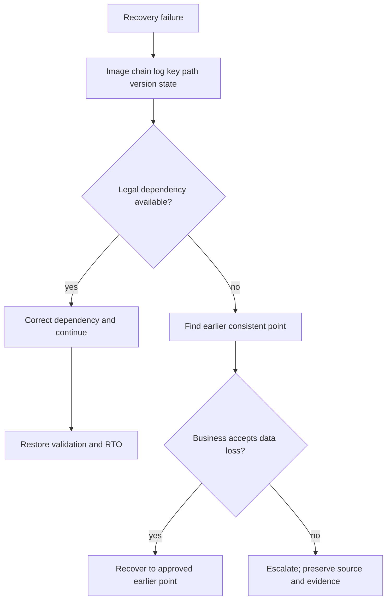

# F-09 — Recovery failure drills, decision trees, legal next steps, evidence, and measured RTO

**Procedure status: NOT YET EXECUTED.** This is a teaching procedure for Db2 LUW 12.1.0 on Linux x86-64, single-member topology. The exact fix pack is not pinned. Engine commands run on the Db2 server as the named instance/database authority; client checks run on the client; OS commands run on the named host and normally require read-only access. Windows, AIX, DPF, and pureScale differences are called out where material. The supplied environment has no Db2 CLI or disposable Db2 server, so no lab command is claimed as executed. Before production use, confirm each command against the installed fix pack and local change controls.

## 1. Quick answer

Use this lesson to make a bounded DBA decision about missing/corrupt image or wrong alias/member, missing archive log and earlier PIT choice, key/archive retrieval failure. The key is to identify the failing layer and scope before changing state.

**Safest first step:** Capture the current target, timestamp, release, and read-only state before acting.

## 2. Learn the concept

The useful mental model is to follow missing/corrupt image or wrong alias/member; missing archive log and earlier PIT choice; key/archive retrieval failure; path/storage exhaustion; platform/version incompatibility; restore/rollforward pending states; inspect/check utilities; stop/escalate gates; measured RTO and integrity validation from the service boundary inward. Record who owns each boundary and which evidence is authoritative there.

### Working model

Scope: missing/corrupt image or wrong alias/member → missing archive log and earlier PIT choice → key/archive retrieval failure → path/storage exhaustion → platform/version incompatibility → restore/rollforward pending states → inspect/check utilities → stop/escalate gates → measured RTO and integrity validation. The arrows represent dependency, not proof of a fault. Confirm each hop independently.



## 3. Choose an approach

| Variant | Choose it when | Do not choose it when / boundary |
|---|---|---|
| Missing/corrupt image | Find alternate immutable copy and verify every stripe. | Do not overwrite only known-good copy. |
| Missing log | Find alternate archive; else choose earlier consistent point with owner approval. | No legal rollforward can skip required log records. |
| Key/path/version issue | Correct dependency or stage compatible target and capacity. | Do not bypass encryption or compatibility constraints. |

## 4. Understand the lifecycle

- Freeze target/image/log/key identity and incident timeline.
- Classify failure: media, chain, key, path, compatibility or state.
- Choose legal recovery path and identify terminal commands.
- Restore to isolated alternate target where possible.
- Verify database/table-space state, keys, data/app and RTO; report accepted loss.

**Pause/retry/stop/rollback rule:** Stop if the target identity, current state, authority, or rollback dependency is uncertain; preserve evidence and escalate.

## 5. Do the work

### Precheck

- Use image headers, db2ckrst, history and query status before retry.
- Record exact first failing message with SQLCODE/SQLSTATE and stack.
- Agree business cutoff and data-loss decision before PIT/forced completion.

### Scoped procedures

### Procedure 1: Check restore prerequisites

**Status:** NOT YET EXECUTED. **Run as:** Recovery operator. **Target:** Candidate image and history chain. **Authority/prerequisite:** Use installed utility syntax; run against copies; confirm image pieces/keys/platform.

```bash
db2ckbkp -h /db2backup/candidate.001; db2ckrst -d SAMPLE -t 20261027120000
```

**Expected result:** Image metadata and candidate chain are summarized.

**Independent check:** Compare output with media catalog and archived-log inventory; then isolate restore.

**Stop/rollback boundary:** No source files changed.

### Procedure 2: Capture restore/rollforward state

**Status:** NOT YET EXECUTED. **Run as:** Recovery operator. **Target:** Target QA1 only. **Authority/prerequisite:** Read-only and no application writes; record time/state.

```bash
db2 list utilities show detail; db2 rollforward db QA1 query status; db2 list tablespaces show detail
```

**Expected result:** Pending utility, next log and tablespace state are shown.

**Independent check:** Compare with recovery worksheet and choose one supported next transition.

**Stop/rollback boundary:** Do not issue CONTINUE/STOP until target and endpoint verified.

## 6. Worked example and verification

The image passes header check but restore fails because the target volume is too small. Legal next action is to redirect to a sufficiently large compatible path or select a smaller older image if appropriate. Repeated restore to same full path cannot solve capacity; assess alternate destination and RTO.

**Expected state/result:** A decision tree identifies one legal next command or an escalation/data-loss gate without destroying source evidence.

**Independent verification:**

- Compare the post-state with the captured pre-state.
- Confirm the intended service or data outcome independently of the command return code.

## 7. Diagnose problems

| Symptom or verified error | Evidence to collect | Likely cause | Safe correction and recheck | Avoid |
|---|---|---|---|---|
| Candidate backup image is corrupt or incomplete. | db2ckbkp, all media pieces, transfer checksum and second-copy inventory. | Storage/transfer corruption, missing stripe or wrong image object. | Retrieve alternate immutable copy and validate before restore. | Deleting or overwriting the original failed image. |
| Required log unavailable and target cannot roll forward. | query status next log, archive system search, retention/key and archive failover. | Log pruned, archive outage or recovery metadata mismatch. | Retrieve exact log, or seek approval to recover to earlier legal point with data-loss accounting. | Skipping a sequence or fabricating a log name. |
| Restore command rejects platform/version combination. | image header level, server OS/architecture, fix pack and IBM compatibility docs. | Unsupported cross-platform restore family or release path. | Use supported migration/logical export path or intermediate compatible server. | Forcing a restore across endian/OS restrictions. |

## 8. Practice

Run tabletop drills for corrupt stripe, missing log, expired key, full restore volume and wrong database alias. For each, list evidence, legal next action, terminal point, business decision and elapsed time. Do not stage destructive failure in an unavailable/non-disposable system.

## 9. Check understanding

**Question:** What is the correct action if required log sequence is permanently unavailable?

**Answer and reasoning:** No rollforward can skip it. Search all approved archives; if unrecoverable, restore/roll forward only to an earlier valid endpoint with explicit data-loss acceptance, or escalate if no acceptable point exists.

## 10. Look it up later

### Short checklist

- Name the target and scope.
- Collect a baseline and confirm prerequisites.
- Choose the least disruptive supported branch.
- Verify state and service behavior.
- Record evidence and recovery limits.

### Related lessons

[F-02](../F/F-02.md) · [F-04](../F/F-04.md) · [F-05](../F/F-05.md) · [F-06](../F/F-06.md) · [F-07](../F/F-07.md) · [F-08](../F/F-08.md) · [K-02](../K/K-02.md)

### Authoritative references

- [IBM BACKUP DATABASE command](https://www.ibm.com/docs/en/db2/12.1.x?topic=commands-backup-database)
- [IBM RESTORE DATABASE command](https://www.ibm.com/docs/en/db2/12.1.x?topic=commands-restore-database)
- [IBM rollforward recovery](https://www.ibm.com/docs/en/db2/12.1.x?topic=recover-rollforward-recovery)
- [IBM RECOVER DATABASE command](https://www.ibm.com/docs/en/db2/12.1.x?topic=commands-recover-database)
- [IBM cross-platform recovery guidance](https://www.ibm.com/docs/en/db2/12.1.x?topic=dbrs-backup-restore-operations-between-different-operating-systems-hardware-platforms)

---

[Domain index](README.md) · [Course index](../README.md) · [Glossary](../GLOSSARY.md)
