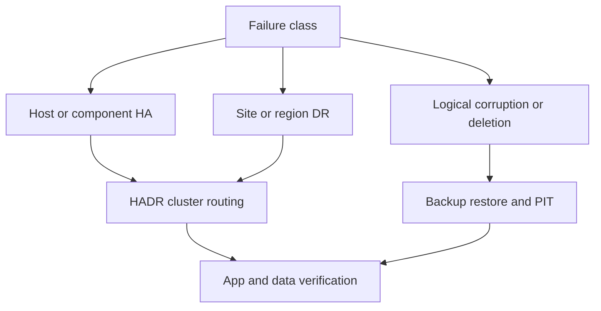

# G-01 — HA versus DR versus backup, failure domains, and service restoration objectives

**Procedure status: NOT YET EXECUTED.** This is a teaching procedure for Db2 LUW 12.1.0 on Linux x86-64, single-member topology. The exact fix pack is not pinned. Engine commands run on the Db2 server as the named instance/database authority; client checks run on the client; OS commands run on the named host and normally require read-only access. Windows, AIX, DPF, and pureScale differences are called out where material. The supplied environment has no Db2 CLI or disposable Db2 server, so no lab command is claimed as executed. Before production use, confirm each command against the installed fix pack and local change controls.

## 1. Quick answer

Use this lesson to make a bounded DBA decision about HA local service continuity, DR site/region recovery, backup for point-in-time and corruption. The key is to identify the failing layer and scope before changing state.

**Safest first step:** Capture the current target, timestamp, release, and read-only state before acting.

## 2. Learn the concept

The useful mental model is to follow HA local service continuity; DR site/region recovery; backup for point-in-time and corruption; host storage network site dependency graph; RPO/RTO and service restoration; fencing/split-brain; client entry points; failure matrix and test evidence from the service boundary inward. Record who owns each boundary and which evidence is authoritative there.

### Working model

Scope: HA local service continuity → DR site/region recovery → backup for point-in-time and corruption → host storage network site dependency graph → RPO/RTO and service restoration → fencing/split-brain → client entry points → failure matrix and test evidence. The arrows represent dependency, not proof of a fault. Confirm each hop independently.



## 3. Choose an approach

| Variant | Choose it when | Do not choose it when / boundary |
|---|---|---|
| HA | Automate or shorten recovery from component/local failures. | Does not protect against all logical corruption or regional loss. |
| DR | Recover service/data at alternate site or failure domain. | A standby with shared dependencies may not survive site loss. |
| Backup | Return to historical recovery point after corruption/deletion. | A copy is not a DR service endpoint without restore, keys and routing. |

## 4. Understand the lifecycle

- Identify business service and data-loss/recovery objectives.
- Map independent failure domains and shared dependencies.
- Select HADR/cluster/backup/client routing layers.
- Test host, storage, network, site and logical-error scenarios.
- Measure restore-to-service time and revise design.

**Pause/retry/stop/rollback rule:** Stop if the target identity, current state, authority, or rollback dependency is uncertain; preserve evidence and escalate.

## 5. Do the work

### Precheck

- Name source and alternate domains; verify power, identity, DNS and storage independence.
- Include application tier, secrets, firewall, certificates and external services.
- Agree RPO/RTO and acceptable consistency point with business owner.

### Scoped procedures

### Procedure 1: Topology evidence inventory

**Status:** NOT YET EXECUTED. **Run as:** DBA/architect. **Target:** SAMPLE primary/standby and backup history. **Authority/prerequisite:** Use only the relevant topology option; inventory is read-only.

```bash
db2pd -db SAMPLE -hadr; db2pd -db SAMPLE -members; db2 list history backup all for SAMPLE
```

**Expected result:** HADR role/state, member view and backup history appear.

**Independent check:** Map each host/storage/network/client entry point and backup copy to failure domain.

**Stop/rollback boundary:** No state change; architecture action requires a reviewed change.

### Procedure 2: Failure objective worksheet

**Status:** NOT YET EXECUTED. **Run as:** Service owner and DBA. **Target:** Named critical service. **Authority/prerequisite:** The symbols are planning measures, not Db2 commands; record evidence timestamps.

```bash
RPO = incident time minus latest recoverable commit
RTO = detect + decide + recover + validate + route
```

**Expected result:** Each scenario has a measurable target.

**Independent check:** Run a failover and restore exercise; compare actual data loss and service-ready time.

**Stop/rollback boundary:** If targets fail, adjust architecture and repeat controlled exercise.

## 6. Worked example and verification

HADR can restore an online database after a host loss, but if primary and standby share the same storage fabric or DNS dependency, the single failure can take both offline. A backup in another region handles other scenarios but has restore RTO.

**Expected state/result:** Failure matrix shows which control handles each event, what it cannot protect against and measured RPO/RTO.

**Independent verification:**

- Compare the post-state with the captured pre-state.
- Confirm the intended service or data outcome independently of the command return code.

## 7. Diagnose problems

| Symptom or verified error | Evidence to collect | Likely cause | Safe correction and recheck | Avoid |
|---|---|---|---|---|
| HADR peer is healthy but both sites lose service during network/storage outage. | dependency map, common network/fabric/DNS and backup copy location. | Failure domains were assumed independent but share critical dependencies. | Separate/duplicate dependencies and test isolation/fencing at alternate site. | Counting two databases as resilience without topology evidence. |
| DR test passes database takeover but app remains down. | DNS/VIP/client reroute, certificates, secrets, firewall, pools and external service state. | Database role recovery was mistaken for full service restoration. | Include app routing and end-user transaction in acceptance test. | Stopping the stopwatch when `TAKEOVER` returns. |

## 8. Practice

Create a failure matrix for host, disk, site, logical delete and key-manager outage. Map each to HADR, backup, service routing and data validation. Tabletop a DR takeover and time every stage.

## 9. Check understanding

**Question:** Why can neither HADR nor backup alone satisfy every resilience need?

**Answer and reasoning:** HADR maintains a standby data stream and quick role transition, while backup provides historical recovery points; they have different failure coverage and do not automatically restore application routing or prevent logical errors.

## 10. Look it up later

### Short checklist

- Name the target and scope.
- Collect a baseline and confirm prerequisites.
- Choose the least disruptive supported branch.
- Verify state and service behavior.
- Record evidence and recovery limits.

### Related lessons

[F-02](../F/F-02.md) · [G-02](../G/G-02.md) · [G-03](../G/G-03.md) · [G-06](../G/G-06.md) · [I-06](../I/I-06.md) · [K-03](../K/K-03.md)

### Authoritative references

- [IBM HADR overview](https://www.ibm.com/docs/en/db2/12.1.x?topic=server-high-availability-disaster-recovery-hadr)
- [IBM BACKUP DATABASE command](https://www.ibm.com/docs/en/db2/12.1.x?topic=commands-backup-database)
- [IBM TAKEOVER HADR command](https://www.ibm.com/docs/en/db2/12.1.x?topic=commands-takeover-hadr)

---

[Domain index](README.md) · [Course index](../README.md) · [Glossary](../GLOSSARY.md)
