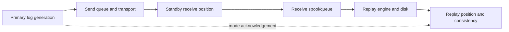

# G-02 — HADR roles, states, synchronization modes, queues, and guarantees

**Procedure status: NOT YET EXECUTED.** This is a teaching procedure for Db2 LUW 12.1.0 on Linux x86-64, single-member topology. The exact fix pack is not pinned. Engine commands run on the Db2 server as the named instance/database authority; client checks run on the client; OS commands run on the named host and normally require read-only access. Windows, AIX, DPF, and pureScale differences are called out where material. The supplied environment has no Db2 CLI or disposable Db2 server, so no lab command is claimed as executed. Before production use, confirm each command against the installed fix pack and local change controls.

## 1. Quick answer

Use this lesson to make a bounded DBA decision about primary/principal/auxiliary standby roles, LOCAL/REMOTE catchup, PEER and disconnected states, SYNC/NEARSYNC/ASYNC/SUPERASYNC guarantees. The key is to identify the failing layer and scope before changing state.

**Safest first step:** Capture the current target, timestamp, release, and read-only state before acting.

## 2. Learn the concept

The useful mental model is to follow primary/principal/auxiliary standby roles; LOCAL/REMOTE catchup, PEER and disconnected states; SYNC/NEARSYNC/ASYNC/SUPERASYNC guarantees; peer window and timeout; send/receive/replay positions and queues; log spooling and delayed replay; multiple standbys and reads on standby; member/state scope from the service boundary inward. Record who owns each boundary and which evidence is authoritative there.

### Working model

Scope: primary/principal/auxiliary standby roles → LOCAL/REMOTE catchup, PEER and disconnected states → SYNC/NEARSYNC/ASYNC/SUPERASYNC guarantees → peer window and timeout → send/receive/replay positions and queues → log spooling and delayed replay → multiple standbys and reads on standby → member/state scope. The arrows represent dependency, not proof of a fault. Confirm each hop independently.



## 3. Choose an approach

| Variant | Choose it when | Do not choose it when / boundary |
|---|---|---|
| SYNC | Wait for standby disk acknowledgement before log write succeeds. | Network latency can affect commit response; failover safety still needs fencing. |
| NEARSYNC | Wait for standby receive to memory, not disk persistence. | Standby crash timing matters. |
| ASYNC | Primary does not wait for acknowledgement. | Transactions can be lost at failover. |
| SUPERASYNC | Primary does not wait; HADR never enters peer/disconnected peer. | Highest data-loss exposure, shortest commit wait. |

## 4. Understand the lifecycle

- Initialize primary and standby from compatible image.
- Set local/remote host/service/instance and synchronization parameters.
- Start standby then primary and observe catchup to peer/disconnected state as configured.
- Monitor log generation, send/receive/replay positions and queue sizes.
- Act only on role and state with commit-loss guarantee understood.

**Pause/retry/stop/rollback rule:** Stop if the target identity, current state, authority, or rollback dependency is uncertain; preserve evidence and escalate.

## 5. Do the work

### Precheck

- Verify log chain, unique hosts/ports, target list and compatible release.
- Read actual configured/effective mode from `db2pd -hadr`/MON_GET_HADR.
- Confirm peer-window restrictions by mode and topology.

### Scoped procedures

### Procedure 1: Observe HADR roles and queues

**Status:** NOT YET EXECUTED. **Run as:** Instance owner/monitor user. **Target:** Primary and selected standby member. **Authority/prerequisite:** Use current exact output columns and one-member/pureScale scope; query from primary for standbys.

```bash
db2pd -db SAMPLE -hadr; SELECT hadr_role, hadr_state, hadr_syncmode, log_gap, standby_log_receive_queue_size, standby_log_replay_queue_size FROM TABLE(mon_get_hadr(NULL)) AS h
```

**Expected result:** Role, state, synchronization mode and send/receive/replay lag are shown.

**Independent check:** Compare primary log position with standby receive/replay position and queue trend across time.

**Stop/rollback boundary:** Read-only; a single state label is not takeover approval.

### Procedure 2: Start HADR in correct order

**Status:** NOT YET EXECUTED. **Run as:** HADR administrator. **Target:** One standby then its primary database. **Authority/prerequisite:** HADR config and restore/image baseline complete; execute each on its correct host.

```bash
START HADR ON DB SAMPLE AS STANDBY; START HADR ON DB SAMPLE AS PRIMARY
```

**Expected result:** Standby starts awaiting primary; primary starts connecting/shipping logs.

**Independent check:** Check `db2pd -hadr` role/state on both sides until expected state and queue behavior.

**Stop/rollback boundary:** STOP HADR is not a generic retry; use only after understanding database shutdown/state consequences.

## 6. Worked example and verification

PEER with SYNC and stable zero receive queue gives strong commit protection under documented conditions; a growing replay queue still signals standby disk/CPU workload risk. In ASYNC a connected state does not mean every primary commit reached standby.

**Expected state/result:** State, mode, roles, queue trends and failover loss guarantees are recorded per member/standby.

**Independent verification:**

- Compare the post-state with the captured pre-state.
- Confirm the intended service or data outcome independently of the command return code.

## 7. Diagnose problems

| Symptom or verified error | Evidence to collect | Likely cause | Safe correction and recheck | Avoid |
|---|---|---|---|---|
| Standby remains in REMOTE_CATCHUP. | send/receive/replay positions, archive fetch, network throughput and log generation. | Standby is behind and transport or replay cannot catch up to generation rate. | Find whether sender/network/receiver/replay is limiting; reduce workload or improve bottleneck, then trend queues. | Taking over based solely on a connected/catchup state. |
| HADR mode or peer window cannot be configured as requested. | DB CFG, mode compatibility and `db2pd -hadr` actual state. | Mode/peer-window combination unsupported or parameters not loaded until START HADR. | Choose documented mode/objective combination; apply and restart HADR through planned path. | Assuming configured parameter equals active runtime value. |

## 8. Practice

Build a state table from fictional HADR samples covering LOCAL_CATCHUP, REMOTE_CATCHUP, PEER, DISCONNECTED_PEER and DISCONNECTED. For each mode, list what a commit acknowledgement means and what can be lost. No HADR pair is available here.

## 9. Check understanding

**Question:** Why do send, receive and replay queues need separate interpretation?

**Answer and reasoning:** Send delay indicates primary shipping; receive queue indicates standby has logs not yet replayed; replay lag indicates standby apply capacity. Different fixes target network, buffering or standby CPU/I/O.

## 10. Look it up later

### Short checklist

- Name the target and scope.
- Collect a baseline and confirm prerequisites.
- Choose the least disruptive supported branch.
- Verify state and service behavior.
- Record evidence and recovery limits.

### Related lessons

[G-01](../G/G-01.md) · [G-03](../G/G-03.md) · [G-04](../G/G-04.md) · [D-04](../D/D-04.md) · [E-03](../E/E-03.md)

### Authoritative references

- [IBM HADR configuration](https://www.ibm.com/docs/en/db2/12.1.x?topic=hadr-database-configuration)
- [IBM HADR synchronization modes](https://www.ibm.com/docs/en/db2/12.1.x?topic=parameters-hadr-syncmode-high-availability-disaster-recovery-synchronization-mode)
- [IBM TAKEOVER HADR command](https://www.ibm.com/docs/en/db2/12.1.x?topic=commands-takeover-hadr)
- [IBM db2pd activity monitoring](https://www.ibm.com/docs/en/db2/12.1.x?topic=commands-db2pd-monitor-troubleshoot-db2-engine-activities)

---

[Domain index](README.md) · [Course index](../README.md) · [Glossary](../GLOSSARY.md)
