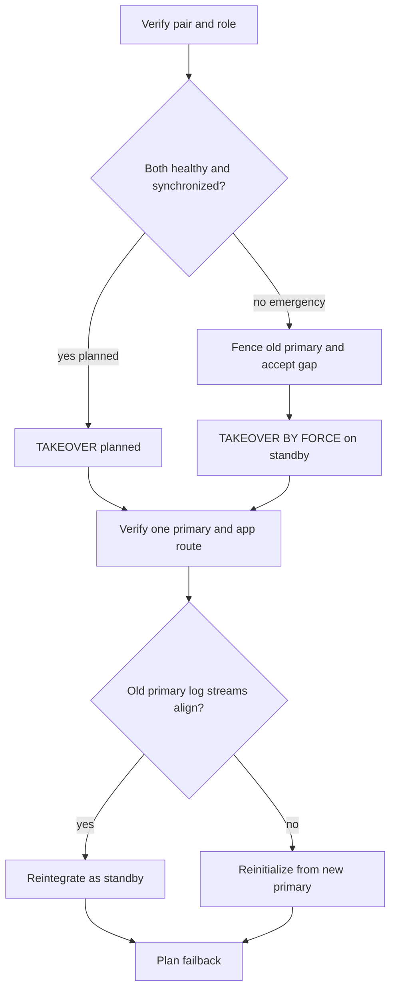

# G-03 — HADR setup, planned takeover, forced takeover gates, reintegration, and failback

**Procedure status: NOT YET EXECUTED.** This is a teaching procedure for Db2 LUW 12.1.0 on Linux x86-64, single-member topology. The exact fix pack is not pinned. Engine commands run on the Db2 server as the named instance/database authority; client checks run on the client; OS commands run on the named host and normally require read-only access. Windows, AIX, DPF, and pureScale differences are called out where material. The supplied environment has no Db2 CLI or disposable Db2 server, so no lab command is claimed as executed. Before production use, confirm each command against the installed fix pack and local change controls.

## 1. Quick answer

Use this lesson to make a bounded DBA decision about HADR init/backup restore and parameter setup, start/stop primary and standby, planned takeover. The key is to identify the failing layer and scope before changing state.

**Safest first step:** Capture the current target, timestamp, release, and read-only state before acting.

## 2. Learn the concept

The useful mental model is to follow HADR init/backup restore and parameter setup; start/stop primary and standby; planned takeover; forced takeover gates and fencing; role/client reroute verification; old primary reintegration eligibility; reinitialize after divergent log streams; cluster manager/manual control; failback and app/data proof from the service boundary inward. Record who owns each boundary and which evidence is authoritative there.

### Working model

Scope: HADR init/backup restore and parameter setup → start/stop primary and standby → planned takeover → forced takeover gates and fencing → role/client reroute verification → old primary reintegration eligibility → reinitialize after divergent log streams → cluster manager/manual control → failback and app/data proof. The arrows represent dependency, not proof of a fault. Confirm each hop independently.



## 3. Choose an approach

| Variant | Choose it when | Do not choose it when / boundary |
|---|---|---|
| Planned takeover | Use while both databases communicate and are synchronized. | Do not call a planned takeover during unexplained lag. |
| Forced takeover | Emergency action only after primary is fenced/known stopped. | Possible data loss and split-brain if old primary remains writable. |
| Reintegration | Restart old primary as standby if logs have not diverged. | If reintegration fails due divergence, reinitialize from new primary. |

## 4. Understand the lifecycle

- Confirm pair and cluster manager status; compare log positions.
- For planned: run takeover on current standby and observe role transition.
- For forced: fence old primary, record last durable receive point and owner’s data-loss decision.
- Verify new primary role, DB accessibility, application route and data.
- Reintegrate old primary as standby or reinitialize; plan failback separately.

**Pause/retry/stop/rollback rule:** Stop if the target identity, current state, authority, or rollback dependency is uncertain; preserve evidence and escalate.

## 5. Do the work

### Precheck

- Confirm primary/standby identities, sync mode, peer state/lag and client route.
- Disable/coordinate independent fault monitors or cluster automation as documented.
- Obtain incident/change authorization and record RPO exposure before BY FORCE.

### Scoped procedures

### Procedure 1: Planned takeover

**Status:** NOT YET EXECUTED. **Run as:** HADR administrator. **Target:** Current synchronized standby. **Authority/prerequisite:** Both sides healthy and in peer or allowed state; agree application drain and route action.

```bash
TAKEOVER HADR ON DB SAMPLE
```

**Expected result:** Standby becomes primary after orderly transition; existing connections may be interrupted.

**Independent check:** Use db2pd -hadr on both hosts, check new role, client alias/reroute and test committed data.

**Stop/rollback boundary:** Planned role change can be reversed only through a second planned takeover after pair is healthy.

### Procedure 2: Forced takeover after fencing

**Status:** NOT YET EXECUTED. **Run as:** HADR administrator on standby. **Target:** Standby database only. **Authority/prerequisite:** Old primary host/database confirmed stopped or fenced from clients and peers; business accepts potential lost commits.

```bash
TAKEOVER HADR ON DB SAMPLE BY FORCE
```

**Expected result:** Standby takes primary role and opens for connections after replaying received logs.

**Independent check:** Verify one primary only, role/state, last received log, client route and application data/transaction reconciliation.

**Stop/rollback boundary:** Forced takeover cannot be rolled back by command; do not restart old primary as primary. Reintegration or reinitialization is next.

### Procedure 3: Old primary reintegration

**Status:** NOT YET EXECUTED. **Run as:** HADR administrator on old primary host. **Target:** Former primary, now to be standby. **Authority/prerequisite:** Only if log streams did not diverge and new primary target list includes former primary.

```bash
START HADR ON DB SAMPLE AS STANDBY
```

**Expected result:** Former primary joins as standby and catches up.

**Independent check:** Check connected state and peer/remote catchup; verify no duplicate primary.

**Stop/rollback boundary:** If reintegration fails from divergence, stop and reinitialize from a fresh new-primary backup; do not force old database into pair.

## 6. Worked example and verification

Planned takeover proceeds while both sides are connected and synchronized. Forced takeover follows a different gate: fence the former primary first, record standby receive/replay point, accept potential loss, then take over and verify one writable primary before routing clients.

**Expected state/result:** One primary is writable, app points to it, data-loss gap is documented, and former primary is either a healthy standby or deliberately reinitialized.

**Independent verification:**

- Compare the post-state with the captured pre-state.
- Confirm the intended service or data outcome independently of the command return code.

## 7. Diagnose problems

| Symptom or verified error | Evidence to collect | Likely cause | Safe correction and recheck | Avoid |
|---|---|---|---|---|
| Both sites appear to accept writes after forced takeover. | cluster manager, host fencing, HADR role on each host and application routes. | Old primary was not fully disabled or fault monitor restarted it. | Fence/isolate the old primary immediately; preserve both data sets and follow split-brain recovery with IBM/support. | Merging divergent database files or restarting one as primary. |
| Old primary cannot reintegrate. | db2diag consistency/LSN messages and new-primary log chain. | Log streams diverged; automatic reintegration impossible. | Reinitialize old primary as standby from a fresh backup of current primary. | Repeated START HADR or issuing BY FORCE on old primary. |

## 8. Practice

Tabletop planned takeover with zero loss and forced takeover after three different sync modes. In the forced case, identify fencing evidence, possible gap and owner acceptance. Follow old-primary reintegration/reinitialize branches. Do not execute failover without a disposable pair.

## 9. Check understanding

**Question:** What is the minimum safe gate before `TAKEOVER ... BY FORCE`?

**Answer and reasoning:** Positive evidence that the former primary cannot write/serve clients (fenced), correct standby target/state and data-gap review, plus explicit incident decision accepting possible loss.

## 10. Look it up later

### Short checklist

- Name the target and scope.
- Collect a baseline and confirm prerequisites.
- Choose the least disruptive supported branch.
- Verify state and service behavior.
- Record evidence and recovery limits.

### Related lessons

[G-01](../G/G-01.md) · [G-02](../G/G-02.md) · [G-04](../G/G-04.md) · [I-02](../I/I-02.md) · [K-03](../K/K-03.md)

### Authoritative references

- [IBM TAKEOVER HADR command](https://www.ibm.com/docs/en/db2/12.1.x?topic=commands-takeover-hadr)
- [IBM HADR failover procedure](https://www.ibm.com/docs/en/db2/12.1.x?topic=outage-performing-hadr-failover-operation)
- [IBM HADR configuration](https://www.ibm.com/docs/en/db2/12.1.x?topic=hadr-database-configuration)
- [IBM cluster managers and HADR](https://www.ibm.com/docs/en/db2/12.1.x?topic=hadr-cluster-managers)

---

[Domain index](README.md) · [Course index](../README.md) · [Glossary](../GLOSSARY.md)
