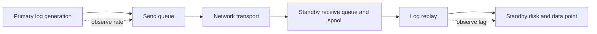

# G-04 — HADR delay, log transport/replay diagnosis, and safe remediation

**Procedure status: NOT YET EXECUTED.** This is a teaching procedure for Db2 LUW 12.1.0 on Linux x86-64, single-member topology. The exact fix pack is not pinned. Engine commands run on the Db2 server as the named instance/database authority; client checks run on the client; OS commands run on the named host and normally require read-only access. Windows, AIX, DPF, and pureScale differences are called out where material. The supplied environment has no Db2 CLI or disposable Db2 server, so no lab command is claimed as executed. Before production use, confirm each command against the installed fix pack and local change controls.

## 1. Quick answer

Use this lesson to make a bounded DBA decision about log generation versus sender, network throughput/latency, standby receive/spool capacity. The key is to identify the failing layer and scope before changing state.

**Safest first step:** Capture the current target, timestamp, release, and read-only state before acting.

## 2. Learn the concept

The useful mental model is to follow log generation versus sender; network throughput/latency; standby receive/spool capacity; log replay workload and disk; gap/archive retrieval; disconnect/state transitions; SQL1770N takeover eligibility; safe remediation and recheck from the service boundary inward. Record who owns each boundary and which evidence is authoritative there.

### Working model

Scope: log generation versus sender → network throughput/latency → standby receive/spool capacity → log replay workload and disk → gap/archive retrieval → disconnect/state transitions → SQL1770N takeover eligibility → safe remediation and recheck. The arrows represent dependency, not proof of a fault. Confirm each hop independently.



## 3. Choose an approach

| Variant | Choose it when | Do not choose it when / boundary |
|---|---|---|
| Send lag | Primary log production outpaces send/network. | Do not tune replay heap for a network bottleneck. |
| Receive/spool block | Standby cannot receive due queue/spool/full space. | Increasing spool without capacity and replay analysis can defer failure. |
| Replay lag | Standby disk/CPU/recovery workload cannot apply received logs. | Lowering source workload may not solve saturated standby device. |

## 4. Understand the lifecycle

- Capture primary and standby `db2pd -hadr` at multiple intervals.
- Compare log positions, queue sizes, flags, network and disk latency.
- Identify first diverging stage: generation/send, transport, receive/spool, replay.
- Correct only the diagnosed limit and check state/takeover eligibility.
- Reassess RPO and planned maintenance/failover risk.

**Pause/retry/stop/rollback rule:** Stop if the target identity, current state, authority, or rollback dependency is uncertain; preserve evidence and escalate.

## 5. Do the work

### Precheck

- Record current role/state/mode and incident impact.
- Use matching timestamped samples; note member scope in pureScale.
- Do not trigger takeover or stop HADR based on one queue sample.

### Scoped procedures

### Procedure 1: HADR queue and state sample

**Status:** NOT YET EXECUTED. **Run as:** Instance owner. **Target:** Primary and standby hosts separately. **Authority/prerequisite:** Bounded 10-second interval; command runs on each server; use native wait syntax.

```bash
db2pd -db SAMPLE -hadr; sleep 10; db2pd -db SAMPLE -hadr
```

**Expected result:** Two snapshots show role/state/positions/queues and movement.

**Independent check:** Compute log position and queue deltas; compare network and standby disk samples.

**Stop/rollback boundary:** Read-only; do not modify HADR config until failure stage is localized.

### Procedure 2: HADR monitor query

**Status:** NOT YET EXECUTED. **Run as:** Monitor-authorized DBA. **Target:** Primary database, member-aware output. **Authority/prerequisite:** Name columns and sample on primary; pureScale output is local member stream.

```bash
SELECT hadr_role, hadr_state, hadr_syncmode, log_gap, standby_log_receive_queue_size, standby_log_replay_queue_size FROM TABLE(mon_get_hadr(NULL)) AS h
```

**Expected result:** HADR state and receive/replay queue fields are returned.

**Independent check:** Trend over intervals; compare queue movement to primary log generation rate.

**Stop/rollback boundary:** Read-only.

## 6. Worked example and verification

Receive queue stays near zero while replay queue grows and standby device write latency is high. Improve replay capacity/storage path or reduce replay contention; changing network buffer does not address the measured stage.

**Expected state/result:** Delay is localized by stage, queues trend in right direction after action and RPO is measured against last applied/received commit.

**Independent verification:**

- Compare the post-state with the captured pre-state.
- Confirm the intended service or data outcome independently of the command return code.

## 7. Diagnose problems

| Symptom or verified error | Evidence to collect | Likely cause | Safe correction and recheck | Avoid |
|---|---|---|---|---|
| Standby receive queue stalls at capacity. | HADR flags, spool percentage/limit, standby log path free space and replay progress. | Replay is stalled or log spool reached configured limit. | Restore replay/disk capacity, clear only safe competing workload and recheck receive progress. | Deleting standby spool/log files manually. |
| HADR disconnects intermittently while both hosts appear healthy. | TCP retransmits/latency, heartbeat timeout, firewall/NAT idle behavior and Db2 diagnostics. | Network interruption, timeout too low or path changes. | Network owner repairs path; tune timeouts only from measured outage and failure objectives. | Setting huge timeout to hide recurring path loss. |
| Operator proposes forced takeover because replay lag increased. | sync mode, last received/replayed log, exact state and primary health/fencing. | Queue interpreted as permission to fail over; takeover has RPO and split-brain risk. | Use G-03 gate; if no outage, repair lag or planned maintenance instead. | Takeover based on a single metric. |

## 8. Practice

Analyze three 10-second HADR snapshots: send backlog, receive backlog and replay backlog. For each locate stage, owner, safest action and recheck. Include one SQL1770N scenario: state does not meet takeover eligibility. No HADR lab exists.

## 9. Check understanding

**Question:** Which queue matters for data received but not yet query-ready at standby?

**Answer and reasoning:** Replay queue/position: logs arrived but still await application. Receive queue reflects shipped logs not yet received; send lag is earlier.

## 10. Look it up later

### Short checklist

- Name the target and scope.
- Collect a baseline and confirm prerequisites.
- Choose the least disruptive supported branch.
- Verify state and service behavior.
- Record evidence and recovery limits.

### Related lessons

[A-04](../A/A-04.md) · [E-03](../E/E-03.md) · [F-01](../F/F-01.md) · [G-02](../G/G-02.md) · [G-03](../G/G-03.md)

### Authoritative references

- [IBM HADR configuration](https://www.ibm.com/docs/en/db2/12.1.x?topic=hadr-database-configuration)
- [IBM db2pd activity monitoring](https://www.ibm.com/docs/en/db2/12.1.x?topic=commands-db2pd-monitor-troubleshoot-db2-engine-activities)
- [IBM HADR state monitoring](https://www.ibm.com/docs/en/db2/12.1.0?topic=management-determining-hadr-standby-database-state)
- [IBM SQL0964C guidance](https://www.ibm.com/docs/en/db2/12.1.x?topic=servers-troubleshooting-full-transaction-log-error)

---

[Domain index](README.md) · [Course index](../README.md) · [Glossary](../GLOSSARY.md)
