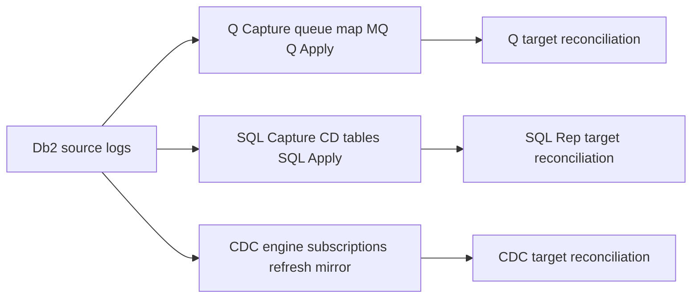

# G-05 — Q Replication and SQL Replication operations; keep CDC as a distinct product track

**Procedure status: NOT YET EXECUTED.** This is a teaching procedure for Db2 LUW 12.1.0 on Linux x86-64, single-member topology. The exact fix pack is not pinned. Engine commands run on the Db2 server as the named instance/database authority; client checks run on the client; OS commands run on the named host and normally require read-only access. Windows, AIX, DPF, and pureScale differences are called out where material. The supplied environment has no Db2 CLI or disposable Db2 server, so no lab command is claimed as executed. Before production use, confirm each command against the installed fix pack and local change controls.

## 1. Quick answer

Use this lesson to make a bounded DBA decision about Q Capture/Apply control tables and queue maps, SQL Replication Capture/Apply control tables and CD tables, CDC product engine/subscription lifecycle distinct from Q/SQL. The key is to identify the failing layer and scope before changing state.

**Safest first step:** Capture the current target, timestamp, release, and read-only state before acting.

## 2. Learn the concept

The useful mental model is to follow Q Capture/Apply control tables and queue maps; SQL Replication Capture/Apply control tables and CD tables; CDC product engine/subscription lifecycle distinct from Q/SQL; latency stages and commit sequence; conflict/exception handling; bulk utility resync/refresh; security/network and target reconciliation from the service boundary inward. Record who owns each boundary and which evidence is authoritative there.

### Working model

Scope: Q Capture/Apply control tables and queue maps → SQL Replication Capture/Apply control tables and CD tables → CDC product engine/subscription lifecycle distinct from Q/SQL → latency stages and commit sequence → conflict/exception handling → bulk utility resync/refresh → security/network and target reconciliation. The arrows represent dependency, not proof of a fault. Confirm each hop independently.



## 3. Choose an approach

| Variant | Choose it when | Do not choose it when / boundary |
|---|---|---|
| Q Replication | Log-based Capture to MQ queues to Apply; queue maps and Q subscriptions. | Requires IBM IDR product, queue manager and control tables. |
| SQL Replication | Capture to change-data tables; Apply reads CD tables/subscription sets. | Distinct control tables, latency and pruning behavior. |
| CDC Replication | Separate replication product with subscriptions/mirroring/refresh and datastore services. | Do not use Q/SQL Replication commands or assume identical states. |

## 4. Understand the lifecycle

- Identify product/version/source/target and topology.
- Verify Capture/Apply/CDC engines, control tables, queue/storage and subscription.
- Start capture, establish snapshot/refresh baseline, then start apply/mirroring.
- Monitor capture/queue/apply lag, errors and target keys.
- After bulk change, run product-specific resync/refresh and reconcile target.

**Pause/retry/stop/rollback rule:** Stop if the target identity, current state, authority, or rollback dependency is uncertain; preserve evidence and escalate.

## 5. Do the work

### Precheck

- Read applicable IDR product release docs and supported source/target matrix.
- Confirm source log retention, MQ queue depth or SQL CD table capacity.
- Record last commit sequence, table maps, conflicts and trigger/constraint semantics.

### Scoped procedures

### Procedure 1: Start Q subscription from ASNCLP

**Status:** NOT YET EXECUTED. **Run as:** Replication operator with source/target privileges. **Target:** Q Replication source SAMPLE and configured MQ queue map. **Authority/prerequisite:** Q Capture/Apply control tables, subscription and MQ queues already configured; command is product-specific.

```bash
ASNCLP SESSION SET TO Q REPLICATION; SET SERVER CAPTURE TO DB SAMPLE; SET CAPTURE SCHEMA SOURCE ASN1; START QSUB SUBNAME ORDERS_QSUB;
```

**Expected result:** Q subscription start is requested; Capture/Apply processes consume signals.

**Independent check:** Check `asnqccmd`/`asnqacmd` status, queue depth, commit sequence and target reconciliation.

**Stop/rollback boundary:** Stop the subscription through product command before altering control tables or dropping schema.

### Procedure 2: SQL Replication start/monitor boundary

**Status:** NOT YET EXECUTED. **Run as:** Replication operator. **Target:** SQL Replication Capture server. **Authority/prerequisite:** Build a complete ASNCLP script from current IDR docs; the snippet selects product context, it does not start a full subscription by itself.

```bash
ASNCLP SESSION SET TO SQL REPLICATION; SET SERVER CAPTURE TO DB SAMPLE; SET CAPTURE SCHEMA ASN1;
```

**Expected result:** ASNCLP context is set for SQL Replication; control definitions are product-specific.

**Independent check:** Check Capture/Apply status, IBMSNAP_REGISTER/CD tables, subscription set and target keys.

**Stop/rollback boundary:** Stop Capture/Apply by product lifecycle and preserve control tables until subscriptions removed.

### Procedure 3: CDC subscription monitoring and refresh

**Status:** NOT YET EXECUTED. **Run as:** CDC administrator. **Target:** Named CDC subscription/table through CDC Management Console/API. **Authority/prerequisite:** Use only CDC engine 11.4 documentation and approved consistency window; do not issue as SQL Replication command.

```bash
CDC Replication: stop mirroring for selected subscription, flag table for refresh, run product Start Refresh, then restart mirroring
```

**Expected result:** Refresh synchronizes source/target then resumes mirroring according to subscription method.

**Independent check:** Check subscription state, refresh row counts/events and compare source-target keys/checksum.

**Stop/rollback boundary:** Do not restart mirroring until refresh completes and target state is accepted.

## 6. Worked example and verification

A bulk LOAD affects a source table. Q Replication requires queue/subscription resynchronization choices; SQL Replication must reconcile capture/Apply and CD tables; CDC uses its own subscription refresh/mirroring states. Pick the product path from installed product, not the generic word “replication.”

**Expected state/result:** Product-specific control planes are healthy, commit sequence/latency are understood, and source/target data is reconciled after baseline or resync.

**Independent verification:**

- Compare the post-state with the captured pre-state.
- Confirm the intended service or data outcome independently of the command return code.

## 7. Diagnose problems

| Symptom or verified error | Evidence to collect | Likely cause | Safe correction and recheck | Avoid |
|---|---|---|---|---|
| Q Capture is running but Q Apply lag grows. | Q Capture log position, send/receive queue depth, Apply status/errors and target locks. | Queue bottleneck, Apply error/target constraint or target workload contention. | Resolve earliest stage and restart only failed product process/subscription as documented. | Dropping queue/control tables to clear latency. |
| SQL Replication CD tables grow without pruning. | Apply prune position, subscriptions, Capture status and CD table volume. | Apply not advancing/prune set missing or subscription stopped. | Restore Apply and verify commit sequence before controlled prune. | Truncating CD tables before confirming applied point. |
| CDC target diverges after bulk operation. | subscription state, refresh/mirror point, event logs and source/target reconciliation. | Bulk change was not mirrored or refresh was skipped. | Stop selected mirroring, perform CDC refresh with workload controls and restart after validation. | Using ASNCLP Q subscription operations for CDC. |

## 8. Practice

Draw three independent sequence diagrams for Q, SQL Replication and CDC. Use official docs to write a start/stop/resync checklist and compare where backlog resides: MQ, CD table, or CDC engine. No replication product is installed here.

## 9. Check understanding

**Question:** Why keep CDC distinct from Q and SQL Replication?

**Answer and reasoning:** It is a separate product engine with its own service, subscription states, refresh/mirroring control and tooling. Similar outcomes do not mean shared commands or lifecycle.

## 10. Look it up later

### Short checklist

- Name the target and scope.
- Collect a baseline and confirm prerequisites.
- Choose the least disruptive supported branch.
- Verify state and service behavior.
- Record evidence and recovery limits.

### Related lessons

[C-05](../C/C-05.md) · [E-05](../E/E-05.md) · [I-04](../I/I-04.md) · [K-04](../K/K-04.md)

### Authoritative references

- [IBM Q Replication system commands](https://www.ibm.com/docs/en/idr/11.4.0?topic=reference-system-commands-q-replication-event-publishing)
- [IBM Q subscription start](https://www.ibm.com/docs/en/idr/11.4.0?topic=program-starting-q-subscriptions)
- [IBM SQL Replication Capture/Apply](https://www.ibm.com/docs/en/idr/11.4.0?topic=communicate-capture-program-apply-program)
- [IBM CDC refresh](https://www.ibm.com/docs/en/idr/11.4.0?topic=replication-starting-refresh-subscription)
- [IBM CDC replication states](https://www.ibm.com/docs/en/idr/11.3.3?topic=subscriptions-understanding-subscription-states)

---

[Domain index](README.md) · [Course index](../README.md) · [Glossary](../GLOSSARY.md)
