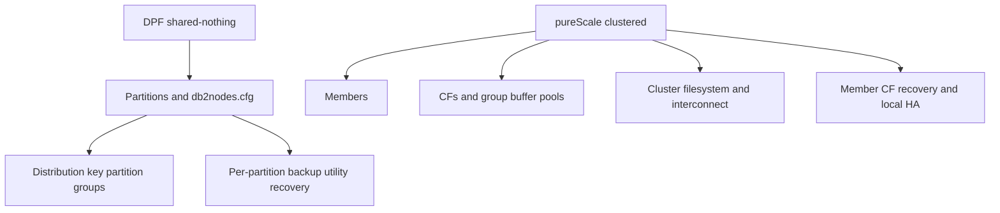

# G-06 — Separate DPF and pureScale architecture, command scope, failures, and labs

**Procedure status: NOT YET EXECUTED.** This is a teaching procedure for Db2 LUW 12.1.0 on Linux x86-64, single-member topology. The exact fix pack is not pinned. Engine commands run on the Db2 server as the named instance/database authority; client checks run on the client; OS commands run on the named host and normally require read-only access. Windows, AIX, DPF, and pureScale differences are called out where material. The supplied environment has no Db2 CLI or disposable Db2 server, so no lab command is claimed as executed. Before production use, confirm each command against the installed fix pack and local change controls.

## 1. Quick answer

Use this lesson to make a bounded DBA decision about DPF partition layout/catalog partition/partition groups, distribution keys/maps and rebalance/redistribute, DPF node failure utilities and recovery. The key is to identify the failing layer and scope before changing state.

**Safest first step:** Capture the current target, timestamp, release, and read-only state before acting.

## 2. Learn the concept

The useful mental model is to follow DPF partition layout/catalog partition/partition groups; distribution keys/maps and rebalance/redistribute; DPF node failure utilities and recovery; pureScale members/CF/cluster FS/interconnect; member and CF failover/restart/recovery; cluster manager and maintenance; HADR on DPF vs pureScale; separate topology diagrams and validation from the service boundary inward. Record who owns each boundary and which evidence is authoritative there.

### Working model

Scope: DPF partition layout/catalog partition/partition groups → distribution keys/maps and rebalance/redistribute → DPF node failure utilities and recovery → pureScale members/CF/cluster FS/interconnect → member and CF failover/restart/recovery → cluster manager and maintenance → HADR on DPF vs pureScale → separate topology diagrams and validation. The arrows represent dependency, not proof of a fault. Confirm each hop independently.



## 3. Choose an approach

| Variant | Choose it when | Do not choose it when / boundary |
|---|---|---|
| DPF | Shared-nothing database partitions and data distribution. | Partition is not a pureScale member. |
| pureScale | Multiple members with CF coordination/shared cluster filesystem. | No DPF-style distribution key or db2nodes.cfg partition semantics. |
| HADR overlay | Creates cross-site recovery on supported topology. | pureScale HADR failover/cluster-manager rules differ. |

## 4. Understand the lifecycle

- Discover topology with supported commands and inventory.
- Map all data locations and member/partition ownership.
- Plan maintenance, utility, backup and recovery at topology scope.
- Inject one controlled host/member/partition failure in a lab.
- Verify all partitions/members, application route and data distribution.

**Pause/retry/stop/rollback rule:** Stop if the target identity, current state, authority, or rollback dependency is uncertain; preserve evidence and escalate.

## 5. Do the work

### Precheck

- Use `db2nodes.cfg` only for DPF; do not edit running instance.
- Check CF, cluster filesystem and cluster-manager state on pureScale.
- Plan interconnect and shared storage dependencies separately from HADR site.

### Scoped procedures

### Procedure 1: DPF partition inventory

**Status:** NOT YET EXECUTED. **Run as:** DPF instance owner. **Target:** All database partitions. **Authority/prerequisite:** DPF only; command fan-out must be bounded and outputs tagged by partition.

```bash
cat $HOME/sqllib/db2nodes.cfg; db2_all "hostname; db2pd -inst"
```

**Expected result:** Node map and instance evidence from each partition are returned.

**Independent check:** Run member-aware DB2 utilities/status and distribution-map validation.

**Stop/rollback boundary:** Read-only; add/drop/change partition via supported utilities and planned rebalance, never edit live file.

### Procedure 2: DPF rebalance/redistribution monitoring

**Status:** NOT YET EXECUTED. **Run as:** DPF DBA/monitor user. **Target:** DPF table-space/database partition movement. **Authority/prerequisite:** Use after an approved data redistribution or storage change; monitor all affected partitions.

```bash
db2pd -db SAMPLE -rebal; SELECT * FROM TABLE(mon_get_rebalance_status(NULL,-2)) AS r
```

**Expected result:** Rebalance status/progress is visible.

**Independent check:** Check completion, data distribution and application latency per partition.

**Stop/rollback boundary:** Do not stop redistribution ad hoc; use documented utility control.

### Procedure 3: pureScale cluster inventory

**Status:** NOT YET EXECUTED. **Run as:** pureScale instance owner. **Target:** Members and CFs in cluster. **Authority/prerequisite:** pureScale only; check cluster manager and CF health first.

```bash
db2instance -list
```

**Expected result:** Member/CF roles and state are shown.

**Independent check:** Compare with cluster manager, cluster filesystem and interconnect monitoring.

**Stop/rollback boundary:** Read-only; cluster resource repair follows supported cluster manager procedures.

### Procedure 4: pureScale member failure behavior

**Status:** NOT YET EXECUTED. **Run as:** pureScale DBA with host admin partner. **Target:** Affected member and local cluster. **Authority/prerequisite:** Read-only evidence before asking cluster services to restart resources.

```bash
db2pd -db SAMPLE -members; db2diag -H 1d
```

**Expected result:** Member recovery/failover and logs are visible.

**Independent check:** Verify restart light/member recovery, lock release, CF health and application continuation.

**Stop/rollback boundary:** Never manually restart/kill CF or edit cluster profile outside product procedure.

## 6. Worked example and verification

After a DPF node outage, partition-local data and utilities require partition-wide recovery and distribution checks. After a pureScale member host failure, cluster services can restart the member locally or elsewhere and run crash recovery; CF/cluster filesystem/interconnect remain separate health checks.

**Expected state/result:** The runbook names DPF partition or pureScale member/CF as the unit of failure and validates every affected scope.

**Independent verification:**

- Compare the post-state with the captured pre-state.
- Confirm the intended service or data outcome independently of the command return code.

## 7. Diagnose problems

| Symptom or verified error | Evidence to collect | Likely cause | Safe correction and recheck | Avoid |
|---|---|---|---|---|
| DPF query or utility is slow only on one partition. | per-partition CPU/I/O, data skew, distribution map, FCM and utility state. | Uneven data placement or one host/storage bottleneck. | Correct skew/capacity through tested redistribution or host remediation; compare all partitions. | Increasing global resources while ignoring a single hot partition. |
| pureScale member restarts in restart light and does not serve work. | db2instance output, member recovery state, home host and CF health. | Member is recovering elsewhere to release locks/restore consistency; restart-light instance does not accept new transactions. | Wait for documented recovery and automatic failback; verify cluster resources before intervention. | Attempting to route new workload to restart-light member. |

## 8. Practice

Build independent DPF and pureScale runbooks. DPF lab: inspect node map and rebalance status. pureScale tabletop: member host loss, CF loss and site loss. Mark cluster manager owner and exact recovery evidence; no clusters are available here.

## 9. Check understanding

**Question:** Which configuration file belongs to DPF and why should it not be edited manually in a running instance?

**Answer and reasoning:** `db2nodes.cfg` defines DPF partition hosts/ports. Db2 uses it for topology; changes require supported node utilities and can break coordinated partition scope.

## 10. Look it up later

### Short checklist

- Name the target and scope.
- Collect a baseline and confirm prerequisites.
- Choose the least disruptive supported branch.
- Verify state and service behavior.
- Record evidence and recovery limits.

### Related lessons

[B-06](../B/B-06.md) · [G-01](../G/G-01.md) · [G-02](../G/G-02.md) · [G-03](../G/G-03.md) · [F-03](../F/F-03.md) · [F-05](../F/F-05.md)

### Authoritative references

- [IBM DPF node configuration](https://www.ibm.com/docs/en/db2/12.1.0?topic=files-creating-node-configuration)
- [IBM DPF node file format](https://www.ibm.com/docs/en/db2/12.1.x?topic=file-format-db2-node-configuration)
- [IBM pureScale components](https://www.ibm.com/docs/en/db2/12.1.x?topic=environment-components-db2-purescale-feature)
- [IBM pureScale failure handling](https://www.ibm.com/docs/en/db2/12.1.0?topic=tdpf-understanding-how-db2-purescale-feature-automatically-handles-failure)
- [IBM pureScale HADR setup](https://www.ibm.com/docs/en/db2/12.1.x?topic=environments-scenario-deploying-hadr-in-db2-purescale-environment)

---

[Domain index](README.md) · [Course index](../README.md) · [Glossary](../GLOSSARY.md)
