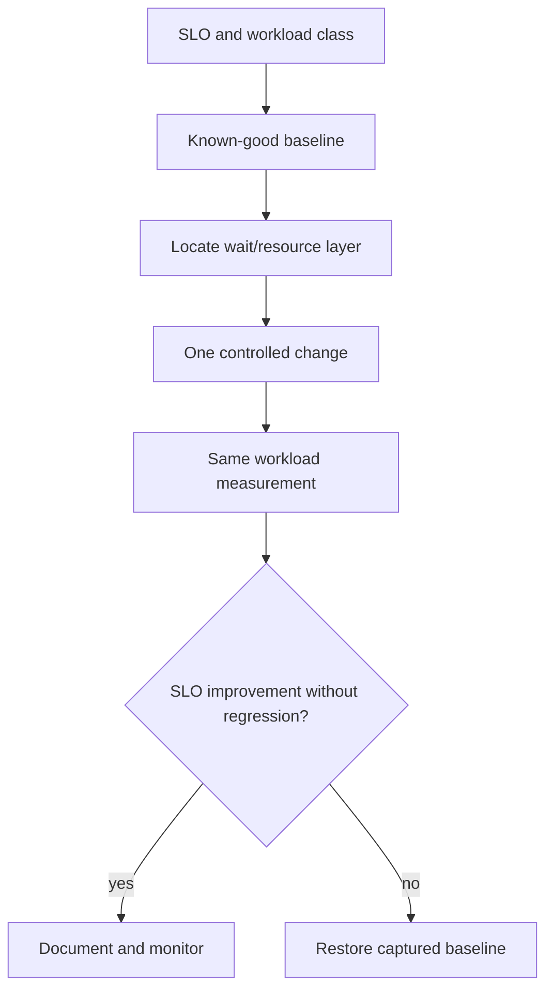

# H-01 — Baselines, workload measurement, service objectives, and bottleneck isolation

**Procedure status: NOT YET EXECUTED.** This is a teaching procedure for Db2 LUW 12.1.0 on Linux x86-64, single-member topology. The exact fix pack is not pinned. Engine commands run on the Db2 server as the named instance/database authority; client checks run on the client; OS commands run on the named host and normally require read-only access. Windows, AIX, DPF, and pureScale differences are called out where material. The supplied environment has no Db2 CLI or disposable Db2 server, so no lab command is claimed as executed. Before production use, confirm each command against the installed fix pack and local change controls.

## 1. Quick answer

Use this lesson to make a bounded DBA decision about workload mix and service objective, response time throughput concurrency, known-good baselines and interval. The key is to identify the failing layer and scope before changing state.

**Safest first step:** Capture the current target, timestamp, release, and read-only state before acting.

## 2. Learn the concept

The useful mental model is to follow workload mix and service objective; response time throughput concurrency; known-good baselines and interval; host vs Db2 vs client attribution; CPU I/O lock log network categories; one change at a time and rollback threshold; replay/representative workload from the service boundary inward. Record who owns each boundary and which evidence is authoritative there.

### Working model

Scope: workload mix and service objective → response time throughput concurrency → known-good baselines and interval → host vs Db2 vs client attribution → CPU I/O lock log network categories → one change at a time and rollback threshold → replay/representative workload. The arrows represent dependency, not proof of a fault. Confirm each hop independently.



## 3. Choose an approach

| Variant | Choose it when | Do not choose it when / boundary |
|---|---|---|
| Latency SLO | Track request percentile and tail by transaction class. | Average hides p95/p99 impact. |
| Throughput SLO | Track completed commits/queries at stated concurrency. | A faster single query can reduce total capacity. |
| Diagnostic window | Use consistent duration and workload mix before/after. | Comparisons with different concurrency are not causal. |

## 4. Understand the lifecycle

- Define transaction class and acceptance target.
- Collect known-good workload and resource samples.
- Isolate client, network, Db2 and storage waits.
- Change one variable or SQL shape under controlled load.
- Compare percentiles/throughput/error rate and restore baseline on regression.

**Pause/retry/stop/rollback rule:** Stop if the target identity, current state, authority, or rollback dependency is uncertain; preserve evidence and escalate.

## 5. Do the work

### Precheck

- Capture SQL/parameter distribution, concurrency and application version.
- Record host, member and storage baseline; use same time window.
- Set stop criteria before performance experiment.

### Scoped procedures

### Procedure 1: Capture interval database metrics

**Status:** NOT YET EXECUTED. **Run as:** Monitor-authorized DBA. **Target:** SAMPLE members at a point in time. **Authority/prerequisite:** Confirm exact metric names/units on installed level; sample twice for deltas.

```bash
SELECT member, total_cpu_time, total_app_rqsts, rows_read, rows_returned FROM TABLE(mon_get_database(-2)) AS d
```

**Expected result:** Database counters by member are returned.

**Independent check:** Compute deltas by elapsed time, align with app p95 and host device samples.

**Stop/rollback boundary:** Read-only; no tuning is performed from a single sample.

### Procedure 2: Measure representative statement

**Status:** NOT YET EXECUTED. **Run as:** Instance owner/benchmark operator. **Target:** Disposable database and fixed query file. **Authority/prerequisite:** Use synthetic data, fixed bind values, warm/cold cache protocol and bounded concurrency.

```bash
db2batch -d SAMPLE -f /secure/lab/queries.sql -r /secure/lab/run.out
```

**Expected result:** Elapsed times and query output are written to result file.

**Independent check:** Compare result correctness, p50/p95, throughput and resource deltas across repetitions.

**Stop/rollback boundary:** Stop test if shared resource threshold is reached; restore baseline after any tuning.

## 6. Worked example and verification

One report’s average latency drops after increasing sort memory, but concurrent OLTP p99 doubles due to memory pressure. Accept only if workload objectives and total resource cost meet the change criterion.

**Expected state/result:** Performance conclusion includes workload, objective, interval, units, sample size and measurable before/after change.

**Independent verification:**

- Compare the post-state with the captured pre-state.
- Confirm the intended service or data outcome independently of the command return code.

## 7. Diagnose problems

| Symptom or verified error | Evidence to collect | Likely cause | Safe correction and recheck | Avoid |
|---|---|---|---|---|
| Query timing improves only in first run. | cache/warmup state, repeated trials, concurrency and statement cache. | Cache warm-up or compilation excluded from later/first run inconsistently. | Use consistent repetitions and report warm/cold results separately. | Claiming a change based on one run. |
| Host CPU looks low but app latency high. | wait categories, lock/log/network/client timing, queue delay and storage latency. | Work blocked outside CPU service time. | Use end-to-end tracing and isolate waits by layer. | Increasing CPU just because query is slow. |

## 8. Practice

Create a fixed synthetic query mix at two concurrency levels. Record throughput, p95 and Db2/OS counters before and after a controlled index or memory experiment. Roll back if any service class breaches its objective.

## 9. Check understanding

**Question:** What makes a before/after benchmark fair?

**Answer and reasoning:** Same data, query/parameter distribution, concurrency, cache protocol, time window, endpoint, and measurement units; repeated trials and correctness checks are required.

## 10. Look it up later

### Short checklist

- Name the target and scope.
- Collect a baseline and confirm prerequisites.
- Choose the least disruptive supported branch.
- Verify state and service behavior.
- Record evidence and recovery limits.

### Related lessons

[E-03](../E/E-03.md) · [E-06](../E/E-06.md) · [H-02](../H/H-02.md) · [H-06](../H/H-06.md) · [I-01](../I/I-01.md)

### Authoritative references

- [IBM MON routines](https://www.ibm.com/docs/en/db2/12.1.x?topic=functions-monitor-mon-routines)
- [IBM query tuning guidance](https://www.ibm.com/docs/en/db2/12.1.0?topic=design-writing-tuning-queries-optimal-performance)

---

[Domain index](README.md) · [Course index](../README.md) · [Glossary](../GLOSSARY.md)
