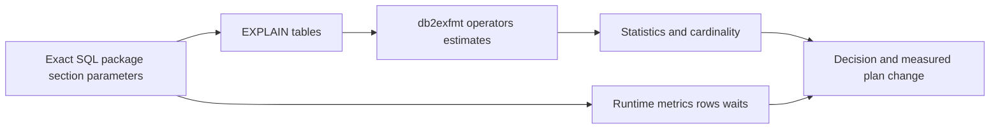

# H-02 — Compilation, access plans, EXPLAIN tables, db2exfmt, and plan interpretation

**Procedure status: NOT YET EXECUTED.** This is a teaching procedure for Db2 LUW 12.1.0 on Linux x86-64, single-member topology. The exact fix pack is not pinned. Engine commands run on the Db2 server as the named instance/database authority; client checks run on the client; OS commands run on the named host and normally require read-only access. Windows, AIX, DPF, and pureScale differences are called out where material. The supplied environment has no Db2 CLI or disposable Db2 server, so no lab command is claimed as executed. Before production use, confirm each command against the installed fix pack and local change controls.

## 1. Quick answer

Use this lesson to make a bounded DBA decision about explain table setup and identity, EXPLAIN PLAN FOR and explain special registers, db2exfmt output. The key is to identify the failing layer and scope before changing state.

**Safest first step:** Capture the current target, timestamp, release, and read-only state before acting.

## 2. Learn the concept

The useful mental model is to follow explain table setup and identity; EXPLAIN PLAN FOR and explain special registers; db2exfmt output; access operators joins/sorts/temp/prefetch/parallelism; estimated rows vs observed workload; dynamic/static SQL and package; wrong query/package/plan matching; missing explain tables from the service boundary inward. Record who owns each boundary and which evidence is authoritative there.

### Working model

Scope: explain table setup and identity → EXPLAIN PLAN FOR and explain special registers → db2exfmt output → access operators joins/sorts/temp/prefetch/parallelism → estimated rows vs observed workload → dynamic/static SQL and package → wrong query/package/plan matching → missing explain tables. The arrows represent dependency, not proof of a fault. Confirm each hop independently.



## 3. Choose an approach

| Variant | Choose it when | Do not choose it when / boundary |
|---|---|---|
| EXPLAIN current SQL | Capture potential optimizer plan without executing query. | It does not prove actual runtime rows/timing. |
| Package explain | Inspect bound static package/section and binder identity. | Dynamic explain of a similar statement may not match package plan. |
| Runtime observation | Correlate plan with actual activity/metrics. | Explain cost is an estimate, not elapsed time. |

## 4. Understand the lifecycle

- Identify exact statement text, package/section, parameter class and current schema.
- Create explain tables under correct authorization identity.
- Capture plan and format with db2exfmt.
- Read cardinality, access, join, sort, spill and parallelism.
- Compare estimates with actual metrics and keep plan identifier with benchmark.

**Pause/retry/stop/rollback rule:** Stop if the target identity, current state, authority, or rollback dependency is uncertain; preserve evidence and escalate.

## 5. Do the work

### Precheck

- Confirm explain tables exist in the current user/schema or SYSTOOLS.
- Record query tag/queryno and statement/package identifier.
- Protect SQL text if it includes sensitive literals.

### Scoped procedures

### Procedure 1: Capture a dynamic plan

**Status:** NOT YET EXECUTED. **Run as:** Explain authority/user with required privileges. **Target:** Current SAMPLE connection. **Authority/prerequisite:** EXPLAIN stores optimizer information but does not execute statement; explain tables must exist.

```bash
EXPLAIN PLAN FOR SELECT order_id, total FROM APP.ORDERS WHERE customer_id = 7012;
```

**Expected result:** Plan rows are written to explain tables.

**Independent check:** Run `db2exfmt -d SAMPLE -1 -o /tmp/orders.plan`; confirm exact statement/queryno and estimates.

**Stop/rollback boundary:** Drop only lab explain tables after storing intended plan evidence.

### Procedure 2: Format latest explain instance

**Status:** NOT YET EXECUTED. **Run as:** Instance owner/DBA. **Target:** Explain tables in SAMPLE and current explain requester. **Authority/prerequisite:** Exact options should be checked against installed db2exfmt help; output file private.

```bash
db2exfmt -d SAMPLE -1 -o /tmp/orders.plan -w -1
```

**Expected result:** Plan is formatted with operators, estimates and object names.

**Independent check:** Inspect table/index stats and compare rows/elapsed with a workload run.

**Stop/rollback boundary:** No database change beyond explain rows; retain/clean output according to privacy rules.

## 6. Worked example and verification

Plan shows a table scan estimated at 10 rows but measured table contains millions. Check statistics and predicate type/parameter marker before creating an index. An explain plan alone does not prove the table scan is the slow stage.

**Expected state/result:** The exact statement/package plan is interpreted alongside stats, runtime rows, waits and actual duration.

**Independent verification:**

- Compare the post-state with the captured pre-state.
- Confirm the intended service or data outcome independently of the command return code.

## 7. Diagnose problems

| Symptom or verified error | Evidence to collect | Likely cause | Safe correction and recheck | Avoid |
|---|---|---|---|---|
| EXPLAIN fails because explain tables are absent. | current schema, SYSCAT.EXPLAIN tables and SQLSTATE. | Explain objects were not created for this identity/database. | Run supported EXPLAIN table creation procedure for the intended schema and retry. | Granting DBADM to plan reviewers. |
| Formatted plan is for a different statement or parameter value. | QUERYNO/QUERYTAG, statement text, package section and explain timestamp. | Matching by “latest plan” alone is ambiguous or plan was captured under different context. | Tag/capture correct statement and parameter environment; explain package section if static. | Tuning from a plan with mismatched SQL. |

## 8. Practice

Explain a selective lookup and a broad scan on synthetic APP.ORDERS. Compare estimated rows, joins and index use; alter statistics in a disposable schema and observe plan changes. Cleanup explain rows after saving relevant plan text.

## 9. Check understanding

**Question:** What is the difference between an EXPLAIN plan and execution evidence?

**Answer and reasoning:** EXPLAIN records the chosen estimated access strategy without running the query. Runtime evidence shows actual time, rows, waits and resource usage.

## 10. Look it up later

### Short checklist

- Name the target and scope.
- Collect a baseline and confirm prerequisites.
- Choose the least disruptive supported branch.
- Verify state and service behavior.
- Record evidence and recovery limits.

### Related lessons

[H-01](../H/H-01.md) · [H-03](../H/H-03.md) · [H-04](../H/H-04.md) · [C-03](../C/C-03.md)

### Authoritative references

- [IBM EXPLAIN statement](https://www.ibm.com/docs/en/db2/12.1.x?topic=statements-explain)
- [IBM Explain facility](https://www.ibm.com/docs/en/db2/12.1.x?topic=optimization-explain-facility)
- [IBM db2exfmt command](https://www.ibm.com/docs/en/db2/12.1.x?topic=commands-db2exfmt)
- [IBM MON routines](https://www.ibm.com/docs/en/db2/12.1.x?topic=functions-monitor-mon-routines)

---

[Domain index](README.md) · [Course index](../README.md) · [Glossary](../GLOSSARY.md)
