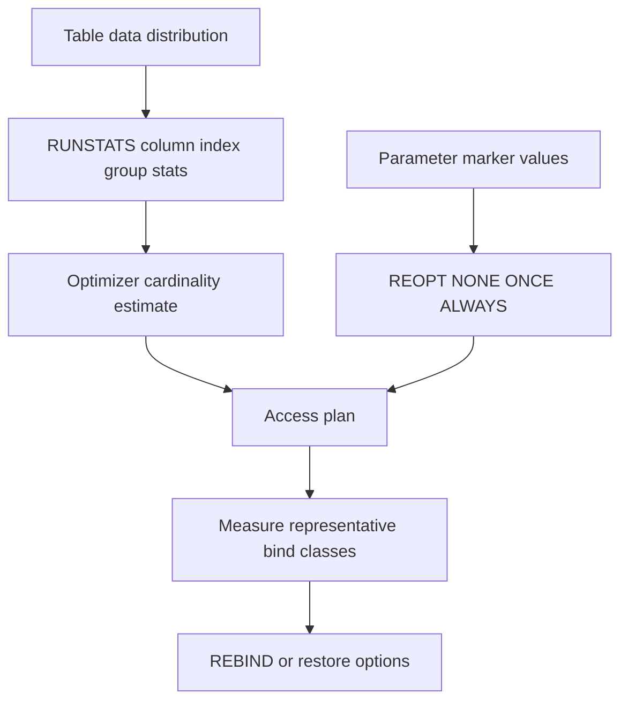

# H-03 — Statistics, cardinality, skew, parameter markers, optimizer choices, and rebind

**Procedure status: NOT YET EXECUTED.** This is a teaching procedure for Db2 LUW 12.1.0 on Linux x86-64, single-member topology. The exact fix pack is not pinned. Engine commands run on the Db2 server as the named instance/database authority; client checks run on the client; OS commands run on the named host and normally require read-only access. Windows, AIX, DPF, and pureScale differences are called out where material. The supplied environment has no Db2 CLI or disposable Db2 server, so no lab command is claimed as executed. Before production use, confirm each command against the installed fix pack and local change controls.

## 1. Quick answer

Use this lesson to make a bounded DBA decision about RUNSTATS scope and profiles, distribution/column-group/statistical-view stats, skew and correlation. The key is to identify the failing layer and scope before changing state.

**Safest first step:** Capture the current target, timestamp, release, and read-only state before acting.

## 2. Learn the concept

The useful mental model is to follow RUNSTATS scope and profiles; distribution/column-group/statistical-view stats; skew and correlation; parameter marker estimates and REOPT NONE/ONCE/ALWAYS; BIND/REBIND package choice; dynamic statement/package cache; plan stability and regression; statistics/rebind rollback limits from the service boundary inward. Record who owns each boundary and which evidence is authoritative there.

### Working model

Scope: RUNSTATS scope and profiles → distribution/column-group/statistical-view stats → skew and correlation → parameter marker estimates and REOPT NONE/ONCE/ALWAYS → BIND/REBIND package choice → dynamic statement/package cache → plan stability and regression → statistics/rebind rollback limits. The arrows represent dependency, not proof of a fault. Confirm each hop independently.



## 3. Choose an approach

| Variant | Choose it when | Do not choose it when / boundary |
|---|---|---|
| Statistics refresh | Use after data distribution/volume changes. | Statistics can be stale at table, index, column or group level. |
| REOPT NONE/ONCE/ALWAYS | Choose based on parameter sensitivity and compile cost. | REOPT can change plans and per-execution CPU. |
| REBIND | Use for identified package after stats/schema/change. | It may block on in-use package and change static plan. |

## 4. Understand the lifecycle

- Inspect current stats timestamps/cardinality and query estimates.
- Collect needed table/index/distribution/column-group statistics.
- Explain representative skewed and common parameter values.
- Choose REOPT/package rebind only for identified statements.
- Measure each parameter class and preserve prior plan/perf evidence.

**Pause/retry/stop/rollback rule:** Stop if the target identity, current state, authority, or rollback dependency is uncertain; preserve evidence and escalate.

## 5. Do the work

### Precheck

- Record RUNSTATS profile, package options, SQL text and common/rare bind values.
- Identify dependent apps and package use; plan rebind lock window.
- Do not run full catalog statistics solely to fix one query without evidence.

### Scoped procedures

### Procedure 1: Collect skew-aware statistics

**Status:** NOT YET EXECUTED. **Run as:** DBA/table control authority. **Target:** APP.ORDERS and relevant indexes. **Authority/prerequisite:** Choose columns from workload predicates; schedule utility resource window.

```bash
RUNSTATS ON TABLE APP.ORDERS WITH DISTRIBUTION ON COLUMNS (REGION, STATUS) AND DETAILED INDEXES ALL
```

**Expected result:** Catalog histograms/index stats refreshed.

**Independent check:** Check stats timestamps and compare estimated cardinality for common/rare values.

**Stop/rollback boundary:** Statistics update is not automatically reverted; restore data/profile and rerun if a tested what-if rollback is needed.

### Procedure 2: Rebind a specific static package

**Status:** NOT YET EXECUTED. **Run as:** Package BIND privilege/DBA. **Target:** APP.ORDERQ package and version. **Authority/prerequisite:** Capture current plan/performance; verify package identity and parameter sensitivity.

```bash
REBIND PACKAGE APP.ORDERQ REOPT ONCE
```

**Expected result:** Package is recreated using selected reoptimization semantics.

**Independent check:** Check SYSCAT.PACKAGES validity/options, explain package section and run application test for common/rare binds.

**Stop/rollback boundary:** REBIND with prior options and preserve plan test; package change is not data rollback.

## 6. Worked example and verification

A parameterized query is fast for region WEST and slow for region EAST because distributions differ sharply. Gather distribution stats and compare REOPT NONE with ONCE/ALWAYS using both binds; a single value cannot represent workload mix.

**Expected state/result:** Statistics support estimated cardinality, and package reoptimization choice is tied to measured parameter classes and compile/resource tradeoff.

**Independent verification:**

- Compare the post-state with the captured pre-state.
- Confirm the intended service or data outcome independently of the command return code.

## 7. Diagnose problems

| Symptom or verified error | Evidence to collect | Likely cause | Safe correction and recheck | Avoid |
|---|---|---|---|---|
| RUNSTATS completes but plan still estimates uniformly. | column group/distribution stats, statistics profile, EXPLAIN and predicate correlation. | Relevant skew/correlation not captured or query form prevents estimate use. | Collect targeted distribution/column-group stats and verify query expression/cardinality. | Running broad RUNSTATS repeatedly without checking collected columns. |
| REBIND improves one bind but regresses others. | REOPT choice, bind distribution, execution latency and package cache observations. | Parameter-sensitive predicates and one plan no longer suit all values. | Evaluate REOPT options or application strategy under realistic mix; roll back prior options if needed. | Global REBIND ALL on a production fleet. |

## 8. Practice

Create skewed synthetic statuses, run baseline explain with representative values, collect distribution stats, and compare estimates. Rebind one lab package with REOPT NONE/ONCE, measure compilation and execution. Cleanup package/test data.

## 9. Check understanding

**Question:** What does REOPT ALWAYS trade?

**Answer and reasoning:** It can use current parameter values to choose more appropriate plans but adds compile/reoptimization cost on executions; measure both CPU and response tail.

## 10. Look it up later

### Short checklist

- Name the target and scope.
- Collect a baseline and confirm prerequisites.
- Choose the least disruptive supported branch.
- Verify state and service behavior.
- Record evidence and recovery limits.

### Related lessons

[C-06](../C/C-06.md) · [H-01](../H/H-01.md) · [H-02](../H/H-02.md) · [H-04](../H/H-04.md)

### Authoritative references

- [IBM RUNSTATS command](https://www.ibm.com/docs/en/db2/12.1.x?topic=commands-runstats)
- [IBM REBIND command](https://www.ibm.com/docs/en/db2/12.1.x?topic=commands-rebind)
- [IBM access plan optimization](https://www.ibm.com/docs/en/db2/12.1.x?topic=optimization-optimizing-access-plans)
- [IBM query tuning guidance](https://www.ibm.com/docs/en/db2/12.1.0?topic=design-writing-tuning-queries-optimal-performance)

---

[Domain index](README.md) · [Course index](../README.md) · [Glossary](../GLOSSARY.md)
