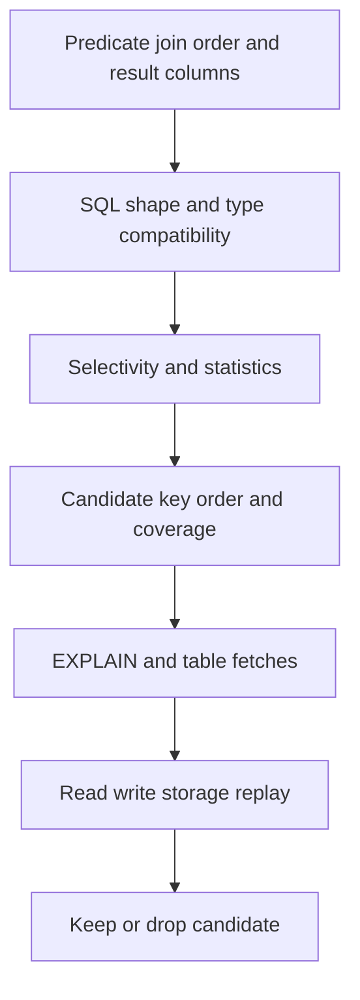

# H-04 — Index and query design, read/write costs, and measured plan changes

**Procedure status: NOT YET EXECUTED.** This is a teaching procedure for Db2 LUW 12.1.0 on Linux x86-64, single-member topology. The exact fix pack is not pinned. Engine commands run on the Db2 server as the named instance/database authority; client checks run on the client; OS commands run on the named host and normally require read-only access. Windows, AIX, DPF, and pureScale differences are called out where material. The supplied environment has no Db2 CLI or disposable Db2 server, so no lab command is claimed as executed. Before production use, confirm each command against the installed fix pack and local change controls.

## 1. Quick answer

Use this lesson to make a bounded DBA decision about predicate/join/order shape, composite key order, unique/covering/include/clustered index supported options. The key is to identify the failing layer and scope before changing state.

**Safest first step:** Capture the current target, timestamp, release, and read-only state before acting.

## 2. Learn the concept

The useful mental model is to follow predicate/join/order shape; composite key order; unique/covering/include/clustered index supported options; index-only access and table fetch; partitioned/XML indexes; redundant indexes and write cost; SQL rewrite/type compatibility; index creation/rebuild and workload measurement from the service boundary inward. Record who owns each boundary and which evidence is authoritative there.

### Working model

Scope: predicate/join/order shape → composite key order → unique/covering/include/clustered index supported options → index-only access and table fetch → partitioned/XML indexes → redundant indexes and write cost → SQL rewrite/type compatibility → index creation/rebuild and workload measurement. The arrows represent dependency, not proof of a fault. Confirm each hop independently.



## 3. Choose an approach

| Variant | Choose it when | Do not choose it when / boundary |
|---|---|---|
| Composite B-tree | Choose key order from selective predicates and joins. | One wide index can increase storage and DML cost. |
| Covering index | Use when it removes costly table fetches for valuable query. | Include columns increase page size and write maintenance. |
| Rewrite SQL | Fix non-sargable predicates/type mismatch/unneeded joins first. | A rewrite must preserve NULL, duplicate and transactional semantics. |

## 4. Understand the lifecycle

- Collect exact query and workload frequency.
- Review EXPLAIN estimates, predicate types, stats and existing indexes.
- Design one candidate key/order/include.
- Build in a lab or approved online utility/window.
- Replay representative read/write mix and retain or remove with measured criteria.

**Pause/retry/stop/rollback rule:** Stop if the target identity, current state, authority, or rollback dependency is uncertain; preserve evidence and escalate.

## 5. Do the work

### Precheck

- List index definitions, clustering and usage stats.
- Calculate storage and DML/log/reorg/backup impact.
- Confirm exact 12.1 syntax/support for index type and table organization.

### Scoped procedures

### Procedure 1: Candidate composite index

**Status:** NOT YET EXECUTED. **Run as:** Schema owner/authorized DBA. **Target:** APP.ORDERS synthetic workload. **Authority/prerequisite:** Candidate syntax and INCLUDE support checked for target table/release; plan space and utility impact.

```bash
CREATE INDEX APP.IX_ORDERS_REGION_DATE ON APP.ORDERS (region, created_at DESC) INCLUDE (order_id, total);
```

**Expected result:** Index is created and cataloged.

**Independent check:** Explain the target query and compare read count/latency plus insert/update throughput.

**Stop/rollback boundary:** Drop the candidate index if measured workload regresses; do not drop existing production index without dependency review.

### Procedure 2: Sargable date predicate

**Status:** NOT YET EXECUTED. **Run as:** Application developer/DBA. **Target:** APP.ORDERS. **Authority/prerequisite:** Use typed boundary values and inclusive-start/exclusive-end semantics; compare with function-on-column form.

```bash
SELECT order_id, total FROM APP.ORDERS WHERE created_at >= TIMESTAMP('2026-10-01-00.00.00') AND created_at < TIMESTAMP('2026-11-01-00.00.00')
```

**Expected result:** Rows for October are returned without applying a function to every key.

**Independent check:** EXPLAIN and benchmark both SQL forms; verify result equality including timestamp precision.

**Stop/rollback boundary:** Read-only; no DDL change unless plan evidence shows index is needed.

## 6. Worked example and verification

An index on `(region, created_at)` can support a query filtering by region and time, but may not serve a date-only query as effectively. Measure query mix and write amplification rather than “indexing every predicate.”

**Expected state/result:** SQL result remains equivalent and the complete workload improves within storage/maintenance budget.

**Independent verification:**

- Compare the post-state with the captured pre-state.
- Confirm the intended service or data outcome independently of the command return code.

## 7. Diagnose problems

| Symptom or verified error | Evidence to collect | Likely cause | Safe correction and recheck | Avoid |
|---|---|---|---|---|
| Index added but query still scans table. | EXPLAIN predicate matching, data types, statistics, leading key and selectivity. | Non-sargable expression/type mismatch or optimizer cost says scan cheaper. | Rewrite predicate or collect stats; compare one alternative key in replay. | Forcing access path before checking semantics and estimates. |
| Read query improves while batch writes slow down. | insert/update latency, log bytes, index pages, reorg and CPU. | Additional index maintenance cost outweighs read gain. | Keep only indexes justified by total service objectives; remove candidate with dependency check. | Measuring only the targeted SELECT. |

## 8. Practice

Build APP.ORDERS with existing primary key, compare date-only and region/date query plans, create one candidate index and replay mixed reads/inserts. Remove only lab index/table after results recorded.

## 9. Check understanding

**Question:** Why does the leading column matter in a composite index?

**Answer and reasoning:** The index is ordered first by its leading key; predicates that constrain that prefix can navigate it efficiently. A later-column-only predicate may not get the same access.

## 10. Look it up later

### Short checklist

- Name the target and scope.
- Collect a baseline and confirm prerequisites.
- Choose the least disruptive supported branch.
- Verify state and service behavior.
- Record evidence and recovery limits.

### Related lessons

[C-02](../C/C-02.md) · [H-01](../H/H-01.md) · [H-02](../H/H-02.md) · [H-03](../H/H-03.md)

### Authoritative references

- [IBM index design](https://www.ibm.com/docs/en/db2/12.1.x?topic=design-designing-indexes)
- [IBM query tuning guidance](https://www.ibm.com/docs/en/db2/12.1.0?topic=design-writing-tuning-queries-optimal-performance)
- [IBM REORG TABLE command](https://www.ibm.com/docs/en/db2/12.1.x?topic=commands-reorg-table)

---

[Domain index](README.md) · [Course index](../README.md) · [Glossary](../GLOSSARY.md)
