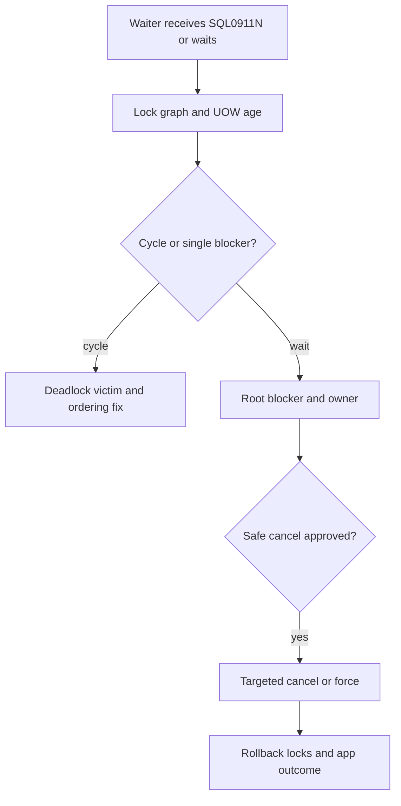

# H-05 — Locks, deadlocks, isolation, transaction design, and safe intervention

**Procedure status: NOT YET EXECUTED.** This is a teaching procedure for Db2 LUW 12.1.0 on Linux x86-64, single-member topology. The exact fix pack is not pinned. Engine commands run on the Db2 server as the named instance/database authority; client checks run on the client; OS commands run on the named host and normally require read-only access. Windows, AIX, DPF, and pureScale differences are called out where material. The supplied environment has no Db2 CLI or disposable Db2 server, so no lab command is claimed as executed. Before production use, confirm each command against the installed fix pack and local change controls.

## 1. Quick answer

Use this lesson to make a bounded DBA decision about lock modes/conversions and escalation, deadlock versus timeout, wait-for graph/root blocker. The key is to identify the failing layer and scope before changing state.

**Safest first step:** Capture the current target, timestamp, release, and read-only state before acting.

## 2. Learn the concept

The useful mental model is to follow lock modes/conversions and escalation; deadlock versus timeout; wait-for graph/root blocker; deadlock/lock-wait event data; transaction length and commit frequency; lock timeout/escalation configuration; cancel/force rollback cost; SQL0911N reason interpretation; correctness tests from the service boundary inward. Record who owns each boundary and which evidence is authoritative there.

### Working model

Scope: lock modes/conversions and escalation → deadlock versus timeout → wait-for graph/root blocker → deadlock/lock-wait event data → transaction length and commit frequency → lock timeout/escalation configuration → cancel/force rollback cost → SQL0911N reason interpretation → correctness tests. The arrows represent dependency, not proof of a fault. Confirm each hop independently.



## 3. Choose an approach

| Variant | Choose it when | Do not choose it when / boundary |
|---|---|---|
| Wait | A transaction awaits incompatible lock. | Find owner/root blocker before canceling waiter. |
| Deadlock | Wait-for cycle; Db2 chooses a victim and rolls it back. | Not the same as a long wait timeout. |
| Timeout/escalation | Wait limit or lock-list pressure changes behavior/scope. | Increasing timeout can worsen queues; raising lock list can consume memory. |

## 4. Understand the lifecycle

- Identify SQL0911N reason and application handle.
- Inspect lock wait, owner, UOW age and transaction boundaries.
- Capture lock event details if current evidence is insufficient.
- Coordinate cancel/commit/rollback/force with owner.
- Validate rollback, released locks, application consistency and retry outcome.

**Pause/retry/stop/rollback rule:** Stop if the target identity, current state, authority, or rollback dependency is uncertain; preserve evidence and escalate.

## 5. Do the work

### Precheck

- Use db2pd -wlocks/-transactions and MON_GET_APPL_LOCKWAIT.
- Check whether blocker is a batch or user transaction and its log usage.
- Before LOCKTIMEOUT/lock-list change, estimate queue impact and test.

### Scoped procedures

### Procedure 1: Inspect current wait graph

**Status:** NOT YET EXECUTED. **Run as:** Instance owner/monitor user. **Target:** SAMPLE active member. **Authority/prerequisite:** Read-only; correlate waiter to owner and application handle.

```bash
db2pd -db SAMPLE -wlocks -transactions; SELECT agent_id, lock_name, lock_wait_start_time FROM TABLE(mon_get_appl_lockwait(NULL,-2)) AS w
```

**Expected result:** Lock wait rows or no-wait result are returned with current timestamps.

**Independent check:** Capture deadlock/lock event monitor and current transaction before intervention.

**Stop/rollback boundary:** Read-only; no FORCE APPLICATION yet.

### Procedure 2: Set bounded lock wait timeout in lab

**Status:** NOT YET EXECUTED. **Run as:** DBA configuration authority. **Target:** Disposable database SAMPLE. **Authority/prerequisite:** Parameter online behavior and application retry contract reviewed; capture previous value.

```bash
UPDATE DATABASE CONFIGURATION FOR SAMPLE USING LOCKTIMEOUT 30
```

**Expected result:** Future lock waits time out after configured interval when active.

**Independent check:** GET DB CFG and induce a bounded lab conflict; verify SQL0911N reason and app retry behavior.

**Stop/rollback boundary:** Restore captured value and verify; rollback cannot restore already failed transactions.

## 6. Worked example and verification

Two sessions lock rows in opposite order. Db2 detects a deadlock cycle and returns SQL0911N to one transaction; a separate long wait may time out later. Fix transaction lock ordering and short UOWs rather than simply raising timeout.

**Expected state/result:** Root blocker/cycle is identified, response is specific to deadlock or timeout, and transaction/business outcomes are verified.

**Independent verification:**

- Compare the post-state with the captured pre-state.
- Confirm the intended service or data outcome independently of the command return code.

## 7. Diagnose problems

| Symptom or verified error | Evidence to collect | Likely cause | Safe correction and recheck | Avoid |
|---|---|---|---|---|
| SQL0911N reason code reports deadlock victim. | lock event, participants, statement order and transaction boundary. | Opposite lock acquisition order creates cycle. | Apply consistent lock ordering or reduce UOW scope, then verify no deadlock under concurrency. | Retrying just the final statement without re-evaluating transaction outcome. |
| Timeout count increases after raising LOCKTIMEOUT. | wait queue length, arrival rate, blocker duration and service latency. | Longer wait retains more queued work and memory/agents. | Resolve root blocker and restore service-aware timeout; enforce app transaction limits. | Setting timeout infinite to suppress SQL0911N. |

## 8. Practice

Open two disposable sessions, acquire row locks in opposing order, create a deadlock, capture event output and identify victim. Separate run: create a lock wait and time out. Verify rollback and no lingering locks; cleanup test rows.

## 9. Check understanding

**Question:** Why might forcing a blocker be more harmful than canceling a waiter?

**Answer and reasoning:** A blocker can have a large uncommitted unit of work whose rollback consumes log/I/O time and affects many waiters; identify owner, business state and rollback cost first.

## 10. Look it up later

### Short checklist

- Name the target and scope.
- Collect a baseline and confirm prerequisites.
- Choose the least disruptive supported branch.
- Verify state and service behavior.
- Record evidence and recovery limits.

### Related lessons

[C-01](../C/C-01.md) · [E-04](../E/E-04.md) · [E-05](../E/E-05.md) · [K-01](../K/K-01.md)

### Authoritative references

- [IBM lock and deadlock event monitoring](https://www.ibm.com/docs/en/db2/12.1.x?topic=events-lock-deadlock-event-monitoring)
- [IBM MON routines](https://www.ibm.com/docs/en/db2/12.1.x?topic=functions-monitor-mon-routines)
- [IBM lock timeout parameter](https://www.ibm.com/docs/en/db2/12.1.x?topic=parameters-locktimeout-lock-timeout)
- [IBM FORCE APPLICATION command](https://www.ibm.com/docs/en/db2/12.1.x?topic=commands-force-application)

---

[Domain index](README.md) · [Course index](../README.md) · [Glossary](../GLOSSARY.md)
